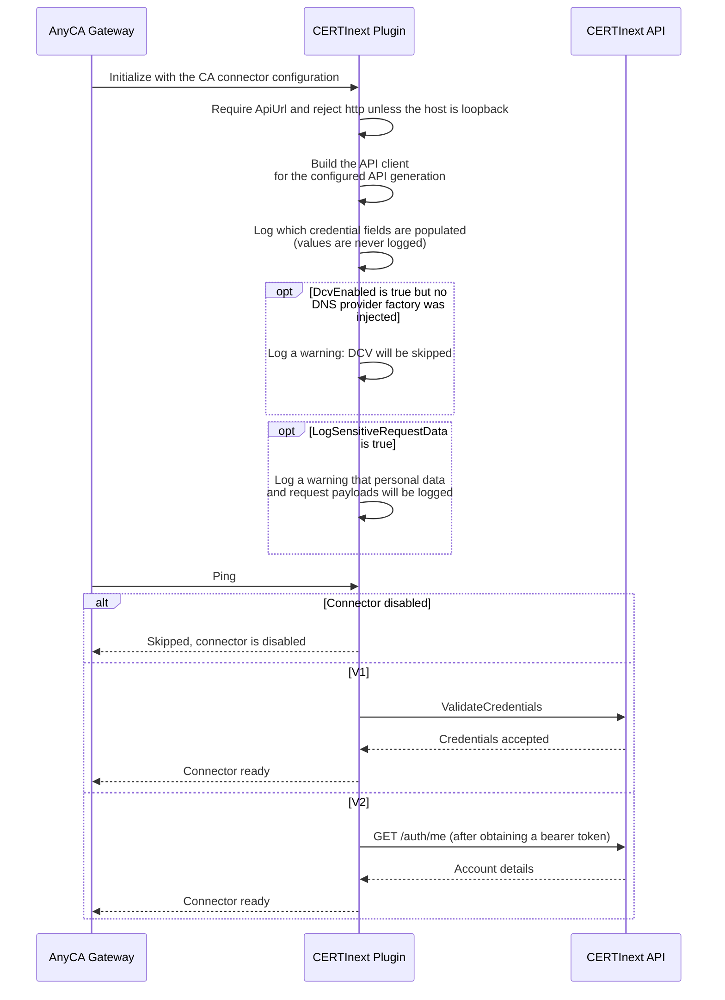
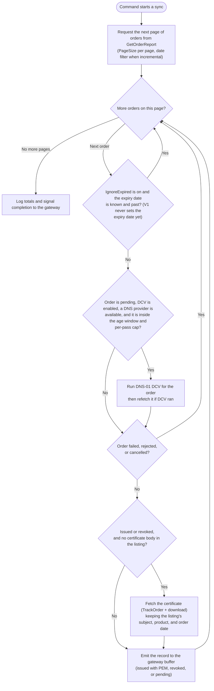
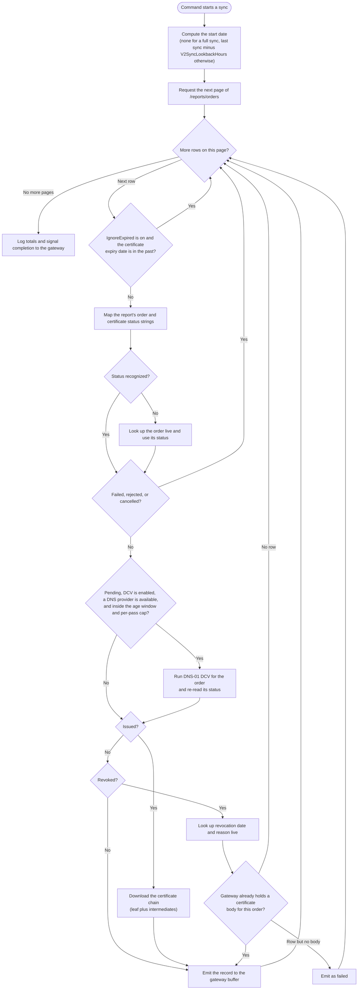
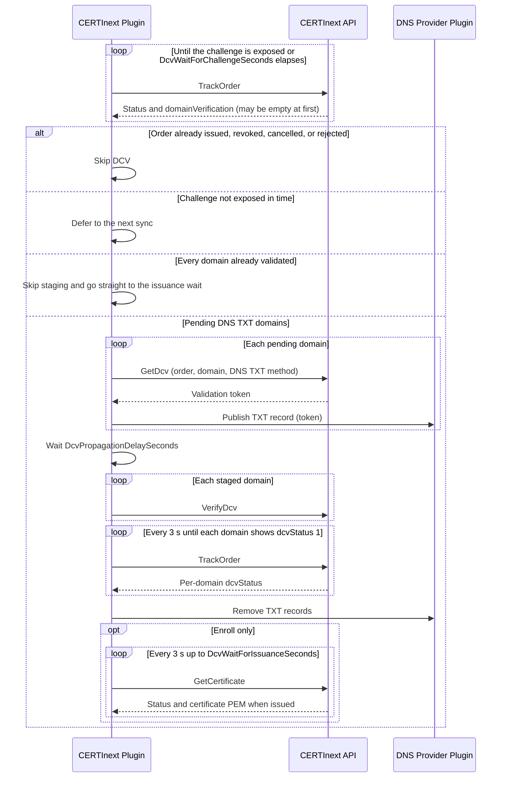
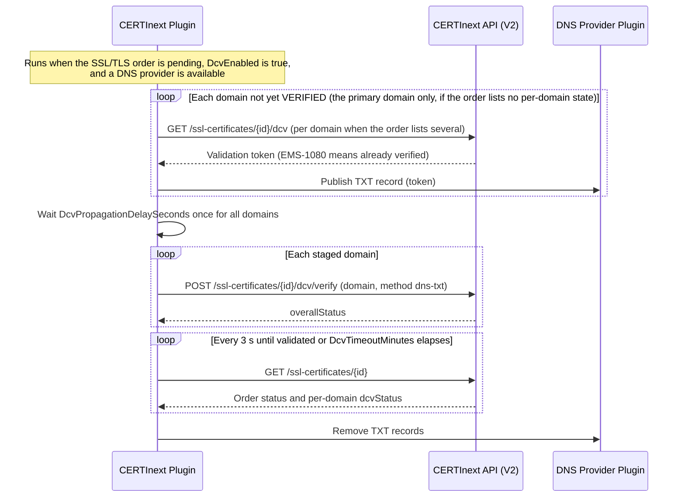
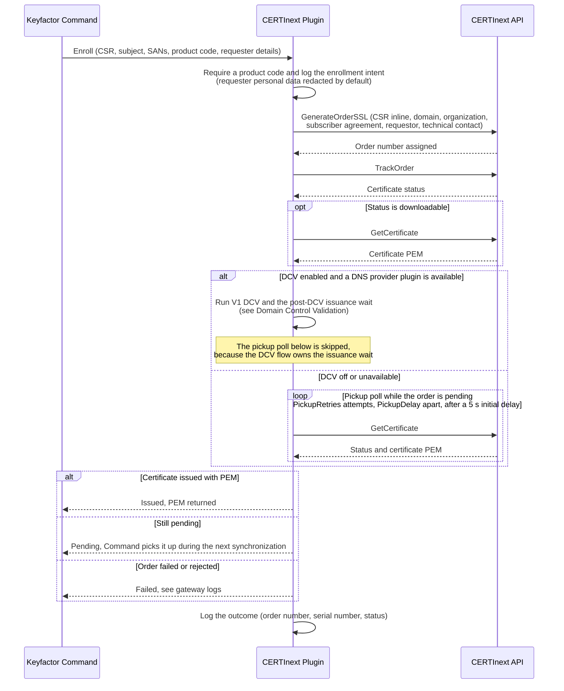
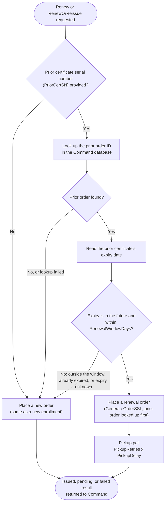
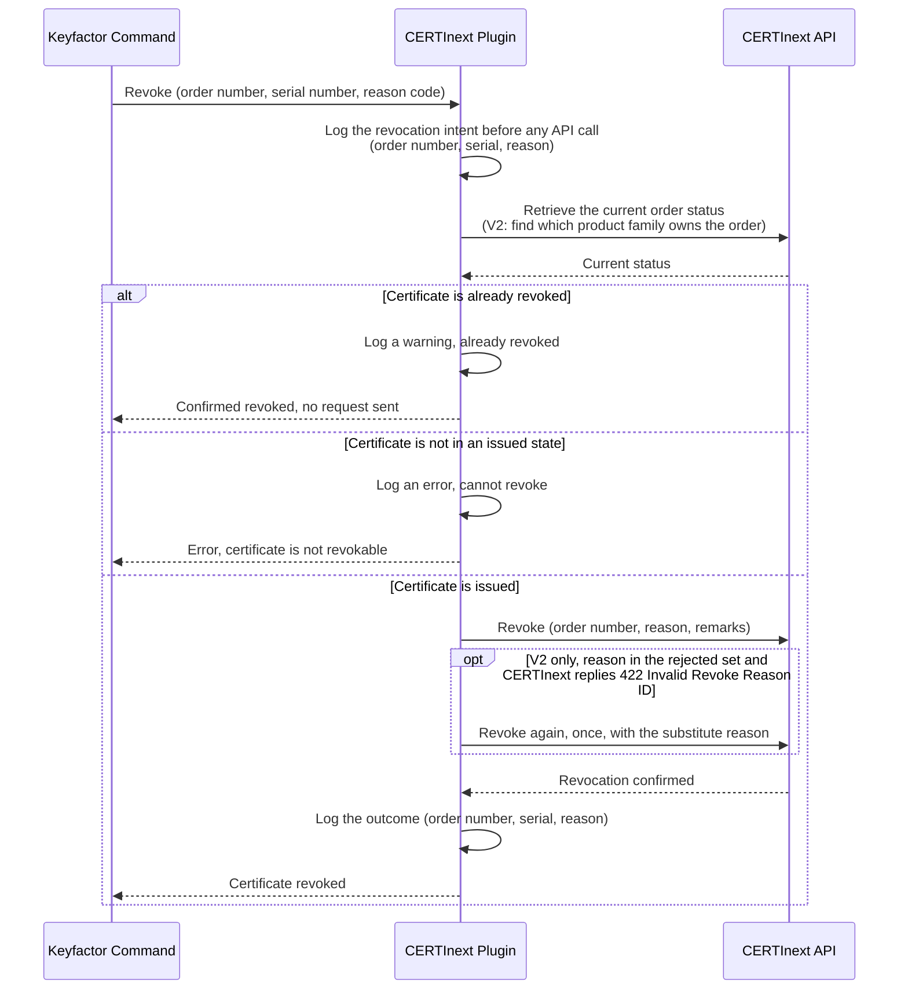
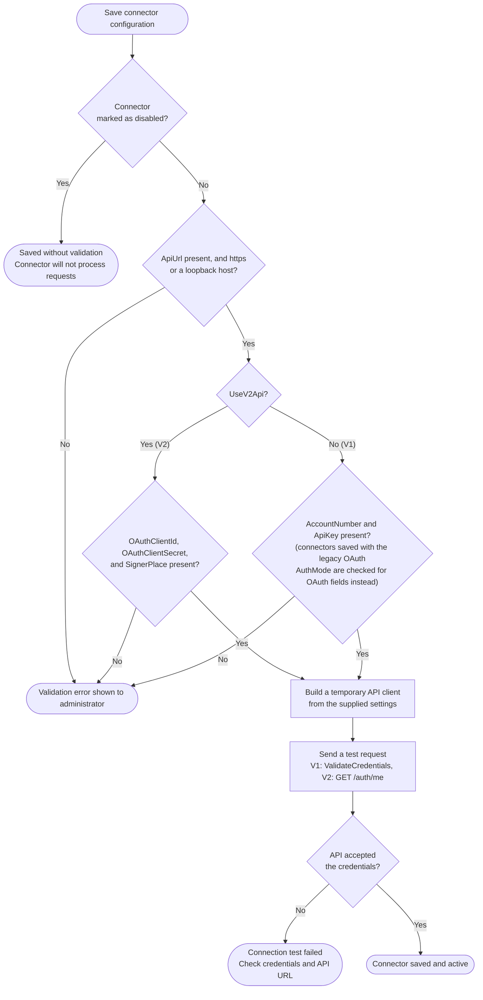

<h1 align="center" style="border-bottom: none">
    CERTInext AnyCA Gateway REST Plugin
</h1>

<p align="center">
  <!-- Badges -->

<a href="https://github.com/Keyfactor/certinext-caplugin/releases"></a>


</p>

<p align="center">
  <!-- TOC -->
  <a href="#support">
    <b>Support</b>
  </a>
  ·
  <a href="#requirements">
    <b>Requirements</b>
  </a>
  ·
  <a href="#installation">
    <b>Installation</b>
  </a>
  ·
  <a href="#license">
    <b>License</b>
  </a>
  ·
  <a href="https://github.com/orgs/Keyfactor/repositories?q=anycagateway">
    <b>Related Integrations</b>
  </a>
</p>

The CERTInext AnyCA Gateway REST plugin extends the certificate lifecycle capabilities of the CERTInext platform (by eMudhra) to Keyfactor Command via the Keyfactor AnyCA Gateway REST. The plugin represents a fully featured AnyCA REST plugin with the following capabilities:

* CA Synchronization:
    * Download all certificates issued through the CERTInext CA, either as a full inventory or incrementally since the last sync.
    * Expired certificates can optionally be excluded from synchronization using the `IgnoreExpired` configuration flag (V2 only; the V1 API does not currently apply it).
* Certificate Enrollment for profiles configured in CERTInext:
    * New certificate enrollment (new keys and certificate).
    * Certificate renewal — on the V1 API, submits a new `GenerateOrderSSL` order when the prior certificate is within the configured renewal window (CERTInext has no dedicated renewal endpoint; the renewal-window check governs how Command tracks old→new, not which API is called). On the V2 API every renewal places a new order.
    * Certificate reissuance (new keys with the same or updated subject/SANs) when outside the renewal window or no prior certificate is found.
    * Synchronous certificate pickup — a fast-issuing order (DV, or already-approved) can return the certificate in the same enrollment call instead of always waiting for the next sync, via `PickupRetries`/`PickupDelay`.
    * DNS-01 domain control validation (DCV) — the plugin publishes the validation TXT record through a DNS provider plugin deployed on the gateway and asks CERTInext to verify it, during enrollment and during synchronization (`DcvEnabled`, on by default).
* Certificate Revocation:
    * Request revocation of a previously issued certificate using RFC 5280 reason codes, mapped to the reasons CERTInext accepts (see [Revocation Reason Codes](#revocation-reason-codes)).
* Supported authentication modes for calls to the CERTInext API:
    * V1 API (default): AccessKey — SHA-256 signed requests.
    * V2 API: OAuth2 `client_credentials` bearer token.
* Two CERTInext API generations, selected per connector with `UseV2Api`: the V1 API (default) and the order-centric V2 REST API, which adds Private PKI products. See [V2 API](#v2-api) and [Migrating from V1 to V2](#migrating-from-v1-to-v2).

## Compatibility

The CERTInext AnyCA Gateway REST plugin is compatible with the Keyfactor AnyCA Gateway REST 26.2.0 and later.

## Support
The CERTInext AnyCA Gateway REST plugin is supported by Keyfactor for Keyfactor customers. If you have a support issue, please open a support ticket via the Keyfactor Support Portal at https://support.keyfactor.com.

> To report a problem or suggest a new feature, use the **[Issues](../../issues)** tab. If you want to contribute actual bug fixes or proposed enhancements, use the **[Pull requests](../../pulls)** tab.

## Requirements

* Keyfactor Command 25.5 or later
* AnyCA Gateway REST framework version 26.2.0 or later
* A DNS provider plugin deployed on the AnyCA Gateway if the connector validates domains with DNS-01 DCV (the default; see `DcvEnabled`)
* A CERTInext account with API access enabled and at least one certificate product configured
* Network connectivity from the AnyCA Gateway host to the CERTInext API endpoint for your region (see table below)
* The AnyCA Gateway host must trust the TLS certificate presented by the CERTInext API endpoint

### Compatibility and Authentication Matrix

The connector runs in one of two modes, chosen with `UseV2Api`. The mode decides the `ApiUrl` shape, how the plugin authenticates, and which credential fields are used.

| | V1 (default) | V2 (`UseV2Api` = `true`) |
|---|---|---|
| AnyCA Gateway REST / `IAnyCAPlugin` | 26.2.0 or later / 3.3.0 | 26.2.0 or later / 3.3.0 |
| Authentication | AccessKey (SHA-256 signed request body) | OAuth2 `client_credentials` bearer token |
| `ApiUrl` shape | `https://<host>/emSignHub-API/` | Bare host, for example `https://us-api.certinext.io` |
| Token URL | None | Derived: `{ApiUrl}/oauth/token` |
| `AccountNumber` | Required | Ignored |
| `ApiKey` | Required | Ignored |
| `AuthMode` | Optional; leave as `AccessKey` (legacy field) | Ignored |
| `OAuthClientId` / `OAuthClientSecret` | Not used (legacy only) | Required |
| `OAuthTokenUrl` | Not used (legacy only) | Ignored |
| `SignerPlace` | Set it; sent on every order | Required at save |
| Products | SSL/TLS (DV, OV, EV) | SSL/TLS (DV, OV, EV) and Private PKI |
| DCV | On by default; needs a DNS provider plugin | On by default; needs a DNS provider plugin |

### CERTInext Environments

CERTInext operates three separate environments. Use the sandbox environment for initial integration testing. Switch to a production environment only after all functionality has been verified.

| Environment | Portal Sign-in URL | V1 API Base URL | V2 API Base URL |
|---|---|---|---|
| Sandbox | https://sandbox-us.certinext.io/ | `https://sandbox-us-api.certinext.io/emSignHub-API/` | `https://sandbox-us-api.certinext.io` |
| Production — India (Global) | https://in.certinext.io/ | `https://api.certinext.io/emSignHub-API/` | `https://api.certinext.io` |
| Production — US | https://us.certinext.io/ | `https://us-api.certinext.io/emSignHub-API/` | `https://us-api.certinext.io` |

> Note: Product codes differ between sandbox and production. Always confirm product codes from the GetProductDetails API call against the environment you are targeting before going live.

## Installation

1. Install the AnyCA Gateway REST per the [official Keyfactor documentation](https://software.keyfactor.com/Guides/AnyCAGatewayREST/Content/AnyCAGatewayREST/InstallIntroduction.htm).

2. On the server hosting the AnyCA Gateway REST, download and unzip the latest [CERTInext AnyCA Gateway REST plugin](https://github.com/Keyfactor/certinext-caplugin/releases/latest) from GitHub.

3. Copy the unzipped directory (usually called `net8.0` or `net10.0`) to the Extensions directory:


    ```shell
    Depending on your AnyCA Gateway REST version, copy the unzipped directory to one of the following locations:
    Program Files\Keyfactor\AnyCA Gateway\AnyGatewayREST\net8.0\Extensions
    Program Files\Keyfactor\AnyCA Gateway\AnyGatewayREST\net10.0\Extensions
    ```

    > The directory containing the CERTInext AnyCA Gateway REST plugin DLLs (`net8.0` or `net10.0`) can be named anything, as long as it is unique within the `Extensions` directory.

4. Restart the AnyCA Gateway REST service.

5. Navigate to the AnyCA Gateway REST portal and verify that the Gateway recognizes the CERTInext plugin by hovering over the ⓘ symbol to the right of the Gateway on the top left of the portal.

## Configuration

1. Follow the [official AnyCA Gateway REST documentation](https://software.keyfactor.com/Guides/AnyCAGatewayREST/Content/AnyCAGatewayREST/AddCA-Gateway.htm) to define a new Certificate Authority, and use the notes below to configure the **Gateway Registration** and **CA Connection** tabs:

    * **Gateway Registration**

        Before enrolling certificates, the Keyfactor Command server must trust the CERTInext issuing CA chain.
        
        1. Log in to the CERTInext portal and download the root CA certificate and any intermediate CA certificates in the chain as PEM or DER files.
        2. On the Keyfactor Command server, import those certificates into the appropriate Windows certificate store — **Trusted Root Certification Authorities** for the root CA and **Intermediate Certification Authorities** for any subordinate CAs.
        3. In the Keyfactor Command Management Portal, navigate to **CA Connectors** and add a new CA using the **CERTInext AnyCA REST Gateway Plugin**.
        4. Complete the CA connector configuration fields described in the next section, then save and test the connection. The gateway performs a live connectivity test during validation: the V1 `ValidateCredentials` endpoint, or `GET /api/certinext/v2/auth/me` when `UseV2Api` is `true`.

    * **CA Connection**

        Populate using the configuration fields collected in the [requirements](#requirements) section.

        * **ApiUrl** - REQUIRED: CERTInext API base URL. V1 (default): host plus /emSignHub-API/, e.g. https://us-api.certinext.io/emSignHub-API/. V2 (UseV2Api=true): bare host, e.g. https://us-api.certinext.io. Must use https.
        * **AccountNumber** - REQUIRED when UseV2Api is false: your CERTInext account number (numeric string). Included in the `meta` block of every V1 request. Not used when UseV2Api is true. Available in the CERTInext portal.
        * **GroupNumber** - OPTIONAL: CERTInext group (delegation) number. When set, it is included in product-catalog requests and in the order (`delegationInformation.groupNumber` on V1, `groupNumber` on V2) so the order is routed to the correct account group, and V2 synchronization is scoped to the group. Some accounts will queue orders for additional review when this field is omitted. Available in the CERTInext portal under Delegation → Groups.
        * **OrganizationNumber** - OPTIONAL: Pre-vetted CERTInext organization number. Required for OV/EV on V2; recommended for V1 OV/EV and faster DV. Skips CERTInext's manual vetting queue.
        * **TechnicalContactName** - OPTIONAL: Name sent as the order's technical point of contact (V1 `technicalPointOfContact.tpcName`, V2 `technicalPointOfContact.name`). Defaults to the configured RequestorName when blank. Some product configurations require a TPoC to be present; omitting it can cause CERTInext to park orders awaiting manual completion of the field.
        * **TechnicalContactEmail** - OPTIONAL: Email sent as the order's technical point of contact (V1 `tpcEmail`, V2 `email`). Defaults to the configured RequestorEmail when blank.
        * **TechnicalContactIsdCode** - OPTIONAL: International dialing code for the technical contact phone number. Defaults to the configured RequestorIsdCode when blank.
        * **TechnicalContactMobileNumber** - OPTIONAL: Mobile number for the technical contact (digits only). Defaults to the configured RequestorMobileNumber when blank.
        * **AuthMode** - OPTIONAL, legacy (V1 only): leave as 'AccessKey' (default). V1 does not honor OAuth tokens, so 'OAuth' is unsupported. Ignored when UseV2Api is true.
        * **ApiKey** - REQUIRED when UseV2Api is false: the REST API Access Key generated in the CERTInext portal under Integrations → APIs. Used to compute authKey = SHA256(accessKey + ts + txn); never transmitted directly. Not used when UseV2Api is true.
        * **OAuthTokenUrl** - Legacy / unsupported (V1): V1 does not honor OAuth tokens; leave blank. Ignored when UseV2Api is true — V2 requests its token from {ApiUrl}/oauth/token.
        * **OAuthClientId** - OAuth client ID. REQUIRED when UseV2Api is true: V2 authenticates with client_credentials against {ApiUrl}/oauth/token. The key must be generated in OAuth mode in the CERTInext portal. Not used on V1.
        * **OAuthClientSecret** - OAuth client secret. REQUIRED when UseV2Api is true (see OAuthClientId). Not used on V1.
        * **RequestorName** - REQUIRED: Default requestor name submitted with all certificate orders. This is the name of the person/service responsible for the certificates.
        * **RequestorEmail** - REQUIRED: Default requestor email submitted with all certificate orders. Must be a valid email address registered in your CERTInext account.
        * **RequestorIsdCode** - International dialing code for the requestor phone number (e.g. '1' for US). Default: '1'.
        * **RequestorMobileNumber** - Requestor mobile number (digits only, no country code).
        * **RequestorDesignation** - OPTIONAL: Job title / role of the requestor (e.g. 'IT Administrator'). Sent as requestorInformation.requestorDesignation (V1) and requestor.designation (V2). Free text. Omitted when blank.
        * **SignerPlace** - City or location of the subscriber agreement signer (e.g. 'San Francisco, CA'). REQUIRED when UseV2Api is on: the V2 Subscriber Agreement sent with every SSL order requires it, so the connector cannot be saved with it blank. A per-template SignerPlace enrollment parameter overrides it.
        * **SignerIp** - IP address of the subscriber agreement signer. V1 sends 127.0.0.1 with a warning when blank; V2 omits it. A template-level SignerIp enrollment parameter overrides it on V2.
        * **DefaultProductCode** - OPTIONAL: Default numeric product code. V1: used for renewals when the template supplies none. V2: disambiguates a ProductId-only template when the catalog has several matches. Get codes via GetProductDetails.
        * **AccountingModel** - OPTIONAL: CERTInext billing model sent in `orderDetails.accountingModel` on V1 orders. "2" = credit-based (most accounts, default). "1" = cash model. Not used by V2.
        * **EmailNotifications** - OPTIONAL: Lifecycle emails to the requestor. "1" = full set (V2: "all"), "0" = silent. Blank: silent on V1, omitted on V2 (CA default applies). Other values fail V2 enrollment. Default: "0".
        * **SubscriptionValidityYears** - OPTIONAL: Default validity in years for SSL orders. "1", "2", or "3". Override per template via the ValidityYears product parameter. Default: "1".
        * **SubscriptionAutoRenew** - OPTIONAL: Whether CERTInext should auto-renew certificates issued through this connector. "0" = disabled (recommended — renewal is driven by Keyfactor Command), "1" = enabled. Default: "0".
        * **SubscriptionRenewCriteriaDays** - OPTIONAL: Days before expiry at which CERTInext auto-renews (only honored when SubscriptionAutoRenew = "1"). Typical values: "30" or "60". Default: "30".
        * **AutoSecureWww** - OPTIONAL: If "1", CERTInext automatically adds the `www.` variant of the primary domain as an additional SAN. "0" = use only the CN/SANs supplied with the CSR. Default: "0".
        * **IgnoreExpired** - If true, expired certificates are skipped during synchronization. V2 only: the V1 sync does not currently apply it. Default: false.
        * **SubmitNonDnsSans** - OPTIONAL (V1 only): If true (default), non-DNS SANs (IP, email, URI) are submitted, but CERTInext cannot validate them, so the order won't issue. If false, only DNS names are submitted.
        * **PageSize** - Number of orders to fetch per page during synchronization (1 or higher). Default: 100, max: 500 (V2 `/reports/orders` pages are capped at 100).
        * **Enabled** - Enables or disables the CA connector. Set to false to create the connector record before credentials are available. Default: true.
        * **LogSensitiveRequestData** - OPTIONAL temporary diagnostic switch. When true, requestor personal data (name, email, phone) and full CA payloads are logged. Credentials are always redacted. Turn off after verifying. Default: false.
        * **PickupRetries** - OPTIONAL: Times Enroll() polls CERTInext for the certificate after order submission (0-30; 0 disables the wait). Unissued orders are picked up by sync. Default: 5.
        * **PickupDelay** - OPTIONAL: Seconds between certificate-pickup polls (1-60). Total wait is 5 s + PickupRetries x this value, capped at 180 s. Default: 10 (~55 s with default retries).
        * **DcvEnabled** - OPTIONAL: When true, the plugin performs DNS-based Domain Control Validation (DCV) during enrollment and synchronization for orders that require it, using the DNS provider plugin deployed on the gateway (e.g. azure-azuredns-dnsplugin). Without a DNS provider plugin, orders that need validation stay pending and the plugin logs why. Set to false to skip DCV. Default: true.
        * **DcvTxtRecordTemplate** - OPTIONAL: Format string for the DNS TXT record hostname used during DCV. {0} is replaced with the domain name being validated. Default: _emsign-validation.{0}
        * **DcvPropagationDelaySeconds** - OPTIONAL: Seconds to wait after publishing the DNS TXT record before asking CERTInext to verify it. Increase for zones with slow propagation. Default: 30.
        * **DcvTimeoutMinutes** - OPTIONAL: Maximum minutes for the entire DCV flow (DNS publish + propagation + verify) for one order before it is abandoned and left pending. Can also be set via the CERTINEXT_DCV_TIMEOUT_MINUTES environment variable; the env var takes precedence when both are set. Default: 10.
        * **DcvWaitForChallengeSeconds** - OPTIONAL (V1 only): Seconds Enroll() waits for CERTInext to expose the DCV challenge. 0 disables the wait. CERTINEXT_DCV_WAIT_FOR_CHALLENGE_SECONDS overrides it. Default: 60.
        * **DcvWaitForIssuanceSeconds** - OPTIONAL (V1 only): Seconds Enroll() waits for issuance after DCV verifies. 0 disables the wait. CERTINEXT_DCV_WAIT_FOR_ISSUANCE_SECONDS overrides it. Default: 60.
        * **DcvSyncMaxOrderAgeHours** - OPTIONAL: During synchronization, only pending DV orders younger than this many hours are driven through DCV. 0 disables the filter. Default: 24.
        * **DcvSyncMaxPerPass** - OPTIONAL: Maximum pending DV orders driven through DCV per synchronization pass. 0 disables the cap. Default: 50.
        * **UseV2Api** - OPTIONAL: When true, the plugin routes Ping / Enroll / GetSingleRecord / Revoke / Synchronize through the CERTInext V2 REST API (/api/certinext/v2/), including V2 /reports/orders for Synchronize. Requires ApiUrl (the V2 base URL in this mode), OAuthClientId, OAuthClientSecret, and SignerPlace. V1 credentials (ApiKey/AccountNumber/AuthMode) are not required when this is true. Default: false (V1 API).
        * **V2SyncLookbackHours** - OPTIONAL (V2 only): Hours subtracted from the last-sync time on incremental sync, so an order created earlier but issued later is not missed. Default: 72.
        * **SyncRecentOrderGraceSeconds** - OPTIONAL: during a Synchronize (full or incremental, in both V1 and V2 modes), a pending or issued order created less than this many seconds ago (plus a small clock margin) is not emitted to the gateway (an issued one is not downloaded); the next incremental pass imports it. This stops the sync from inserting a gateway row for an order whose enrollment is still in flight, which would make the enrollment's own save fail with a duplicate key. Revoked and failed orders are never held back. 0 disables the hold; a negative value uses the default. Default: 120.
        * **V2InlineCsr** - OPTIONAL (V2 mode only): when true, SSL/TLS enrollment sends the CSR inline in the order create call (a single POST /ssl-certificates) instead of the default two-call flow (create the order, then PUT .../csr). This matches a direct single-call API integration and is about 4-5 seconds faster, but the create call then often holds about 20 seconds until the certificate is issued, and a create that times out or returns a 5xx can leave an order that still issues; it is not cancelled and the next synchronization imports it, so do not resubmit. Private PKI orders ignore this setting and always use the two-call flow (the CA rejects an inline CSR on Private PKI create). Ignored when UseV2Api is false. Default: false (two-call).

2. A Keyfactor Command certificate template maps an enrollment request to a specific CERTInext product. Create one template per CERTInext product that you want to make available to requesters.

The AnyCA Gateway REST portal also needs one certificate profile per product before Command templates can be created against it. Create the profiles by hand in the gateway portal, or with the helper script this repository ships (`make register-profiles`; set `DRY_RUN=1` to preview). See [scripts/register/README.md](https://github.com/Keyfactor/certinext-caplugin/blob/main/scripts/register/README.md) for authentication and options.

In the Keyfactor Command Management Portal, navigate to **Certificate Templates** and create a new template associated with the CERTInext CA connector. The following enrollment parameters are available:

| Parameter | Required / Optional | Type | Description | Example / Default |
|---|---|---|---|---|
| `ProductCode` | Optional | String | Overrides the numeric CERTInext product code. Get the right code from `GetProductDetails` for your account. Required for `ProductFamily=private-pki`. | DV SSL: `842` (sandbox) or `838` (production) |
| `ProfileId` | Deprecated | String | Legacy alias for `ProductCode`. Accepted for backward compatibility — if `ProductCode` is not set, `ProfileId` is used in its place. New templates should use `ProductCode`. | `838` |
| `ValidityYears` | Optional | Number | Subscription validity period in years: `1`, `2`, or `3`. Default: `1`. CERTInext certificates are issued within a subscription term at up to 390 days per certificate, with free renewals within the term. | `1` |
| `ValidityDays` | Deprecated | Number | Legacy validity field, V1 only. If set, the value is divided by 365 and rounded up to derive a year count. New templates should use `ValidityYears`. | `365` |
| `AutoApprove` | Optional | Boolean | **Currently has no effect** — reserved for future use. The plugin does not call any approval endpoint against CERTInext regardless of this setting. | `false` |
| `RequesterName` | Optional | String | Overrides the connector `RequestorName` for this template when non-blank. Never derived from the certificate subject. | `Keyfactor Automation` |
| `RequesterEmail` | Optional | String | Overrides the connector `RequestorEmail` for this template when non-blank. Never derived from the certificate subject. | `pki-admin@example.com` |
| `RenewalWindowDays` | Optional | Number | V1 only. Number of days before certificate expiration within which a renewal is attempted instead of a reissue. V2 places a new order for every renewal and reissue. Default: `90`. | `90` |
| `KeyType` | Optional | String | Informational. The CSR decides the key algorithm. CERTInext accepts only RSA 2048/3072/4096 and ECC P-256/P-384. | `RSA2048`, `RSA3072`, `RSA4096`, `EC256`, `EC384` |
| `DomainName` | Optional | String | V2 only: primary domain name for SSL/TLS orders (for Private PKI, the primary hostname). If omitted, the plugin uses the CSR subject `CN`. V1 always uses the CSR subject `CN`. | `example.com` |
| `SignerName` | Optional | String | V2 only: per-template override for the subscriber agreement signer name. When omitted, defaults to the requestor name. V1 uses the connector-level `RequestorName`. | `Jane Smith` |
| `SignerPlace` | Optional | String | V2 only: per-template override for the subscriber agreement signer location. When omitted, defaults to the connector-level `SignerPlace`. V1 uses the connector-level value. | `Austin` |
| `SignerIp` | Optional | String | V2 only: per-template override for the subscriber agreement signer IP address. When omitted, defaults to the connector-level `SignerIp`. V1 uses the connector-level value. | `203.0.113.10` |

- **Key types:** larger RSA, ECC P-521, and the Ed25519/Ed448 curves are rejected by the CA (`Invalid key size`).

When `ProductCode` is omitted:

- **V1:** the plugin uses the built-in default code for the selected product name (see [Product Codes](#product-codes)).
- **V2:** the plugin resolves the code from the live product catalog (see [V2 Product Code Resolution](#v2-product-code-resolution)).
- **Sandbox or non-standard codes:** set `ProductCode` explicitly.

The V2-only template parameters `ProductFamily` and `ProductVariant` are described under [V2 Certificate Template Fields](#v2-certificate-template-fields).

3. Follow the [official Keyfactor documentation](https://software.keyfactor.com/Guides/AnyCAGatewayREST/Content/AnyCAGatewayREST/AddCA-Keyfactor.htm) to add each defined Certificate Authority to Keyfactor Command and import the newly defined Certificate Templates.

4. In Keyfactor Command (v12.3+), for each imported Certificate Template, follow the [official documentation](https://software.keyfactor.com/Core-OnPrem/Current/Content/ReferenceGuide/Configuring%20Template%20Options.htm) to define enrollment fields for each of the following parameters:

    * **ProductCode** - OPTIONAL: Override the numeric CERTInext product code for this template. When omitted: on V1, the default production code for the selected product is used (e.g. DV SSL → 838); on V2, the code is resolved from the live CERTInext product catalog by matching the selected product, so it stays correct even though V2 catalog numbering varies by account. Required for ProductFamily 'private-pki'. Set this explicitly when targeting sandbox or a non-standard code.
    * **ProfileId** - DEPRECATED: Use ProductCode instead. Kept for backward compatibility — mapped to ProductCode if ProductCode is not set.
    * **ValidityYears** - OPTIONAL: Subscription validity in years: 1, 2, or 3. Default: 1. Note: CERTInext validates per 390-day certificate within the subscription; the 'validity' field in the order is the subscription term, not certificate lifetime.
    * **ValidityDays** - DEPRECATED: Use ValidityYears instead. V1 only: if set, value is divided by 365 and rounded up to get the subscription year count.
    * **AutoApprove** - Currently has no effect — reserved for future use. The plugin does not call any approval endpoint against CERTInext regardless of this setting. Default: false.
    * **RequesterName** - OPTIONAL: Overrides the connector RequestorName for this template when non-blank. Never derived from the certificate subject.
    * **RequesterEmail** - OPTIONAL: Overrides the connector RequestorEmail for this template when non-blank. Never derived from the certificate subject.
    * **RenewalWindowDays** - OPTIONAL: V1 only. Number of days before certificate expiration within which a renewal is triggered. Certificates expiring further than this window are reissued instead. Certificates that have already expired also fall back to reissue. V2 places a new order for every renewal and reissue. Default: 90.
    * **KeyType** - OPTIONAL: Informational. The key algorithm is determined by the submitted CSR; CERTInext accepts RSA 2048/3072/4096 and ECC P-256/P-384 and rejects larger RSA, ECC P-521, and Ed25519/Ed448.
    * **DomainName** - OPTIONAL: Primary domain for SSL/TLS orders (for V2 private-pki orders, the primary hostname). Derived from the CSR CN if omitted.
    * **SignerName** - OPTIONAL: V2 only. Per-template subscriber agreement signer name. Falls back to the requestor name if omitted. V1 uses the connector-level RequestorName.
    * **SignerPlace** - OPTIONAL: V2 only. Per-template signer city/location. Falls back to the connector-level SignerPlace if omitted. V1 uses the connector-level SignerPlace.
    * **SignerIp** - OPTIONAL: V2 only. Per-template signer IP address. Falls back to the connector-level SignerIp if omitted. V1 uses the connector-level SignerIp.
    * **ProductFamily** - V2 ONLY: Product family for this template. Accepted values: 'ssl' (default) or 'private-pki'. 'private-pki' requires an explicit ProductCode and a Private PKI ProductVariant. 'signature' (Document Signer) is accepted by the parameter, but Document Signer enrollment is not supported.
    * **ProductVariant** - V2 ONLY: Product variant sent in the V2 order body. ProductFamily 'ssl': 'dv', 'ov', or 'ev' — if omitted, derived from the selected product; an explicit value that contradicts the product fails enrollment. ProductFamily 'private-pki': 'intranet-ssl' or 'igtf-host' (required; no default).

## CERTInext API Setup

The credentials you create in the CERTInext portal depend on the API generation the connector uses.

| Mode | API | Where credentials go | Fields required |
|---|---|---|---|
| AccessKey | V1 (default) | `authKey` in the `meta` block of every request body. There is no `Authorization` header. | `AccountNumber`, `ApiKey` |
| OAuth2 client credentials | V2 (`UseV2Api` = `true`) | `Authorization: Bearer` header. The token comes from `{ApiUrl}/oauth/token`. | `OAuthClientId`, `OAuthClientSecret`, `SignerPlace` |

> Note: V1 OAuth is not supported. The live V1 API ignores a bearer token and answers HTTP 401 (`clientAccessKey is not active`) whether or not one is sent. The `AuthMode` and `OAuthTokenUrl` fields remain only so connectors saved with them keep loading. Leave `AuthMode` as `AccessKey`.

### AccessKey (SHA-256 signed requests) — V1

The V1 API signs every request. Each call includes a computed `authKey` field in the `meta` block of the request body. The access key itself is never transmitted — only the derived hash is sent.

The `authKey` is a plain SHA-256 digest (not an HMAC), computed as:

```
authKey = SHA256(accessKey + ts + txn)
```

Where `ts` is the ISO 8601 timestamp of the request and `txn` is the unique transaction ID generated per request; both are sent in the same `meta` block. The gateway performs this computation automatically on every outbound API call.

**Steps to generate an Access Key:**

1. Log in to the CERTInext portal for your environment (e.g. https://in.certinext.io).
2. Navigate to **Integrations → APIs**.
3. Click **+ Create API Credentials** at the top right of the page.
4. In the dialog, fill in the following fields:
    - **API Type**: Select `REST`.
    - **Description**: Enter a descriptive label, such as `keyfactor-gateway`.
    - **User**: Select the CERTInext user account this credential will be associated with.
    - **Auth Type**: Select `Access Key`.
5. Click **Generate**.
6. In the confirmation dialog, copy the displayed Access Key immediately. This is the only time the key is shown in plaintext.
7. Confirm that the new credential row appears in the APIs list with status **Active** before proceeding.

Enter the copied value in the `ApiKey` field of the CA connector configuration. The field is masked in the Keyfactor Command UI and stored in Command's encrypted gateway configuration.

### OAuth2 client credentials — V2

The V2 API authenticates with an OAuth2 `client_credentials` bearer token. Create the credential with **Auth Type** `OAuth` and enter the client ID and secret in `OAuthClientId` and `OAuthClientSecret`. See [V2 OAuth2 Setup](#v2-oauth2-setup) for the steps.

> Note: Credentials are stored in Keyfactor Command's encrypted gateway configuration and are never written to disk by the plugin.

## CA Configuration

The following fields are presented in the Keyfactor Command Management Portal when creating or editing the CERTInext CA connector. The **Applies to** column shows which API generation uses the field: **V1**, **V2**, or **Both**.

### Save-Time Validation

When the connector is saved (and `Enabled` is `true`), the plugin checks only the fields below. Every other field marked **Required** in the tables is needed by CERTInext for a successful order, but the connector saves without it — enrollment then fails, or the order is parked pending, until it is set.

| Mode | Fields checked at save |
|---|---|
| All | `ApiUrl` must be present and use `https` (`http` is allowed only for a loopback host: `localhost`, `127.0.0.1`, `::1`). |
| V1 AccessKey | `AccountNumber`, `ApiKey` |
| V2 | `OAuthClientId`, `OAuthClientSecret`, `SignerPlace` |

### Connection

| Field | Applies to | Required | Description |
|---|---|---|---|
| `ApiUrl` | Both | Required | CERTInext API base URL. The shape depends on `UseV2Api`; see [ApiUrl by mode](#apiurl-by-mode). |
| `UseV2Api` | Both | Optional | Route all operations through the V2 REST API. Requires `OAuthClientId`, `OAuthClientSecret`, and `SignerPlace`. Default: `false`. |
| `AccountNumber` | V1 | Required | CERTInext account number (numeric string), sent in the `meta` block of every request. Example: `1234567890`. |
| `ApiKey` | V1 | Required | Access Key from **Integrations → APIs**. Masked in the UI. |
| `AuthMode` | V1 | Optional | Legacy. Default: `AccessKey`. Leave as is; V1 does not honor OAuth. Ignored on V2. |
| `OAuthClientId` | V2 | Required | OAuth client ID. The key must be generated in OAuth mode. |
| `OAuthClientSecret` | V2 | Required | OAuth client secret. Masked in the UI. |
| `OAuthTokenUrl` | V1 (legacy) | Optional | Legacy / unsupported: V1 does not honor OAuth tokens. Ignored on V2, which derives `{ApiUrl}/oauth/token`. |
| `Enabled` | Both | Optional | Set to `false` to create the connector record before credentials exist; skips validation and the live connectivity test. Default: `true`. |

#### ApiUrl by Mode

| Mode | Value | Examples |
|---|---|---|
| V1 (default) | Host plus the `/emSignHub-API/` path | Sandbox: `https://sandbox-us-api.certinext.io/emSignHub-API/`<br>Production US: `https://us-api.certinext.io/emSignHub-API/`<br>Production India: `https://api.certinext.io/emSignHub-API/` |
| V2 (`UseV2Api` = `true`) | Bare host, no path suffix | `https://sandbox-us-api.certinext.io` |

- The two APIs are hosted differently, so change `ApiUrl` whenever you toggle `UseV2Api`.
- A trailing slash is accepted in either mode.
- The URL must use `https`: the API key (V1) or OAuth client secret (V2) is sent to it on every request. `http` is rejected except for a loopback host, for local test servers only.

### Requestor and Signer

| Field | Applies to | Required | Description |
|---|---|---|---|
| `RequestorName` | Both | Required | Default name of the person or service submitting orders. Example: `PKI Automation`. |
| `RequestorEmail` | Both | Required | Default requestor email. Use a monitored inbox registered in your CERTInext account. |
| `RequestorIsdCode` | Both | Optional | Dialing code for the requestor phone, digits only, no `+`. Default: `1`. |
| `RequestorMobileNumber` | Both | Optional | Requestor mobile number, digits only, no country code. |
| `RequestorDesignation` | Both | Optional | Job title of the requestor. Sent as `requestorInformation.requestorDesignation` (V1) and `requestor.designation` (V2). Omitted when blank. |
| `TechnicalContactName`<br>`TechnicalContactEmail`<br>`TechnicalContactIsdCode`<br>`TechnicalContactMobileNumber` | Both | Optional | Technical point of contact on every SSL order. Each defaults to the matching `Requestor*` field. Some products park orders without one. |
| `SignerPlace` | Both | Required | City of the person accepting the subscriber agreement. Required at save on V2; a template `SignerPlace` overrides it. Example: `Austin`. |
| `SignerIp` | Both | Required | Public IP of the host accepting the subscriber agreement. See the bullets below. Example: `203.0.113.10`. |

- **`SignerIp` blank:** on V1 the plugin sends `127.0.0.1` and logs a warning, which misstates the audit record CERTInext keeps. Set it to the gateway host's outbound IP. On V2 a blank value is omitted from the agreement.
- **Where to find values:** the account number is under your name or avatar → **Account Settings** or **My Profile**. Use a monitored team inbox for `RequestorEmail`.

### Order Defaults

| Field | Applies to | Required | Description |
|---|---|---|---|
| `GroupNumber` | Both | Optional | CERTInext group (delegation) number, from **Delegation → Groups**. Routes orders to the right group. See the bullets below. |
| `OrganizationNumber` | Both | Optional | Pre-vetted organization number, from **Organizations → Pre-vetted Organizations**. Required for OV/EV on V2: enrollment fails before any CA call if blank. |
| `DefaultProductCode` | Both | Optional | Numeric product code fallback. See [DefaultProductCode](#defaultproductcode). |
| `AccountingModel` | V1 | Optional | Billing model: `2` = credit-based (most accounts), `1` = cash. Default: `2`. |
| `EmailNotifications` | Both | Optional | Lifecycle emails to the requestor. See [EmailNotifications values](#emailnotifications-values). Default: `0`. |
| `SubscriptionValidityYears` | Both | Optional | Default validity in years: `1`, `2`, or `3`. A template `ValidityYears` overrides it. Default: `1`. |
| `SubscriptionAutoRenew` | Both | Optional | `0` = CERTInext does not auto-renew (recommended; Command drives renewal), `1` = enabled. Default: `0`. |
| `SubscriptionRenewCriteriaDays` | Both | Optional | Days before expiry at which CERTInext auto-renews. Honored only when `SubscriptionAutoRenew` is `1`. Default: `30`. |
| `AutoSecureWww` | Both | Optional | `1` adds the `www.` variant of the primary domain as an extra SAN. Default: `0`. |
| `SubmitNonDnsSans` | V1 | Optional | `true` submits non-DNS SANs (IP, email, URI) to CERTInext, which cannot validate them, so the order will not issue until they are removed. `false` submits DNS names only. Default: `true`. |

- **`GroupNumber`:** it is sent in `productDetails.groupNumber` on `GetProductDetails` and in `delegationInformation.groupNumber` on every V1 SSL order. On V2 it is sent as `groupNumber` on order create and as a query parameter on the catalog and orders-report calls. Some sandbox accounts return an empty product list unless it is set.
- **`GroupNumber` is not `AccountNumber`:** `AccountNumber` is your top-level account identifier. Each CERTInext group (cost center or department) has its own `groupNumber`, which is separate from any organization number on the Organizations page.
- **`OrganizationNumber`:** when set, V1 orders carry `organizationDetails.preVetting="1"` and this number, so CERTInext skips its manual vetting queue. Without it, orders can sit in `Pending System RA` for tens of hours. V2 DV orders never send an organization block.
- **Non-DNS SANs on V2:** `SubmitNonDnsSans` is not consulted. See [Migrating from V1 to V2](#step-2--update-the-ca-connector).

#### DefaultProductCode

Calling `GetProductDetails` against your account lists the codes available to you (see [Product Codes](#product-codes)).

| Mode | When it applies |
|---|---|
| V1 | Renewals only, and only when the template supplies no `ProductCode`/`ProfileId`. CERTInext's `TrackOrder` does not return the prior order's product code. No effect on new enrollments. |
| V2 | Also disambiguates a template that sets only `ProductId` when the live catalog has several products at the same assurance level. |

- If neither the template nor this field supplies a code on a V1 renewal, the renewal goes out with an empty product code.
- On V2, a value that matches none of the candidate codes fails that enrollment, and template save-time validation, with an error listing them.

#### EmailNotifications Values

| Value | V1 | V2 |
|---|---|---|
| `1` | Full notification set (sent as `1`) | Sent as `all` |
| `0` | Silent | Silent |
| Blank | Silent (sent as `0`) | Omitted, so the CA default (`all`, not silent) applies |
| Anything else | Sent unchanged, not validated | Enrollment fails before any CA call |

### Synchronization and Pickup

| Field | Applies to | Required | Description |
|---|---|---|---|
| `IgnoreExpired` | V2 | Optional | Skip expired certificates during sync. The V1 API does not currently apply it. Default: `false`. |
| `PageSize` | Both | Optional | Orders fetched per page during sync. Must be 1 or higher; reduce it if sync requests time out. Default: `100`. Maximum: `500` on V1, `100` on V2. |
| `V2SyncLookbackHours` | V2 | Optional | Extra hours subtracted from the last-sync time on incremental sync, so a slow order is not missed. Default: `72`. |
| `SyncRecentOrderGraceSeconds` | Both | Optional | A sync (full or incremental) skips pending or issued orders created less than this many seconds ago (plus a 5-second clock margin); the next incremental sync imports them. This keeps a sync that runs during an in-flight enrollment from causing that enrollment to fail with a duplicate key. `0` disables it. Default: `120`. |
| `PickupRetries` | Both | Optional | Times `Enroll` polls CERTInext for the certificate after a successful order. `0` disables the wait. Default: `5`. |
| `PickupDelay` | Both | Optional | Seconds between pickup polls. Default: `10`. |

- **`IgnoreExpired` on V1:** the V1 sync maps no certificate expiry date, so the filter never matches and expired certificates are still imported. The V2 sync applies it.
- **`PageSize` limits:** values above the maximum are clamped. On V2, a value of 0 or less falls back to 100. On V1, a value below 1 is not corrected, so keep it at 1 or higher.
- **`PickupRetries` and `PickupDelay`:** OV/EV orders validate asynchronously (minutes to hours) and typically exhaust the wait regardless of these values. Pickup applies to V1 and V2.

#### Pickup Limits

| Setting | Minimum | Maximum | Default | Out-of-range behavior |
|---|---|---|---|---|
| `PickupRetries` | 0 (disabled) | 30 | 5 | Negative becomes 0; above 30 becomes 30 |
| `PickupDelay` (seconds) | 1 | 60 | 10 | Zero or negative becomes 10; above 60 becomes 60 |
| Total wait | — | 180 s | ~55 s | The retry count is reduced to fit the cap |

> **Pickup timing detail:** after a successful order placement, the plugin waits a fixed 5-second initial delay before the first poll, then polls CERTInext every `PickupDelay` seconds up to `PickupRetries` times. Each poll calls `GetCertificate` to check whether the certificate has been issued. The total time budget is **5 s + (`PickupRetries` × `PickupDelay`) + about 1 s API round trip per poll**. With the defaults this is 5 + (5 × 10) = **~55 s plus round trips**.
>
> **Tuning for faster pickup:** if CERTInext typically issues certificates within a few seconds of order placement (as is typical for DV and auto-approved orders), lower `PickupDelay` and raise `PickupRetries` to compensate. This polls more often without changing the total budget. Keep the total well under about 90 s so the call does not trip Command's own enrollment timeout.
>
> | Configuration | PickupRetries | PickupDelay | Total budget | Poll cadence |
> |---------------|:---:|:---:|---|---|
> | Default | `5` | `10` | ~55 s | Every 10 s |
> | Faster polling | `10` | `5` | ~55 s | Every 5 s |
> | Aggressive | `30` | `2` | ~65 s | Every 2 s |
> | Minimal wait | `0` | — | 0 s | No polling; defers to sync |
>
> The 5-second initial delay is not configurable, and the 180-second ceiling applies regardless of configuration. When the DCV flow ran for the order inside the same `Enroll` call, the pickup poll is skipped, because the DCV flow already waited for issuance.

### Domain Control Validation (DCV)

DCV needs a DNS provider plugin (for example `azure-azuredns-dnsplugin`) deployed on the gateway. Without one, orders that need validation stay pending and the plugin logs why.

| Field | Applies to | Required | Description |
|---|---|---|---|
| `DcvEnabled` | Both | Optional | Perform DNS-based DCV during enrollment and synchronization. Set to `false` to validate domains another way. Default: `true`. |
| `DcvTxtRecordTemplate` | Both | Optional | TXT record hostname format; `{0}` is the domain being validated. Default: `_emsign-validation.{0}`. |
| `DcvPropagationDelaySeconds` | Both | Optional | Seconds to wait after publishing the TXT record before asking CERTInext to verify. Default: `30`. |
| `DcvTimeoutMinutes` | Both | Optional | Maximum minutes for the whole DCV flow before the order is left pending. Default: `10`. |
| `DcvWaitForChallengeSeconds` | V1 | Optional | How long `Enroll()` waits for CERTInext to expose the DCV challenge. `0` disables the wait. Default: `60`. |
| `DcvWaitForIssuanceSeconds` | V1 | Optional | How long `Enroll()` waits for issuance after DCV verifies. `0` disables the wait. Default: `60`. |
| `DcvSyncMaxOrderAgeHours` | Both | Optional | During sync, only pending DV orders younger than this are driven through DCV. `0` disables the filter. Default: `24`. |
| `DcvSyncMaxPerPass` | Both | Optional | Maximum pending DV orders driven through DCV per sync pass. `0` disables the cap. Default: `50`. |

- **Environment variables:** `DcvTimeoutMinutes`, `DcvWaitForChallengeSeconds`, and `DcvWaitForIssuanceSeconds` can also be set with `CERTINEXT_DCV_TIMEOUT_MINUTES`, `CERTINEXT_DCV_WAIT_FOR_CHALLENGE_SECONDS`, and `CERTINEXT_DCV_WAIT_FOR_ISSUANCE_SECONDS`. The environment variable wins when both are set.
- **Propagation delay:** on V1, DCV driven during synchronization uses its own fixed 3-second delay. V2 uses `DcvPropagationDelaySeconds` everywhere.
- **Sync limits:** `DcvSyncMaxOrderAgeHours` and `DcvSyncMaxPerPass` keep a large backlog of old or abandoned pending orders from slowing every sync pass.

### Diagnostics

| Field | Applies to | Required | Description |
|---|---|---|---|
| `LogSensitiveRequestData` | Both | Optional | Temporary diagnostic switch. When `true`, requestor personal data and full CA request/response payloads are written to the gateway logs. Default: `false`. |

- **Use it briefly:** turn it on only while verifying a new deployment (to confirm exactly what was sent to the CA), then turn it off.
- **When `false`:** personal-data fields are redacted. Emails are masked but keep their domain (for example `j***@example.com`), and the enrollment log line omits the requester name.
- **Email SANs:** `rfc822Name` values in log lines are masked the same way. DNS, IP, and URI SANs are always logged in full.
- **Credentials:** API keys, OAuth secrets, and tokens are always redacted, whatever this setting is.

## Product Codes

CERTInext uses numeric product codes to identify certificate types. **Product codes are provisioned per account by eMudhra** — the codes available to your account are determined when your account is set up. The codes in the tables below are example values for the sandbox and production environments; your account may have different codes.

To retrieve the exact codes available to your account, call the `GetProductDetails` endpoint:
- If you have a `GroupNumber` configured, include it in the request `productDetails` block — some accounts require this to return a non-empty list.
- Use the `make get-product-details-group` Makefile target to retrieve products from the sandbox with `groupNumber` included.

> Note: Product codes differ between the sandbox and production environments. Always verify the correct code before switching environments.

> Note: Product codes are per-account. If you receive "Invalid Product Code" (EMS-1162) when placing an order, your account does not have that product provisioned. Contact your eMudhra account representative to request provisioning of the product codes you need.

### SSL/TLS

The product codes in this table are for:
- the US sandbox environment (`sandbox-us-api.certinext.io`)
- the Production India environment (`api.certinext.io`)

**Your account may still have different codes.** Always call `GetProductDetails` against your target environment before going live.

| Product | Sandbox Code | Production Code | CERTInext-side requirements (beyond `domainName`, `csr`, `requestorInformation`, `subscriptionDetails`, `agreementDetails`) |
|---|---|---|---|
| DV (Domain Validated) | `842` | `838` | None. `domainName` is derived from the CSR CN if omitted on the template. |
| DV Wildcard | `843` | `839` | CSR CN must use wildcard format (e.g. `*.example.com`). `domainName` in the order must also use the wildcard format. |
| DV UCC (Multi-domain) | `844` | `840` | `certificateInformation.additionalDomains` — array of additional SAN values beyond the primary `domainName`. |
| DV Wildcard UCC (Multi-domain Wildcard) | `845` | `841` | Combines wildcard and multi-domain requirements. CSR CN and `domainName` must use wildcard format; `certificateInformation.additionalDomains` required. |
| OV (Organization Validated) | `846` | `842` | `organizationDetails.organizationNumber` (your CERTInext org ID); `certificateInformation.locality`, `postalCode`, and full organization address fields (`streetAddress`, `city`, `state`, `country`). |
| OV Wildcard | `847` | `843` | Same as OV. CSR CN and `domainName` must use wildcard format. |
| OV UCC (Multi-domain) | `848` | `844` | Same as OV plus `certificateInformation.additionalDomains`. |
| OV Wildcard UCC (Multi-domain Wildcard) | `849` | `845` | Combines OV, wildcard, and multi-domain requirements. Same as OV plus wildcard CN/domainName and `certificateInformation.additionalDomains`. |
| EV (Extended Validation) | `850` | `846` | All OV fields plus: `contractSignerInfo` object (`name`, `email`, `isdCode`, `mobileNumber`, `designation`, `employeeID`); `certificateApproverInfo` object (same fields); `certificateInformation.companyRegistrationNumber`; `streetAddress2` must be non-empty. |
| EV UCC (Multi-domain EV) | `851` | `847` | Same as EV plus `certificateInformation.additionalDomains`. |

> Note: The plugin supplies `domainName` and `additionalDomains` (from the CSR and its SANs), but none of the organization, address, or EV fields in the table. For OV and EV it sends only `organizationDetails.preVetting` and `organizationNumber` (V1), so these products need a pre-vetted organization: set `OrganizationNumber` on the connector.

> Note: SSL/TLS codes are offset by 4 between the US sandbox and Production India in the tables above — treat that as a coincidence, not a guarantee. eMudhra controls the per-account mapping and may use different numeric codes for any new account. Always confirm via `GetProductDetails`.

> Note: The CERTInext portal may display additional short-validity products (e.g. **DV SSL Certificate 1 Month**, **DV SSL Certificate Wildcard 1 Month**) that do not appear in the `GetProductDetails` API response and have no published product code. These products are not accessible via the API and are therefore **not supported by this plugin**. Contact eMudhra to determine whether API ordering is available for these products on your account.

### Private PKI

| Product | Sandbox Code | Production Code | Availability |
|---|---|---|---|
| emSign Intranet SSL 1 year | `149` | `100` | Requires special provisioning by eMudhra. Not orderable on standard accounts. |
| IGTF Host 1 year | n/a | `104` | Requires special provisioning by eMudhra. Not orderable on standard accounts. |

> Note: Private PKI products need a separate entitlement. On an account without it, placing an order returns EMS-1162 (product not provisioned). Contact eMudhra to have these products enabled. Whether the sandbox code `149` ("Sandbox emSign Intranet SSL 1 Year", `productTypeID` `39`) is available depends on the account. Check your own account's catalog.

### S/MIME and Document Signing

**Not supported by this plugin.** `GetProductIds` advertises SSL/TLS products only, and V2 `ProductFamily=signature` enrollment fails before any order is placed. The codes below are listed for reference only, because they can appear in your account's `GetProductDetails` response.

CERTInext uses the same numeric codes for these products on the US sandbox and Production India in the snapshots we have. **Treat that as an example, not a contract** — eMudhra assigns codes per account.

| Product | Sandbox / Production Code | Notes |
|---|---|---|
| S/MIME | `894` | Not supported. Needs a separate S/MIME entitlement. |
| Document Signer | `819`–`827` | Not supported. Needs a document signing entitlement. |

CERTInext's published references don't agree on which Document Signer code maps to which product. The V2 API spec lists:

| Code | Product (per V2 API spec) |
|---|---|
| `819` / `820` / `821` | Natural Person, 1 / 2 / 3 year |
| `822` / `823` / `824` | Legal Person, 1 / 2 / 3 year |
| `825` / `826` / `827` | Legal Entity, 1 / 2 / 3 year |

## V2 API

The plugin includes an opt-in CERTInext V2 REST API code path that uses OAuth2 `client_credentials` authentication and an order-centric resource model. V2 is disabled by default; V1 remains the active path unless `UseV2Api` is explicitly set to `true`. When enabled, V2 is fully self-contained: Ping, Enroll, GetSingleRecord, Revoke, and Synchronize all route through the V2 API, and V1 credentials (`ApiKey`, `AccountNumber`, `AuthMode`) are not required. Known limitations are listed under [Known Gaps](#known-gaps).

### V2 CA Connector Fields

V2 mode reuses the connector's `ApiUrl`, `OAuthClientId`, and `OAuthClientSecret` fields (see [Connection](#connection)) rather than separate V2-only credentials. `ApiUrl` becomes the V2 host, and the client ID and secret authenticate against it regardless of `AuthMode`. Two fields are specific to V2:

| Field | Required | Description |
|---|---|---|
| `UseV2Api` | Optional | Enables the V2 code path for connection tests, enrollment, revocation, status checks, and synchronization. Default: `false`. |
| `V2SyncLookbackHours` | Optional | Hours subtracted from the last-sync time on incremental sync. Default: `72`. |
| `V2InlineCsr` | Optional | SSL/TLS only. `true` sends the CSR inline in the create call (a single `POST /ssl-certificates`) instead of creating the order and then submitting the CSR. It is about 4-5 seconds faster, but the create call can hold about 20 seconds until issuance, and a create that times out or returns a 5xx can leave an order that issues and is imported by the next sync rather than cancelled. Private PKI always uses two calls. Default: `false`. |

- **Why a lookback:** the API's `from`/`to` filter may bracket either the order-placement date or the issuance date. The window keeps an order created before the last sync but issued afterward (for example a slow DCV order) from being missed.

#### V2 OAuth2 Setup

1. Log in to the CERTInext portal for your environment.
2. Navigate to **Integrations → APIs**.
3. Click **+ Create API Credentials**, set **API Type** to `REST`, and select the **OAuth** auth type (not `Access Key`). The V2 spec requires the key to be generated in OAuth mode. A key that wasn't gets HTTP 403 `unauthorized_client` at token time.
4. Note the client ID and client secret. Enter them in `OAuthClientId` and `OAuthClientSecret`. The V2 spec's token example uses the account number as `client_id`, but the plugin never substitutes `AccountNumber` for it, so set `OAuthClientId` explicitly. See [Step 1 of the migration guide](#step-1--create-a-v2-oauth2-credential) for the failure modes.
5. Set `UseV2Api` to `true` and set `ApiUrl` to the V2 base URL (no trailing path suffix), e.g. `https://sandbox-us-api.certinext.io`.
6. V1-only fields (`ApiKey`, `AccountNumber`, `AuthMode`) are not required in this mode and can be left blank.

#### V2 Token Caching

The plugin obtains a V2 bearer token via the standard OAuth2 `client_credentials` grant (`grant_type=client_credentials`, form-encoded) against `{ApiUrl}/oauth/token`. Tokens are cached in memory and reused until 60 seconds before expiry (minimum 30-second cache). Token refresh is thread-safe.

### V2 Certificate Template Fields

When `UseV2Api` is `true`, two additional enrollment parameters become relevant:

| Parameter | Required / Optional | Type | Description | Example / Default |
|---|---|---|---|---|
| `ProductFamily` | Optional | String | CERTInext V2 product family: `ssl` or `private-pki` (see [V2 Private PKI Orders](#v2-private-pki-orders)). Default: `ssl`. | `ssl` |
| `ProductVariant` | Optional | String | Variant within the family. `ssl`: `dv`, `ov`, or `ev`. `private-pki`: `intranet-ssl` or `igtf-host` (required). | Derived from `ProductId` (for example `dv`) |

- **`ProductVariant` default:** when omitted for `ssl`, the plugin derives it from the selected product (an OV product sends `ov`, an EV product sends `ev`). An explicit value that contradicts the product fails enrollment.
- **`signature` (Document Signer):** the parameter accepts it, but enrollment is not supported and fails before any order is placed.
- **Unrecognized family:** treated as `ssl`.
- **`ProductCode`:** continues to carry the numeric product code, sent in the `X-Product-Code` header on V2 order placement.

### V2 Product Code Resolution

When `UseV2Api` is `true`, the numeric product code sent to CERTInext is resolved as follows:

1. **Explicit `ProductCode` (or the deprecated `ProfileId` alias) on the template** — sent as-is in the `X-Product-Code` header, after template save-time validation confirms it exists in the live V2 catalog.
2. **No explicit code set** — the plugin maps the template's selected product to the catalog's expected `productTypeID` and looks for catalog entries sharing it:
   - **Exactly one match** — used automatically.
   - **No match** — enrollment (and template save-time validation) fails; the account may not be entitled to the product.
   - **More than one match** — the catalog has several entries at the same assurance level (for example two DV SSL entries with different billing terms). Set `ProductCode` on the template or `DefaultProductCode` on the connector, or enrollment fails with an error listing every candidate.

This differs from V1, where `DefaultProductCode` only affects renewals (see [DefaultProductCode](#defaultproductcode)) — in V2 mode it also disambiguates new enrollments and template validation for a `ProductId`-only template.

### V2 Private PKI Orders

With `ProductFamily=private-pki`, the plugin places the order against CERTInext's Private PKI endpoint using the Private PKI request body, which differs from the SSL/TLS one:

- **Product code is required.** Set `ProductCode` to your account's Private PKI catalog code; codes vary per customer catalog, so the plugin can't look one up. Template validation checks that it is a Private PKI product (`productTypeID` `39`).
- **Which `ProductID` to pick.** The plugin advertises SSL/TLS product names only, so the template still needs one from that list. It does not affect a `private-pki` order, which is built from `ProductCode` and `ProductVariant`, so any ProductID (for example `DV SSL`) works.
- **Variant is required.** Set `ProductVariant` to `intranet-ssl` or `igtf-host`.
- **Hostname.** The order's primary `hostname` comes from `DomainName`, or from the CSR's CN when `DomainName` isn't set.
- **SANs.** Sent in `additionalHosts`, which accepts DNS names and IPv4/IPv6 addresses. They come from the gateway's SAN list, or from the CSR when the gateway supplies none.
- **Unsupported SANs.** Email and URI SANs can't be expressed, so they are left off the order and a warning is logged. `SubmitNonDnsSans` isn't consulted.
- **No DCV, organization, or subscriber agreement.** Private PKI orders have none of these steps, so DCV is never attempted for them, and `OrganizationNumber`, `AutoSecureWww`, `SignerName`, `SignerPlace`, and `SignerIp` aren't used.
- **Shared fields.** The requestor, technical contact, subscription, email-notification, and group settings are sent exactly as they are for SSL/TLS orders.
- **Two-call CSR delivery.** The plugin creates the order without a CSR and then submits it, always. CERTInext rejects an inline CSR on the Private PKI create (HTTP 422), so the SSL/TLS-only `V2InlineCsr` setting doesn't apply; when it's on, the plugin logs a one-time notice that Private PKI ignores it.

### V2 Order Lifecycle

A V2 enrollment places the order, submits the CSR (or, with `V2InlineCsr` on for SSL/TLS, sends it inline in the create call), and then checks the order status; see [V2 enrollment flow](#v2-enrollment-flow) for the full sequence. V2 orders are identified by the `orderId` the V2 order placement endpoint returns, which the plugin stores unchanged as the `CARequestID` and uses for all later tracking, certificate download, and revocation calls. The V2 spec's examples show `ord_`-prefixed IDs, but V2 returns numeric order numbers in the same format as V1 (e.g. `6625262451`). Treat the ID as an opaque string.

V2 status strings map to Keyfactor enrollment statuses as follows:

| V2 Status | Keyfactor Status | Notes |
|---|---|---|
| `issued` | Issued | Certificate is immediately downloaded and returned to Command. |
| `pending-dcv` | Pending External Validation | Order is awaiting domain control validation. |
| `pending-csr` | Pending External Validation | Order is awaiting CSR submission or processing. |
| `pending-agreement` | Pending External Validation | Order requires subscriber agreement acceptance. |
| `pending-organization-verification` | Pending External Validation | OV/EV order is awaiting organization verification. |
| `pending-documents` | Pending External Validation | Order is awaiting supporting document submission. |
| `pending-approval` | Pending External Validation | Order is awaiting final CA/LRA approval before issuance. |
| `revoked` | Revoked | Order has been revoked. |
| `cancelled` | Failed | Order was cancelled; a new enrollment is required. |
| `rejected` | Failed | Order was rejected by the CA/LRA; a new enrollment is required. |
| `expired` | Issued | An expired-but-not-revoked order is reported as issued (GENERATED), matching V1's convention — it remains visible in Command's inventory rather than disappearing as a failure. |
| `unknown` | Pending External Validation | CERTInext can't currently report where the order is; the order is kept pending and re-checked on the next status poll or sync, and the plugin logs a warning. |

Any V2 status not in this table (e.g. a value CERTInext adds in the future) maps to Failed, and the
plugin logs a warning distinguishing "unmapped status" from the statuses above that are deliberately
mapped to Failed — see the gateway trace log if certificates unexpectedly show as failed.

**V2 synchronization:**

- Synchronize pages through `/reports/orders`. Pages are capped at 100 rows, and `PageSize` is clamped to that.
- The report carries display strings (for example `Order Fulfilled`, `Certificate Downloaded`) rather than the status enum above. Recognized strings are mapped directly. Any other combination falls back to a live order-status call, so a new display value never silently misclassifies an order.
- Cancelled and rejected orders are skipped. Issued orders have their certificate chain downloaded.
- CERTInext does not serve the certificate body of a revoked order. A revoked order is propagated as revoked only when the gateway already holds that certificate (the revocation date and reason come from a live status call).
- Otherwise a revoked order is reported as Failed (the gateway has a record without a body) or skipped (no record), so the gateway never stores a revoked record without a certificate.
- `IgnoreExpired` is applied here: expired certificates are skipped.

V2 has no *renew* endpoint. CERTInext does document a `/reissue` endpoint (`mode: rekey|update-sans`, with optional `revokePrevious`/`revokeReason`), but the plugin does not use it — every enrollment type (New, Reissue, Renew, RenewOrReissue) places a fresh V2 order, and the prior order/certificate is left issued rather than auto-revoked.

### V2 Revocation Reason Handling

CERTInext's V2 revoke endpoint accepts only a subset of its own documented reason enum. When Command's revoke reason maps to one CERTInext rejects, the plugin substitutes an accepted reason and retries once, rather than failing the revoke outright: CA-compromise and AA-compromise are retried as key-compromise; unspecified (Command's default when no reason is given) and certificate-hold are retried as cessation-of-operation. See [Revocation Reason Codes](#revocation-reason-codes) in the migration guide below for the full accepted/rejected matrix.

## Migrating from V1 to V2

The CERTInext V2 REST API is an opt-in, order-centric API with OAuth2 authentication. It is
controlled entirely by the `UseV2Api` connector flag: `false` (default) keeps the connector on the
V1 API documented above; `true` switches **all** operations — Ping, Enroll, GetSingleRecord, Revoke,
and Synchronize — to V2. The two APIs cannot be mixed on a single connector.

> Read [Known Gaps](#known-gaps) before migrating a production connector. The most important:
>
> - Document Signer (`ProductFamily=signature`) enrollment isn't supported.
> - DCV isn't validated end to end for per-SAN UCC domains, never-validated domains, or wildcards.
> - Every renewal places a new order.
>
> The plugin requires AnyCA Gateway REST 26.2.0 or later; see the compatibility matrix under [Requirements](#requirements).

### Before You Begin: Confirm V2 Will Work for Your Templates

- **Multi-domain (UCC) certificates are supported.** That covers DV UCC, DV Wildcard UCC, OV UCC, OV Wildcard UCC, and EV UCC. The plugin detects a UCC product from the live catalog's `productTypeID` and sends the extra SAN domains in the order's `additionalDomains` field. Per the V2 spec, a UCC order's SANs come from the order, not the CSR.
- **Only DNS SANs are sent.** `additionalDomains` takes DNS names only, so IP, email, and URI SANs are left off a UCC order and a warning is written to the gateway log.
- **Non-UCC SSL products are checked up front.** A CSR or SAN list with DNS names beyond the primary domain and its `www.` variant is rejected before any order is placed. UCC products are exempt.
- **DCV is not validated end to end in three cases.** These are per-SAN DCV on UCC orders, a domain that has never been validated, and wildcard DCV. The plugin runs the DNS-01 flow for each domain CERTInext reports as not yet validated, but test each UCC or wildcard template on the sandbox before relying on it in production. Keep it on a V1 connector if you need a validated path today.
- **DCV needs a DNS provider plugin.** `DcvEnabled` defaults to `true`. Without a DNS provider plugin for the order's domains, V2 DV orders stay pending after the order is placed. Deploy one, or set `DcvEnabled` to `false` and validate domains another way. See [DCV under V2](#dcv-under-v2).

### Step 1 — Create a V2 OAuth2 Credential

V2 authenticates with an OAuth2 `client_credentials` token, and the CERTInext V2 spec requires the API key to be generated in **OAuth mode**. The credential goes in the connector's `OAuthClientId` and `OAuthClientSecret` fields.

1. Log in to the CERTInext portal for your environment.
2. Navigate to **Integrations → APIs**.
3. Click **+ Create API Credentials**.
4. Set **API Type** to `REST` and select the **OAuth** auth type, not `Access Key`.
5. Complete the form and click **Generate**.
6. Note the client ID and client secret right away.

A V1 `Access Key` credential won't work against V2. The token request fails in one of two ways:

| Response | Meaning | Fix |
|---|---|---|
| HTTP 403 `unauthorized_client` | The key exists but wasn't generated in OAuth mode. The plugin reports this. | Create a new key in OAuth mode. |
| HTTP 401 `invalid_client` | The client ID or secret is wrong. | Re-enter the values from the portal, or regenerate the secret. |

> **Warning:** The V2 spec's token example sends the account number as `client_id`. The plugin never substitutes `AccountNumber` for the client ID, so always set `OAuthClientId` explicitly to the client ID shown in the portal, even if the value matches your account number.

### Step 2 — Update the CA Connector

You can update the existing CA connector in place, or create a second connector for the same CERTInext account with `UseV2Api=true` to validate V2 without disturbing V1 traffic.

> **Caution:** Two connectors on one account both import the same orders, and each plugin instance can run DCV for the same pending order. Use the second-connector approach on the sandbox only, not in production.

To switch a connector:

- [ ] Set `UseV2Api` to `true`.
- [ ] Change `ApiUrl` to the V2 host.
- [ ] Set `OAuthClientId` and `OAuthClientSecret`.
- [ ] Set `SignerPlace`. The connector can't be saved with it blank in V2 mode.

New fields `UseV2Api` and `V2SyncLookbackHours` are documented in [V2 API](#v2-api). The remaining V1 fields behave as follows.

**Not used on V2**

| V1 field | Behavior |
|---|---|
| `AccountNumber` | Not read by any V2 code path. The plugin never reuses it as the OAuth `client_id` (see Step 1). |
| `AuthMode` | V2 always authenticates with OAuth2 `client_credentials`. On V1, `OAuth` is legacy and unsupported: V1 does not honor OAuth, though the code still accepts it for already-saved connectors. |
| `ApiKey` | V2 never computes an `authKey`. |
| `OAuthTokenUrl` | V2 always requests a token from `{ApiUrl}/oauth/token`. Legacy and unsupported on V1, as for `AuthMode`. |
| `AccountingModel` | V2 order create has no equivalent field. |

**Used unchanged**

| V1 field | Behavior |
|---|---|
| `SubscriptionValidityYears` | Fallback validity when the template's `ValidityYears` is not set. |
| `TechnicalContactName` / `Email` / `IsdCode` / `MobileNumber` | Sent as the order's `technicalPointOfContact` on SSL/TLS and Private PKI orders. A blank field falls back to the matching `Requestor*` value, as on V1. `designation` is always `Technical Contact`. |
| `RequestorName` / `RequestorEmail` / `RequestorIsdCode` / `RequestorMobileNumber` / `RequestorDesignation` | Carried into the order's `requestor` block. The phone number is sent as `+<ISD code><number>`, and a blank `RequestorDesignation` is omitted. |
| `SignerPlace` / `SignerIp` | Carried into the order's `agreement` block. `SignerPlace` is required in V2 mode. |
| `AutoSecureWww` | Controls whether V2 adds the `www.` variant. |
| `PageSize` | Applies to V2 `/reports/orders` paging, capped at 100 per page. |
| `PickupRetries` / `PickupDelay` | V2 enrollment polls for a quickly issued certificate the same way V1 does. |
| `LogSensitiveRequestData` | Governs redaction of V2 request and response bodies in the gateway log. |
| `Enabled` | Unchanged. |

**Used with changed behavior**

| V1 field | What changes on V2 |
|---|---|
| `ApiUrl` | Use the bare host (for example `https://us-api.certinext.io`), not the V1 `/emSignHub-API/` URL. A trailing slash is harmless because the client trims it. A V1-style URL under V2, or the reverse, fails every call. Both modes require `https`; `http` is rejected except for a loopback host. |
| `OAuthClientId` / `OAuthClientSecret` | Set them to the OAuth-mode credential from Step 1. |
| `GroupNumber` | Sent as `groupNumber` on SSL/TLS and Private PKI order create, and as a query parameter on catalog and orders-report calls. Omitted when blank, so the account's default group applies. |
| `OrganizationNumber` | Required for OV/EV, unused for DV. V2 OV/EV orders send `organization.organizationNumber` with `preVetted=true`. CERTInext rejects an OV/EV order without organization data (HTTP 422 `EMS-1180`), so the plugin fails the enrollment before any CA call if it is blank. |
| `EmailNotifications` | `1` maps to `"all"` and `0` maps to `"0"`. Blank is omitted on V2, so the CA's default of `"all"` applies; V1 sends `"0"`. Set `0` explicitly for silent V2 orders. Any other value fails the enrollment before any CA call. |
| `SubscriptionAutoRenew` / `SubscriptionRenewCriteriaDays` | `SubscriptionAutoRenew=1` sets `subscription.autoRenew=true`. `SubscriptionRenewCriteriaDays` sets `subscription.renewBeforeDays` (blank omits it, so the CA's default of 30 applies). An unparseable or negative value fails the enrollment before any CA call. |
| `DefaultProductCode` | On V2 it also disambiguates a template that sets only `ProductId` when the catalog has several products at that assurance level (see [V2 Product Code Resolution](#v2-product-code-resolution)). Renewals don't need it. |
| `IgnoreExpired` | Honored during V2 Synchronize: a report row with a parseable, past `certificateExpiryDate` is skipped, and a row with a missing or unparseable date is kept. Not applied on V1 yet. |
| `SubmitNonDnsSans` | SSL family: not consulted. A UCC order's `additionalDomains` takes DNS names only, so non-DNS SANs are left off with a gateway-log warning. Private PKI: not consulted. `additionalHosts` takes DNS names and IPs, so IP SANs are always submitted, and email and URI SANs are left off with a warning. |

#### DCV under V2

`DcvEnabled` defaults to `true`, and the DCV settings behave as follows under V2:

- `DcvEnabled`, `DcvTxtRecordTemplate`, `DcvPropagationDelaySeconds`, and `DcvTimeoutMinutes` are used.
- `DcvSyncMaxOrderAgeHours` and `DcvSyncMaxPerPass` bound DCV during synchronization, the same as V1.
- `DcvWaitForChallengeSeconds` and `DcvWaitForIssuanceSeconds` apply to V1 only. V2 publishes the challenge as soon as the order exists and polls the order until it leaves `pending-dcv` (bounded by `DcvTimeoutMinutes`), then runs the normal pickup poll.
- DCV applies to the SSL/TLS family. Private PKI orders have no DCV step.

### Step 3 — Update Certificate Templates

For each template you're migrating:

1. **If the template sets only `ProductId` (no explicit `ProductCode`), check whether the live V2
   catalog has more than one product at that assurance level.** The plugin resolves the numeric code
   automatically from the catalog when exactly one entry matches; when the catalog has several (e.g.
   two DV SSL entries with different billing terms), you must either set `ProductCode` explicitly on
   the template or set the connector's `DefaultProductCode` to one of the candidates — otherwise every
   enrollment against that template fails with an error listing the candidate codes. See
   [V2 Product Code Resolution](#v2-product-code-resolution) for the full resolution order.
2. Add `ProductFamily` (default `ssl`) if not already present — this is a V2-only parameter with no
   V1 equivalent. `ProductVariant` (`dv`/`ov`/`ev`) is optional for `ssl`: if left unset, the plugin
   derives it from the selected product (an OV product sends `ov`, an EV product sends `ev`) instead
   of defaulting to `dv`; set it explicitly only to override. For a Private PKI template, set
   `ProductFamily=private-pki`, `ProductVariant` to `intranet-ssl` or `igtf-host` (required, no
   default), and an explicit `ProductCode` (see [V2 Private PKI Orders](#v2-private-pki-orders)).
   `ProductFamily=signature` (Document Signer) enrollment is not supported.
3. Re-verify `ProductCode` (if set explicitly) against the V2 catalog. V1 and V2 product codes are not
   guaranteed to be the same numeric values on your account — check the V2 catalog
   rather than assuming the V1 code carries over. Template validation
   (`ValidateProductInfo`) automatically checks `ProductCode` against the V2 catalog once
   `UseV2Api=true`, so an incorrect code will be caught at template save time, not silently at
   enrollment.
4. The `SignerName`, `SignerPlace`, `SignerIp`, and `DomainName` template parameters take effect in
   V2. `RenewalWindowDays` and `ValidityDays` are V1-only and are ignored.
5. If the template enrolls for a UCC (multi-domain) or wildcard product, test it on the sandbox first.
   The plugin runs DCV for each domain, but per-SAN, never-validated-domain, and wildcard DCV aren't
   validated end to end (see
   [Before You Begin](#before-you-begin-confirm-v2-will-work-for-your-templates)).
6. If the product is OV or EV (whether `ProductVariant` is set explicitly or left to be derived), set
   `OrganizationNumber` on the CA connector (a pre-vetted organization number from CERTInext's
   Accounts → List Organizations). It is mandatory for OV/EV under V2 — enrollment fails fast with a
   clear error if it's missing, rather than reaching the CA and getting back an opaque 422.

### Step 4 — Test Before Cutting Over

Run a full enroll → sync → revoke cycle against the sandbox environment with `UseV2Api=true` before
pointing a production template at the V2 connector. At minimum, confirm:

- A new enrollment issues (or parks pending DCV/approval as expected) and is retrievable via
  `GetSingleRecord`.
- A full and an incremental `Synchronize` both pick up the order.
- `Revoke` succeeds for the Command revoke reasons you actually use.

### Verification Checklist

- [ ] **Connection test.** Save the connector. It succeeds after a token request to `{ApiUrl}/oauth/token` and `GET /api/certinext/v2/auth/me`; a 401 or 403 is explained in Step 1.
- [ ] **Template save.** Each template saves. A "multiple catalog products match" error means the template needs `ProductCode` or the connector needs `DefaultProductCode`.
- [ ] **DV enrollment.** Enroll a single-domain DV order. It returns the certificate, or returns pending and is imported by the next sync, and its TXT record is removed.
- [ ] **UCC and wildcard.** Enroll each migrated template. One order carries every DNS SAN, and each domain reaches the validated state.
- [ ] **OV/EV.** Set `OrganizationNumber` and enroll. The order is accepted, stays pending until organization verification completes, and the next sync imports it.
- [ ] **Synchronization.** Run a full and then an incremental sync. New orders are imported with their certificates; revoked orders appear only when the gateway already holds their certificate.
- [ ] **Revocation.** Revoke a test certificate with Command's default reason (unspecified) and with key compromise. The gateway log shows the substituted reason for the first.
- [ ] **Logs.** The gateway log has no requestor names, email addresses, or request bodies unless `LogSensitiveRequestData` is on.

## Behavioral Differences After Migrating

- **Order identifiers.** The V2 spec's examples show `ord_`-prefixed IDs (for example `ord_8K9mQ2vR8nP4bL`), but V2 returns numeric order numbers in the same format as V1 (for example `6625262451`). V1-placed order numbers also resolve through V2 Track Order and appear under the same number in the V2 orders report, so existing `CARequestID` values carry over. The plugin stores whatever `orderId` CERTInext returns; treat it as an opaque string in external tooling.
- **Status vocabulary.** V2 reports order status as strings (`issued`, `pending-dcv`, `pending-csr`,
  `pending-agreement`, `pending-organization-verification`, `pending-documents`, `pending-approval`,
  `revoked`, `cancelled`, `rejected`, `expired`, `unknown`) rather than V1's numeric CERTInext status
  codes. The plugin maps both to the same Keyfactor status values, so this is transparent to
  Command, but it changes what you'll see in gateway trace logs.
- **Synchronization source.** V2 sync reads CERTInext's `/reports/orders` endpoint instead of V1's
  `GetOrderReport`. Incremental sync queries a window starting `V2SyncLookbackHours` (default 72)
  before the last sync time rather than the exact last-sync timestamp, because the API's date filter
  may bracket either the order-placement or the issuance date — this trades a small
  amount of redundant re-processing for not missing a slow-issuing order.
- **Revoked orders in sync.** CERTInext doesn't serve the certificate body of a revoked order, so a
  revoked order is imported as revoked only when the gateway already holds its certificate. Otherwise
  it is reported as failed or skipped, so the gateway never stores a revoked record with no
  certificate.
- **Orphaned orders.** If CERTInext rejects the CSR after the order was created, the plugin cancels
  the order once and returns a failed result carrying the order ID. After a timeout, the plugin
  checks the order before deciding: it cancels the order only if the CSR never arrived.

- **CSR delivery.** By default V2 enrollment creates the order and then submits the CSR, as above. The
  optional `V2InlineCsr` connector setting (SSL/TLS only, default `false`) sends the CSR inline in the
  create call instead: about 4-5 seconds faster and the same call shape as a direct single-call API
  integration, but the create call can hold about 20 seconds until issuance, and a create that times
  out or returns a 5xx can leave an order that issues and is imported by the next sync rather than
  cancelled. Private PKI always uses the two-call flow.

### Renewals and Reissuance

CERTInext V2 has no *renew* endpoint. It documents a `/reissue` endpoint (`mode: rekey|update-sans`, with optional `revokePrevious` and `revokeReason`), which the plugin does not use.

- **Every enrollment type places a new order.** `New`, `Renew`, `Reissue`, and `RenewOrReissue` all take the same path as a new enrollment, without V1's renewal-window logic.
- **The prior order is untouched.** The old order and certificate stay issued and are not auto-revoked. Command links the old and new certificates through history only.
- **Each renewal is billed as a new order.** Confirm with eMudhra how your account treats renewals before you rely on free renewals within a subscription term.

### Revocation Reasons After Migrating

V1 sends a numeric `revokeReasonId` and V2 sends a kebab-case string; the plugin translates automatically. CERTInext rejects four of the V2 reason values on SSL/TLS orders, including Command's default `unspecified`. The plugin retries each once with an accepted substitute, so no customer action is needed. The full mapping is in [Revocation Reason Codes](#revocation-reason-codes).

## Known Gaps

The following V2 limitations are known. None of them is a show-stopper for a single-domain
deployment, but decide with these in mind rather than discovering them after cutting over:

- **DCV isn't validated end to end** for per-SAN domains on UCC orders, for a domain that has never been validated, or for wildcards. The plugin runs the flow for each of these, but the paths haven't been confirmed against the CA. See [Before You Begin](#before-you-begin-confirm-v2-will-work-for-your-templates).
- **Document Signer (`ProductFamily=signature`) enrollment isn't supported.** It fails before any
  order is placed.
- **Every renewal/reissue places a new order.** See [Renewals and Reissuance](#renewals-and-reissuance)
  above.
- **`OrganizationNumber` is required to enroll OV/EV via V2.** V2 OV/EV orders send
  `organization.organizationNumber` with `preVetted=true` (mirroring V1's
  `organizationDetails.preVetting`); omitting it fails the enrollment. If your account relies on
  `OrganizationNumber` to fast-path DV issuance under V1, note that DV orders under V2 never send an
  organization block, so that benefit does not carry over.
- **`AccountingModel` has no V2 effect.** V2 order create has no equivalent field. `GroupNumber`, the
  technical-contact fields, `EmailNotifications`, `SubscriptionAutoRenew`/`SubscriptionRenewCriteriaDays`, and
  `IgnoreExpired` are all honored on V2 (see the tables in Step 2).
- **OV and OV UCC orders can exceed the plugin's fixed 120-second request timeout.** The order may
  still be created on the CA and is imported by the next sync. EV orders under V2 are not validated
  end to end.

## Rolling Back to V1

Rolling back means setting `UseV2Api` back to `false`, as long as you kept the V1 values.

1. Set `UseV2Api` to `false` on the connector.
2. Restore the V1-format `ApiUrl` (with the `/emSignHub-API/` path). Keep a copy of this value before you edit an existing connector.
3. Confirm `ApiKey` and `AccountNumber` are intact. They are unaffected by being unused while V2 was active, unless you overwrote them in Step 2.
4. Save the connector and confirm the connection test passes.

**Rollback caveat:** `Enroll`, `GetSingleRecord`, `Revoke`, and `Synchronize` choose V1 or V2 from the connector's current `UseV2Api` flag, not from the stored `CARequestID`. V1-placed order numbers resolve through V2 Track Order, and V2 order numbers use the V1 format, but V1 Track Order and `GetOrderReport` may not see an order placed through V2. Rolling back a connector that has already issued V2 certificates isn't validated: check on the sandbox that sync, revoke, and renewal still work for them. Certificates enrolled before the switch to V2 are V1 orders and are unaffected.

## Architecture

This document describes how the CERTInext AnyCA Gateway REST plugin integrates with Keyfactor Command and the CERTInext certificate authority. It covers the primary certificate lifecycle operations — synchronization, enrollment, domain control validation, and revocation — for both CERTInext API generations (V1 and V2), and how the plugin routes each one.

### Component Overview

```text
┌─────────────────────────────────────────────────────────┐
│                  Keyfactor Command                      │
│                                                         │
│   Certificate Enrollment  ·  Revocation  ·  Sync Jobs   │
└────────────────────────────┬────────────────────────────┘
                             │
                    AnyCA Gateway REST
                    (plugin host process)
                             │
┌────────────────────────────▼────────────────────────────┐
│            CERTInext AnyCA Gateway Plugin               │
│                                                         │
│   Translates Keyfactor operations into CERTInext API    │
│   calls, maps responses back to Command's data model,   │
│   publishes DNS-01 validation records through the       │
│   gateway's DNS provider plugin, and logs every         │
│   operation.                                            │
└────────────────────────────┬────────────────────────────┘
                             │  HTTPS · AccessKey (V1) or OAuth2 bearer
                             │
┌────────────────────────────▼────────────────────────────┐
│             CERTInext REST API (eMudhra)                │
│                                                         │
│ V1  ValidateCredentials · GenerateOrderSSL              │
│     TrackOrder · GetCertificate · GetOrderReport        │
│     RevokeOrder · GetProductDetails                     │
│     GetDcv · VerifyDcv                                  │
│                                                         │
│ V2  POST /oauth/token · GET /auth/me                    │
│     GET  /catalog/products · GET /reports/orders        │
│     POST /{family}                 create order         │
│     PUT  /{family}/{id}/csr   (two-call, the default)   │
│     GET  /{family}/{id}            track order          │
│     GET  /{family}/{id}/certificate                     │
│     GET  /ssl-certificates/{id}/dcv                     │
│     POST /ssl-certificates/{id}/dcv/verify              │
│     POST /{family}/{id}/revoke · POST .../cancel        │
└─────────────────────────────────────────────────────────┘
```

`{family}` is `ssl-certificates`, `private-pki-certificates`, or `signature-certificates` (see the [API Endpoint Reference](#api-endpoint-reference)).

### V1 and V2 at a Glance

`UseV2Api` selects one API generation for the whole connector; the two cannot be mixed.

| Aspect | V1 (default) | V2 (`UseV2Api` = `true`) |
|---|---|---|
| Authentication | Access key, sent as `meta.authKey` | OAuth2 `client_credentials` bearer token |
| `ApiUrl` | Includes the `/emSignHub-API/` path | Bare host, no path |
| Order ID (`CARequestID`) | Order number (a request number comes first) | Single `orderId`, stored unchanged |
| Sync source | `GetOrderReport`, filtered by order date (`yyyy-MM-dd`), no lookback | `/reports/orders`, from `V2SyncLookbackHours` (default 72) before the last sync |
| `IgnoreExpired` | Not applied yet | Applied |
| Renewal | Renewal window (`RenewalWindowDays`), otherwise a new order | Every enrollment type places a new order |
| DCV waits | `DcvWaitForChallengeSeconds`, `DcvWaitForIssuanceSeconds` | None; polls until the order leaves `pending-dcv`, bounded by `DcvTimeoutMinutes` |
| Revoke reasons | Numeric `revokeReasonId`; unaccepted codes sent as key compromise | Kebab-case strings; four rejected values retried once with a substitute |
| Product code | `ProductCode`, then `ProfileId`, then the built-in default for the selected product | `ProductCode`, then the live catalog, then `DefaultProductCode` among several matches |

### Request Authentication

| Mode | Credential | Sent as | `meta.authKey` |
|---|---|---|---|
| V1 | Access key (`ApiKey`) and `AccountNumber` | A `meta` block in every JSON request body (`ver`, `ts`, `txn`, `accountNumber`, `authKey`) | `SHA256(accessKey + ts + txn)` as lowercase hex |
| V2 (`UseV2Api` = `true`) | OAuth2 client ID and secret (`OAuthClientId`, `OAuthClientSecret`) | `Authorization: Bearer` header; the token comes from `POST {ApiUrl}/oauth/token` (`client_credentials`, form-encoded) | Not used |

- **V1 `authKey`.** A plain SHA-256 digest, not an HMAC. The access key is never transmitted; only the digest is sent. `ts` is a timestamp and `txn` is a random numeric transaction ID generated for each request, and both travel in `meta` so CERTInext can recompute the digest. The plugin does this automatically.
- **V2 tokens.** The plugin caches the bearer token until 60 seconds before the expiry the token endpoint reports (minimum 30 seconds), and refreshes it thread-safely.
- **V1 OAuth is unsupported.** The `AuthMode=OAuth` and `OAuthTokenUrl` settings are legacy: the live V1 API ignores a bearer token and rejects the call with 401 "clientAccessKey is not active". The code still accepts them for connectors that were already saved with that mode.

### Certificate Identifiers

V1 assigns two different reference numbers to each order. Understanding the difference matters when tracing certificates across systems:

| Identifier | When it is assigned | What it is used for |
|---|---|---|
| **Request Number** | Immediately when an order is created | Tracking a draft order before it is formally submitted; attaching a CSR to a pending order |
| **Order Number** | After the order is formally submitted and accepted | All post-issuance operations: checking status, downloading the certificate, revoking — **this is the identifier stored in Keyfactor Command** |

V2 returns a single `orderId` when the order is created, and the plugin stores it unchanged as the `CARequestID`. V2 order IDs are numeric, in the same format as V1 order numbers; see [Behavioral Differences After Migrating](#behavioral-differences-after-migrating).

### Gateway Startup

When the AnyCA Gateway process starts, it loads each configured CA connector. For CERTInext, this step reads the connector settings, checks that the API URLs are acceptable, and builds the API client. Credentials are validated separately, when an administrator saves the connector (see [Connector Validation](#connector-validation)).



### Synchronization

Keyfactor Command periodically synchronizes its certificate inventory with CERTInext. The plugin retrieves orders page by page and feeds them into Command's database. Synchronization can be a full refresh or incremental. V1 and V2 differ in the report they read and in how they classify each order.

#### V1 synchronization

A full sync reads every order in the account. An incremental sync requests only orders placed on or after the date of the previous sync. The filter is a date only (`yyyy-MM-dd`) on the order date, with no lookback, so an older order that is slow to issue is missed by incremental syncs; run a full sync to import it. V2 avoids this with `V2SyncLookbackHours`.



- **Errors.** If processing an order throws, the plugin logs and counts the error and moves on to the next order. After at least 50 records, if more than 25 percent have errored, the sync aborts and is retried on the next cycle instead of completing with mostly failed records. V2 synchronization applies the same rule.
- **Expired certificates.** `IgnoreExpired` is applied on V2 only. On V1 the order report never populates a certificate expiry date, so the setting has no effect yet and expired certificates are imported.
- **DCV during sync.** Pending orders go through DNS-01 validation only while younger than `DcvSyncMaxOrderAgeHours` (older orders are reported as pending and left alone) and only up to `DcvSyncMaxPerPass` orders per pass, so a backlog of stalled orders can't slow every sync.
- **DCV timing.** The V1 sync path uses a short fixed propagation delay and a single-shot challenge check rather than the longer `Enroll` waits. See [Domain Control Validation](#domain-control-validation).

#### V2 synchronization

With `UseV2Api = true`, Synchronize pages through V2 `/reports/orders` (at most 100 rows per page, scoped to `GroupNumber` when set). An incremental sync asks for orders from `V2SyncLookbackHours` (default 72) before the last sync date, because the report's date filter may bracket either the order date or the issuance date and a slow order must not be missed.



### Single-Record Retrieval

When Command asks for one order (`GetSingleRecord`), for example to refresh a pending certificate, the plugin looks the order up and, if it is still pending, tries to advance it through DNS-01 DCV first.

| Step | V1 | V2 |
|---|---|---|
| Look up the order | `TrackOrder`, then `GetCertificate` when the order is downloadable | Find the product family that owns the order, then track it |
| Pending order | Run DCV, then refetch the certificate if DCV ran (a failed refetch is logged and the earlier result is returned) | Run DCV when the order lists a domain, bounded by `DcvTimeoutMinutes`, then track again (a DCV failure is logged and ignored) |
| Issued order | Certificate PEM from `GetCertificate` | Download the chain, leaf first (a failed download is logged and the record is returned without a body) |
| Revoked order with no certificate body | Status, date, and reason come from `TrackOrder` | Returned as revoked only if the gateway already holds the certificate body; otherwise returned as failed |

The last V2 row is the body-less revoked guard. CERTInext does not serve the body of a revoked order, and a body-less revoked record would break Command's revoked-certificate scans for the whole CA. `Synchronize` applies the same guard but skips the order when the gateway has no row for it, whereas `GetSingleRecord` must return something and so returns failed.

### Domain Control Validation

DNS-01 domain control validation (DCV) proves control of each domain on an order by publishing a TXT record that CERTInext then checks. The plugin publishes and removes the record through the DNS provider plugin the gateway resolves for the domain (`DcvEnabled`, on by default).

- **Where DCV runs.** Inline during `Enroll`, during `Synchronize` for pending orders, and during `GetSingleRecord` for a pending order.
- **Where it never runs.** For an order that is already issued, revoked, cancelled, or rejected. V2 also skips Private PKI and Document Signer orders, which have no DCV step.
- **Record name.** The TXT record is published at `DcvTxtRecordTemplate` (default `_emsign-validation.{0}`), with `{0}` replaced by the domain.
- **Wildcards.** The `*.` label is stripped, so the record is published at the base domain, and a wildcard and its apex on the same order share one record.
- **Which domains.** V1 processes only domains CERTInext lists as pending that are unassigned or assigned to the DNS TXT method. V2 processes every domain that is not yet verified.
- **Skip and continue.** A domain that can't be staged (no DNS provider resolves it, the provider fails, or CERTInext returns no token) is logged and skipped so the other domains can still be validated. The order stays pending until the skipped domain is resolved.
- **Time bounds.** The whole flow for one order is bounded by `DcvTimeoutMinutes`. TXT records are always removed afterward, each removal bounded separately at 60 seconds.

#### V1 DCV



If `GetDcv` returns `EMS-956` (CERTInext lists the challenge before it accepts calls for the order), the whole pass is deferred to the next sync. On the sync and single-record paths the plugin refetches the certificate after DCV instead of running the issuance wait.

#### V2 DCV



For an order that lists per-domain verification state (a multi-domain order, for example), every domain that is not yet `VERIFIED` is staged, with one propagation wait for the whole batch, and the poll waits until each verified domain shows `VERIFIED` (or `REJECTED`). For a single-domain order the poll waits for the status to leave `pending-dcv`, and if `verify` doesn't report `VERIFIED` the plugin removes the record and leaves the order pending. Either way, the next sync or `GetSingleRecord` call retries only the domains that are still unverified.

### Certificate Enrollment

When a requester submits a certificate request through Keyfactor Command, the plugin translates the request into a CERTInext order and returns the result. V1 and V2 follow different flows. V1 handles renewals specially (see [V1 renewal and RenewOrReissue](#v1-renewal-and-reneworreissue)), while V2 places a new order for every enrollment type.

#### V1 enrollment (New or Reissue)



- **Issued but not yet downloadable.** An order CERTInext reports as issued before the certificate can be downloaded is returned as pending, not as an issued result with no certificate.
- **OV and EV.** These orders issue after organization verification (minutes to hours) and almost always exhaust the pickup window, so the next synchronization imports them.
- **Rate limiting.** A rate-limit rejection (`Inactive Account User.`) on order placement is retried with backoff before the failure is surfaced.
- **Synchronous pickup.** After placing an order, the plugin polls CERTInext up to `PickupRetries` times (default 5), `PickupDelay` seconds apart (default 10), after a fixed 5-second initial delay and within a hard ceiling of 180 seconds. This lets fast-issuing DV certificates come back in the same enrollment call; only a result with a certificate body counts as issued.

#### V1 renewal and RenewOrReissue

When Command initiates a renewal, the plugin checks whether the prior certificate is within the configured renewal window. Inside the window it places a renewal order; outside the window, or when the prior certificate can't be found, it places a new order.

> **Note:** CERTInext does not have a dedicated certificate renewal endpoint. Both paths submit a new `GenerateOrderSSL` order; the prior order is not revoked. The distinction determines how the request is built, not which endpoint is called. A renewal order does not run inline DCV; sync-driven DCV completes a pending DV renewal.

> **Note:** If the prior-order lookup itself throws (rather than cleanly returning "not found" — for example a transient database error), the plugin falls back to a new order rather than failing the enrollment.



#### V2 enrollment flow

With `UseV2Api = true`, every enrollment type (New, Reissue, Renew, RenewOrReissue) takes the same path and places a new order. The plugin checks the request locally first, so a template or request that can never succeed is rejected before any order is placed.

```mermaid
flowchart TD
    A([Enroll requested]) --> B["Log the enrollment intent"]
    B --> C{"Request passes local checks?<br/>family is ssl or private-pki, CSR present, SignerPlace set for SSL,<br/>Private PKI variant and ProductCode set,<br/>OrganizationNumber set for OV or EV,<br/>valid subscription and notification settings"}
    C -- No --> X1(["Enrollment rejected, no order placed"])
    C -- Yes --> D{Private PKI?}
    D -- Yes --> G0
    D -- No --> E["Fetch the product catalog<br/>and resolve the product code and product type"]
    E --> F{"Code resolved?<br/>Explicit ProductCode, or exactly one catalog match,<br/>or DefaultProductCode among several"}
    F -- No --> X2(["Failed result listing the candidates, no order placed"])
    F -- Yes --> F2{"Single-domain product with extra DNS SANs<br/>in the CSR or SAN list?"}
    F2 -- Yes --> X3(["Failed result, no order placed"])
    F2 -- No --> G0{"SSL/TLS with V2InlineCsr on?<br/>(Private PKI never)"}
    G0 -- "No: two-call, the default" --> G["Create the order without a CSR<br/>(X-Product-Code and Idempotency-Key headers)"]
    G0 -- "Yes: single call" --> GI["Create the order with the CSR inline, unchanged<br/>(X-Product-Code and Idempotency-Key headers)"]
    GI --> GI2{"Create call answered?"}
    GI2 -- "Rejected by the CA (HTTP 4xx)" --> X5a(["Enrollment fails, no order was created"])
    GI2 -- "5xx, timeout, or no response" --> X5b(["Enrollment fails with a do-not-resubmit message:<br/>the order may exist and may issue, the next sync imports it"])
    GI2 -- "Yes, order ID returned" --> M["Track the order"]
    G --> H["Submit the CSR unchanged<br/>PUT /{family}/{id}/csr"]
    H --> I{CSR accepted?}
    I -- "Rejected by the CA (HTTP 4xx)" --> J["Cancel the orphaned order once"]
    J --> X4(["Failed result carrying the order ID"])
    I -- "Transport error or timeout" --> K["Track the order"]
    K --> L{"Still pending-csr?"}
    L -- Yes --> J
    L -- "Tracking failed" --> P1(["Pending result with the order ID,<br/>next sync resolves it"])
    L -- "Moved past pending-csr" --> M
    I -- Yes --> M
    M --> M2{Tracking succeeded?}
    M2 -- No --> P1
    M2 -- Yes --> N{"SSL order pending, DCV enabled,<br/>and a DNS provider available?"}
    N -- Yes --> O["Run V2 DCV, then track the order again"]
    N -- No --> Q
    O --> Q{Issued?}
    Q -- Yes --> R["Download the certificate chain"]
    R --> S{Download succeeded?}
    S -- Yes --> T(["Issued result with the PEM chain"])
    S -- No --> U
    Q -- No --> U{"Order still pending, and DCV did not<br/>already wait inside this call?"}
    U -- No --> W
    U -- Yes --> V["Pickup poll<br/>PickupRetries x PickupDelay<br/>track, and download once issued"]
    V --> W{"Order revoked at the CA<br/>before a certificate was delivered?"}
    W -- Yes --> X5(["Failed result"])
    W -- No --> P2(["Issued if the poll found the certificate, failed if the<br/>order was rejected or cancelled, otherwise pending<br/>and picked up by the next sync"])
```



Notes on the V2 flow:

- **Product code.** For SSL/TLS, the plugin fetches the live catalog once per enrollment and resolves the code in this order:
  1. An explicit `ProductCode` is used as given. The catalog is then used only to recognize multi-domain and wildcard products; if it can't be fetched, the order proceeds as single-domain, so a request with extra SANs is rejected rather than silently accepted.
  2. Otherwise the catalog entry whose product type matches the selected product is used, and the enrollment fails if none match.
  3. If several entries match, `DefaultProductCode` must name one of them, or the enrollment fails and lists the candidates.

  Private PKI never fetches the catalog. Its `ProductCode` is required and was validated when the template was saved.
- **Multi-domain products.** DNS SANs other than the primary domain are sent as `additionalDomains`, and non-DNS SANs are left off the order with a warning. Private PKI sends DNS and IP SANs as `additionalHosts`.
- **CSR delivery (`V2InlineCsr`).** By default the plugin creates the order without a CSR and then submits it with `PUT .../csr`; if that submit is rejected, the plugin cancels the orphaned order once. With `V2InlineCsr = true` (SSL/TLS only), the CSR is sent inline in the create body exactly as Command supplied it, and there is no Submit CSR step (a `PUT .../csr` after an inline CSR is rejected with HTTP 422). The create call then often holds about 20 seconds until the certificate is issued, and the order ID is known only once it returns. If that call fails with a 5xx or times out, the order may still exist and issue: the failure message says so, the plugin doesn't cancel the order, and the next sync imports it. Private PKI ignores the setting and always uses two calls, because CERTInext rejects an inline CSR on the Private PKI create (HTTP 422). In both modes the create call is pinned with `X-Product-Code`, because an unpinned SSL create resolves to a CERTInext default product whose Submit CSR is rejected ("PFX based certificate orders are not allowed"). A blank CSR is rejected before any CA call.
- **Idempotency.** Order-create, revoke, and cancel calls carry a fresh `Idempotency-Key` UUID. The V2 spec documents that header only for Verify DCV and Domains, as parsed but not yet enforced. On order create, a same-key retry was observed to create a second order behind an HTTP 500, so the plugin never retries an order-create call, and the AnyCA Gateway doesn't retry a timed-out `Enroll`. If an operator resubmits after an order-create error, check the CERTInext portal for an order that was created anyway.
- **Revoked before delivery.** An order CERTInext reports as revoked before any certificate was delivered is returned as failed, never as a revoked record with no certificate.
- **Full certificate chain.** The V2 `/certificate` endpoint returns the leaf in `certificatePem` and intermediates in `chainPem[]`. The plugin concatenates them, leaf first, into one PEM.

### Status Mapping

CERTInext statuses map to the Keyfactor statuses Command understands as follows. This applies to enrollment, synchronization, single-record retrieval, and revocation pre-checks. The V2 status strings are listed under [V2 Order Lifecycle](#v2-order-lifecycle); V1 uses CERTInext's numeric certificate status codes.

| CERTInext | Command status |
|---|---|
| Issued, or expired but not revoked | Issued (an expired certificate stays in inventory) |
| Any pending state (approval, validation, CSR, agreement, documents, `unknown`) | Pending external validation |
| Revoked | Revoked |
| Rejected, cancelled, or an unrecognized status | Failed |

### Revocation

When a certificate is revoked in Keyfactor Command, the plugin verifies the certificate's current state before calling the CERTInext revocation endpoint. This prevents unnecessary API calls for certificates that are already revoked or in a non-revokable state.



- **Idempotency.** If Command retries a revocation (for example after a timeout), the plugin sees the certificate is already revoked and returns success without a duplicate request to CERTInext.
- **Audit trail.** The revocation intent is written to the gateway log *before* the API call, so it is recorded even if the call fails.
- **V2 not revokable.** A 404 from the V2 revoke endpoint means the order was not found or is not in a revokable state. The plugin has already located the order's product family, so it reports that plainly instead of probing the other families.
- **Note field.** CERTInext rejects a semicolon (`;`) in the revoke `note` (audit remarks) with a separate 422, "Invalid Revoke Remarks." Commas, periods, slashes, and parentheses are accepted. The plugin's generated notes avoid semicolons.

#### Revocation Reason Codes

V1 sends a numeric `revokeReasonId`; V2 sends a kebab-case `reason` string. The plugin translates the RFC 5280 code Command supplies.

| Command reason (CRL code) | V1 sends | V2 sends | If CERTInext rejects it |
|---|---|---|---|
| Unspecified (0) | Key compromise (1) | `unspecified` | Rejected on V2; retried once as `cessation-of-operation` |
| Key compromise (1) | 1 | `key-compromise` | Accepted |
| CA compromise (2) | Key compromise (1) | `ca-compromise` | Rejected on V2; retried once as `key-compromise` |
| Affiliation changed (3) | 3 | `affiliation-changed` | Accepted |
| Superseded (4) | 4 | `superseded` | Accepted |
| Cessation of operation (5) | 5 | `cessation-of-operation` | Accepted |
| Certificate hold (6) | Key compromise (1) | `certificate-hold` | Rejected on V2; retried once as `cessation-of-operation` |
| Privilege withdrawn (9) | 9 | `privilege-withdrawn` | Accepted |
| AA compromise (10) | Key compromise (1) | `aa-compromise` | Rejected on V2; retried once as `key-compromise` |
| Any other code (for example 8, `removeFromCRL`) | Key compromise (1) | `unspecified` | Same as Unspecified |

- **What CERTInext accepts.** Only key compromise (1), affiliation changed (3), superseded (4), cessation of operation (5), and privilege withdrawn (9), on both API generations. V1 never sends anything else, so it needs no retry.
- **V2 spec versus live behavior.** The V2 spec documents 8 reason values for the SSL/TLS revoke endpoint (`aa-compromise` is listed only for the Private PKI and Document Signer endpoints). Live, SSL/TLS orders reject four of the values, `unspecified`, `ca-compromise`, `certificate-hold`, and `aa-compromise`, with 422 "Invalid Revoke Reason ID".
- **Retry rule.** The plugin retries a rejected reason once with the substitute in the table; any other revoke failure is surfaced as-is.
- **Why `cessation-of-operation`.** It substitutes for `unspecified` and `certificate-hold` because neither implies a key compromise, and `key-compromise` carries the V2 spec's Baseline Requirements §4.9.1.1 24-hour CRL-turnaround obligation, which would misrepresent the revoke. `unspecified` is Command's default reason, so it is the most common revoke case.

### Connector Validation

When an administrator saves or edits a CERTInext CA connector in the Keyfactor Command Management Portal, the gateway validates the configuration and performs a live connectivity check.



**Disabled connectors:** setting `Enabled` to `false` allows the connector record to be created and saved before credentials are available. The live connectivity test is skipped, so no credentials are required at save time.

The same https-or-loopback check runs again at gateway startup, so a connector saved with an `http` URL before the check existed fails to start until its URL is corrected.

#### Template validation

When an administrator saves a certificate template, the gateway asks the plugin to validate its product settings. The product code must be set (explicitly, or derived from the selected product on V1). On V1 it must appear in the CERTInext product list for the account. On V2:

- an explicit `ProductCode` must exist in the live catalog and match the selected product's type;
- without one, exactly one catalog entry must match the selected product, or `DefaultProductCode` must name one of several;
- an SSL template's `ProductVariant` must agree with the selected product;
- a Private PKI template needs a Private PKI `ProductVariant` and an explicit `ProductCode` that is a Private PKI catalog product.

Any failure is shown to the administrator with the candidate codes or the field to fix.

### API Endpoint Reference

The table below maps each Keyfactor Command operation to the CERTInext API endpoint it calls.

**V1 endpoints (default)**

| Operation | CERTInext API endpoint |
|---|---|
| Test connection / verify credentials | `POST ValidateCredentials` |
| Issue new certificate | `POST GenerateOrderSSL` (CSR inline), then `POST TrackOrder` and `POST GetCertificate` |
| Renew certificate | `POST TrackOrder` on the prior order, then `POST GenerateOrderSSL` as above |
| Check certificate status | `POST TrackOrder` + `POST GetCertificate` |
| Revoke certificate | `POST RevokeOrder` |
| Synchronize inventory | `POST GetOrderReport` (paginated) |
| Domain control validation | `POST GetDcv`, `POST VerifyDcv` |
| List available product codes | `POST GetProductDetails` |
| Attach CSR to a draft order | `POST SubmitCSR` (developer tooling only; the plugin sends the CSR inline with `GenerateOrderSSL`) |

**V2 endpoints (UseV2Api = true)**

| Operation | V2 endpoint |
|---|---|
| Obtain Bearer token | `POST /oauth/token` |
| Test connection | `GET /api/certinext/v2/auth/me` |
| Create order | `POST /api/certinext/v2/{family}` (carries the CSR inline only with `V2InlineCsr`, SSL/TLS) |
| Submit CSR | `PUT /api/certinext/v2/{family}/{orderId}/csr` (two-call flow: the default, and always for Private PKI) |
| Check order status | `GET /api/certinext/v2/{family}/{orderId}` |
| Get DCV challenge (SSL/TLS only) | `GET /api/certinext/v2/ssl-certificates/{orderId}/dcv` (with `?domain=` per domain) |
| Verify DCV (SSL/TLS only) | `POST /api/certinext/v2/ssl-certificates/{orderId}/dcv/verify` |
| Download certificate | `GET /api/certinext/v2/{family}/{orderId}/certificate` |
| Revoke certificate | `POST /api/certinext/v2/{family}/{orderId}/revoke` |
| Cancel an orphaned order | `POST /api/certinext/v2/{family}/{orderId}/cancel` |
| List available products | `GET /api/certinext/v2/catalog/products` |
| Synchronize inventory | `GET /api/certinext/v2/reports/orders` (paginated) |

`{family}` is `ssl-certificates`, `private-pki-certificates`, or `signature-certificates`. The plugin finds the family that owns an existing order by tracking it in each family in that order.

## License

Apache License 2.0, see [LICENSE](LICENSE).

## Related Integrations

See all [Keyfactor Any CA Gateways (REST)](https://github.com/orgs/Keyfactor/repositories?q=anycagateway).
