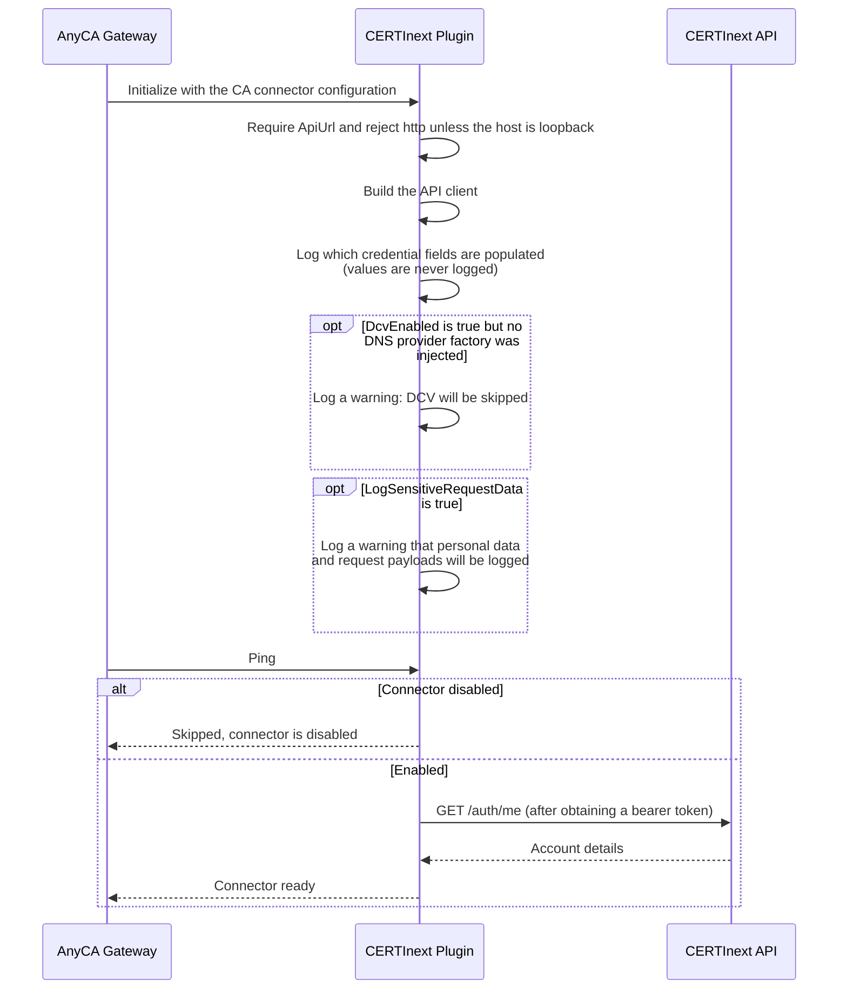
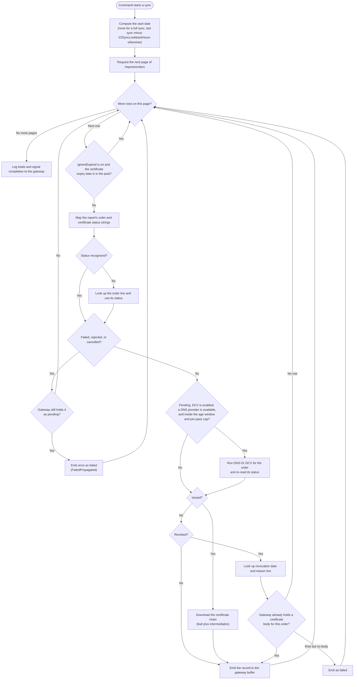
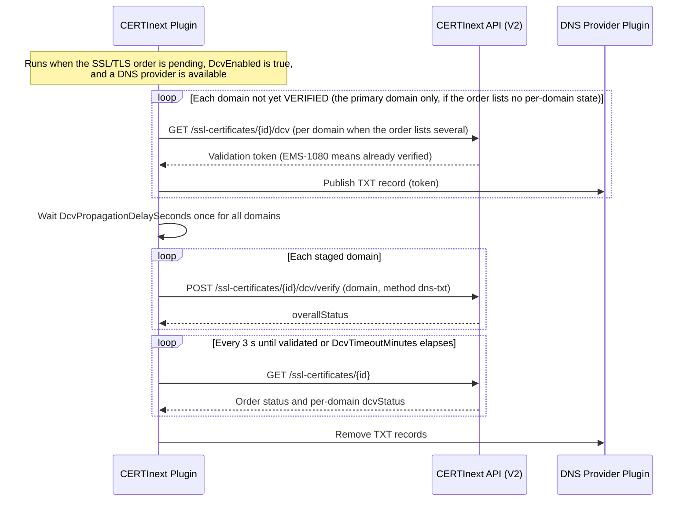
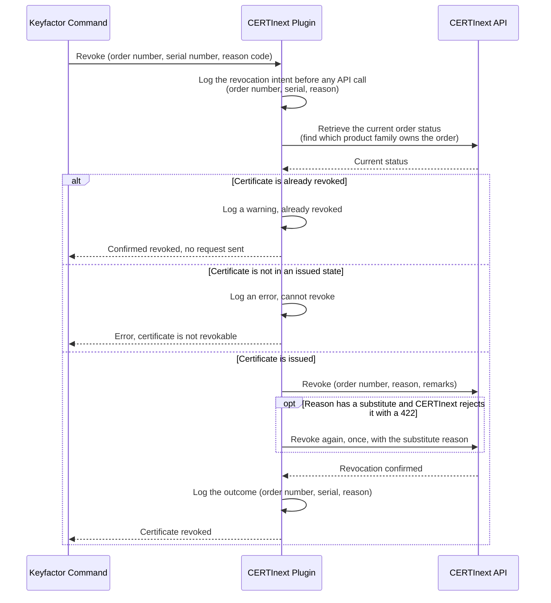
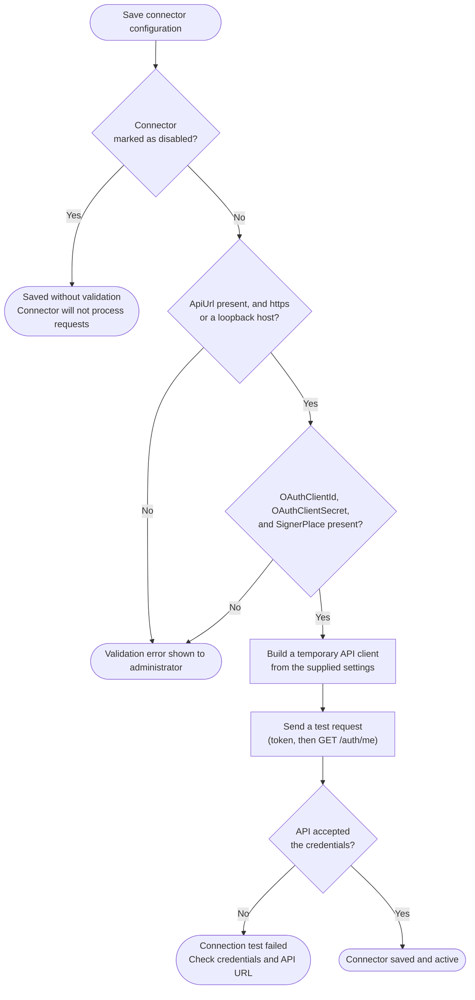
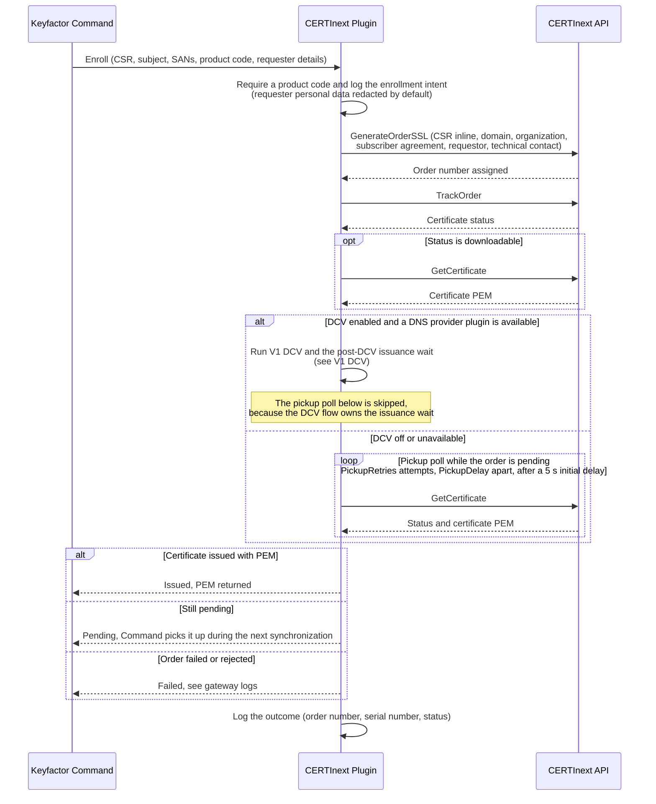
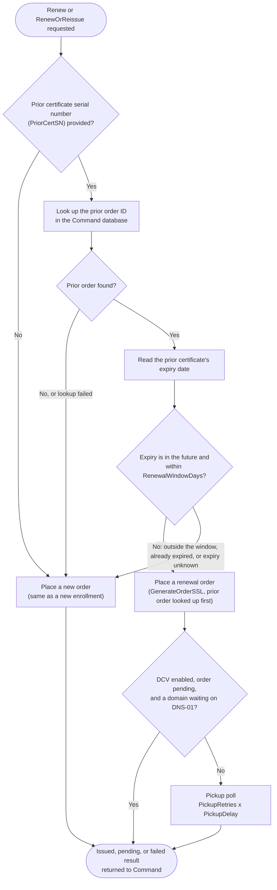
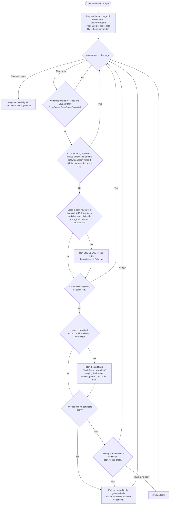
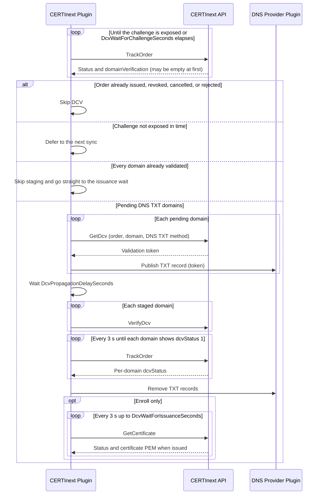

<h1 align="center" style="border-bottom: none">
    CERTInext AnyCA Gateway REST Plugin
</h1>

<p align="center">
  <!-- Badges -->

<a href="https://github.com/Keyfactor/certinext-caplugin/releases"></a>


</p>

<p align="center">
  <!-- TOC -->
  <a href="#support">
    <b>Support</b>
  </a>
  ·
  <a href="#requirements">
    <b>Requirements</b>
  </a>
  ·
  <a href="#installation">
    <b>Installation</b>
  </a>
  ·
  <a href="#license">
    <b>License</b>
  </a>
  ·
  <a href="https://github.com/orgs/Keyfactor/repositories?q=anycagateway">
    <b>Related Integrations</b>
  </a>
</p>

> [!CAUTION]
> **The CERTInext V1 API is deprecated and no longer works.** CERTInext changed its API, so plugin
> 1.x and any connector with `UseV2Api` set to `false` can no longer be relied on. **Upgrade to
> 2.0.0 and move every connector to the V2 API** — see [Migrating from V1 to V2](#migrating-from-v1-to-v2).
> From 2.0.0, `UseV2Api` defaults to `true`. V1 is documented only under
> [Legacy V1 API (Deprecated)](#legacy-v1-api-deprecated).

The CERTInext AnyCA Gateway REST plugin extends the certificate lifecycle capabilities of the CERTInext platform (by eMudhra) to Keyfactor Command via the Keyfactor AnyCA Gateway REST, using the order-centric CERTInext V2 REST API. The plugin represents a fully featured AnyCA REST plugin with the following capabilities:

* CA Synchronization:
    * Download all certificates issued through the CERTInext CA, either as a full inventory or incrementally since the last sync.
    * Expired certificates can optionally be excluded from synchronization using the `IgnoreExpired` configuration flag.
* Certificate Enrollment for SSL/TLS (DV, OV, EV, including wildcard and multi-domain) and Private PKI products:
    * New certificate enrollment (new keys and certificate).
    * Certificate renewal — every renewal places a new order.
    * Certificate reissuance (new keys) through CERTInext's SSL/TLS reissue endpoint when outside the renewal window.
    * Synchronous certificate pickup — a fast-issuing order (DV, or already-approved) can return the certificate in the same enrollment call instead of always waiting for the next sync, via `PickupRetries`/`PickupDelay`.
    * DNS-01 domain control validation (DCV) — the plugin publishes the validation TXT record through a DNS provider plugin deployed on the gateway and asks CERTInext to verify it, during enrollment and during synchronization (`DcvEnabled`, on by default).
* Certificate Revocation:
    * Request revocation of a previously issued certificate using RFC 5280 reason codes, mapped to the reasons CERTInext accepts (see [Revocation Reason Codes](#revocation-reason-codes)).
* Authentication with an OAuth2 `client_credentials` bearer token.

## Compatibility

The CERTInext AnyCA Gateway REST plugin is compatible with the Keyfactor AnyCA Gateway REST 26.2.0 and later.

## Support
The CERTInext AnyCA Gateway REST plugin is supported by Keyfactor for Keyfactor customers. If you have a support issue, please open a support ticket via the Keyfactor Support Portal at https://support.keyfactor.com.

> To report a problem or suggest a new feature, use the **[Issues](../../issues)** tab. If you want to contribute actual bug fixes or proposed enhancements, use the **[Pull requests](../../pulls)** tab.

## Requirements

* Keyfactor Command 25.5 or later
* AnyCA Gateway REST framework version 26.2.0 or later (`IAnyCAPlugin` 3.3.0)
* A DNS provider plugin deployed on the AnyCA Gateway if the connector validates domains with DNS-01 DCV (the default; see `DcvEnabled`)
* A CERTInext account with API access enabled, an OAuth-mode API credential, and at least one certificate product configured
* Network connectivity from the AnyCA Gateway host to the CERTInext API endpoint for your region (see table below)
* The AnyCA Gateway host must trust the TLS certificate presented by the CERTInext API endpoint

### CERTInext Environments

CERTInext operates three separate environments. Use the sandbox environment for initial integration testing. Switch to a production environment only after all functionality has been verified.

| Environment | Portal Sign-in URL | API Base URL (`ApiUrl`) |
|---|---|---|
| Sandbox | https://sandbox-us.certinext.io/ | `https://sandbox-us-api.certinext.io` |
| Production — India (Global) | https://in.certinext.io/ | `https://api.certinext.io` |
| Production — US | https://us.certinext.io/ | `https://us-api.certinext.io` |

> Note: Product catalogs differ between sandbox and production. Check your account's catalog (`GET /api/certinext/v2/catalog/products`) in the environment you are targeting before going live.

## Installation

1. Install the AnyCA Gateway REST per the [official Keyfactor documentation](https://software.keyfactor.com/Guides/AnyCAGatewayREST/Content/AnyCAGatewayREST/InstallIntroduction.htm).

2. On the server hosting the AnyCA Gateway REST, download and unzip the latest [CERTInext AnyCA Gateway REST plugin](https://github.com/Keyfactor/certinext-caplugin/releases/latest) from GitHub.

3. Copy the unzipped directory (usually called `net8.0` or `net10.0`) to the Extensions directory:


    ```shell
    Depending on your AnyCA Gateway REST version, copy the unzipped directory to one of the following locations:
    Program Files\Keyfactor\AnyCA Gateway\AnyGatewayREST\net8.0\Extensions
    Program Files\Keyfactor\AnyCA Gateway\AnyGatewayREST\net10.0\Extensions
    ```

    > The directory containing the CERTInext AnyCA Gateway REST plugin DLLs (`net8.0` or `net10.0`) can be named anything, as long as it is unique within the `Extensions` directory.

4. Restart the AnyCA Gateway REST service.

5. Navigate to the AnyCA Gateway REST portal and verify that the Gateway recognizes the CERTInext plugin by hovering over the ⓘ symbol to the right of the Gateway on the top left of the portal.

## Configuration

1. Follow the [official AnyCA Gateway REST documentation](https://software.keyfactor.com/Guides/AnyCAGatewayREST/Content/AnyCAGatewayREST/AddCA-Gateway.htm) to define a new Certificate Authority, and use the notes below to configure the **Gateway Registration** and **CA Connection** tabs:

    * **Gateway Registration**

        Before enrolling certificates, the Keyfactor Command server must trust the CERTInext issuing CA chain.
        
        1. Log in to the CERTInext portal and download the root CA certificate and any intermediate CA certificates in the chain as PEM or DER files.
        2. On the Keyfactor Command server, import those certificates into the appropriate Windows certificate store — **Trusted Root Certification Authorities** for the root CA and **Intermediate Certification Authorities** for any subordinate CAs.
        3. In the Keyfactor Command Management Portal, navigate to **CA Connectors** and add a new CA using the **CERTInext AnyCA REST Gateway Plugin**.
        4. Complete the CA connector configuration fields described in the next section, then save and test the connection. The gateway performs a live connectivity test during validation: a token request, then `GET /api/certinext/v2/auth/me`.
        
        ### Change of issuing CA (eMudhra exit from public TLS)
        
        eMudhra, CERTInext's parent company, is withdrawing from the public SSL/TLS certificate business, and browser root programs are phasing out the emSign roots that CERTInext public TLS certificates have chained to. Public TLS certificates ordered through CERTInext will be issued under a different CA. Which CA depends on your service: InCommon members are moving to [SSL.com](https://incommon.org/about/news/incommon-certificate-service-update), and eMudhra offers [Sectigo](https://emudhra.com/en/post/certificate-security-incident) certificates to its customers. Confirm the new chain for your account with CERTInext.
        
        Dates published by eMudhra for the emSign G1 root (check the [eMudhra statement](https://emudhra.com/en/post/certificate-security-incident) for changes):
        
        | Root program | Effect |
        |---|---|
        | Chrome, Mozilla Firefox | Certificates logged after November 16, 2026 are not trusted. Certificates issued before then stay trusted until they expire. |
        | Apple | The root is removed on November 30, 2026. Every certificate issued under it stops being trusted on Apple platforms, including existing ones. |
        | Microsoft | No date announced. |
        
        The plugin does not need to change. It stores only the issued certificate and never reads or checks the issuer. Repeat the trust and registration steps above with the new chain:
        
        1. Get the new root and intermediate certificates for your account from CERTInext.
        2. Import them on the Keyfactor Command server and the AnyCA Gateway REST host, and on any orchestrator or client that builds or validates certificate chains. Use **Trusted Root Certification Authorities** for the root and **Intermediate Certification Authorities** for subordinates.
        3. Replace the CA certificate in this CA's **Gateway Registration** with the new issuing chain.
        4. Replace certificates that chain to the emSign G1 root before November 30, 2026 if Apple clients rely on them. Keep the emSign certificates in your trust stores until you have replaced every certificate issued under them.
        
        Also confirm with CERTInext whether your account's product catalog changes. If a template sets `ProductCode`, update it.

    * **CA Connection**

        Populate using the configuration fields collected in the [requirements](#requirements) section.

        * **ApiUrl** - REQUIRED: CERTInext API base URL. V2 (default, UseV2Api=true): bare host, e.g. https://us-api.certinext.io. Legacy V1 (UseV2Api=false): host plus /emSignHub-API/, e.g. https://us-api.certinext.io/emSignHub-API/. Must use https.
        * **AccountNumber** - REQUIRED when UseV2Api is false: your CERTInext account number (numeric string). Included in the `meta` block of every V1 request. Not used when UseV2Api is true. Available in the CERTInext portal.
        * **GroupNumber** - OPTIONAL: CERTInext group (delegation) number. When set, it is included in product-catalog requests and in the order (`orderDetails.groupNumber` on V1, `groupNumber` on V2) so the order is routed to the configured account group, and V2 synchronization is scoped to the group. When blank, CERTInext uses the account's default group. Available in the CERTInext portal under Delegation → Groups.
        * **OrganizationNumber** - OPTIONAL: Pre-vetted CERTInext organization number. Required for OV/EV on V2; recommended for V1 OV/EV and faster DV. Skips CERTInext's manual vetting queue.
        * **TechnicalContactName** - OPTIONAL: Name sent as the order's technical point of contact (V1 `technicalPointOfContact.pocFirstName` / `pocLastName`, V2 `technicalPointOfContact.name`). On V1 the name is split on the first whitespace: the first word is the first name and the rest is the last name; a single-word name is sent in both. Defaults to the configured RequestorName when blank. On V1, if no contact name or no email resolves (including from RequestorName/RequestorEmail), the whole technicalPointOfContact block is omitted from the order and a Warning is logged, since CERTInext requires both inside the block.
        * **TechnicalContactEmail** - OPTIONAL: Email sent as the order's technical point of contact (V1 `technicalPointOfContact.pocEmail`, V2 `email`). Defaults to the configured RequestorEmail when blank. On V1, if no contact name or no email resolves (including from RequestorName/RequestorEmail), the whole technicalPointOfContact block is omitted from the order and a Warning is logged, since CERTInext requires both inside the block.
        * **TechnicalContactIsdCode** - OPTIONAL: International dialing code for the technical contact phone number. Defaults to the configured RequestorIsdCode when blank.
        * **TechnicalContactMobileNumber** - OPTIONAL: Mobile number for the technical contact (digits only). Defaults to the configured RequestorMobileNumber when blank.
        * **AuthMode** - OPTIONAL, legacy (V1 only): leave as 'AccessKey' (default). V1 does not honor OAuth tokens, so 'OAuth' is unsupported. Ignored when UseV2Api is true.
        * **ApiKey** - REQUIRED when UseV2Api is false: the REST API Access Key generated in the CERTInext portal under Integrations → APIs. Used to compute authKey = SHA256(accessKey + ts + txn); never transmitted directly. Not used when UseV2Api is true.
        * **OAuthTokenUrl** - Legacy / unsupported (V1): V1 does not honor OAuth tokens; leave blank. Ignored when UseV2Api is true — V2 requests its token from {ApiUrl}/oauth/token.
        * **OAuthClientId** - OAuth client ID. REQUIRED when UseV2Api is true: V2 authenticates with client_credentials against {ApiUrl}/oauth/token. The key must be generated in OAuth mode in the CERTInext portal. Not used on V1.
        * **OAuthClientSecret** - OAuth client secret. REQUIRED when UseV2Api is true (see OAuthClientId). Not used on V1.
        * **RequestorName** - REQUIRED: Default requestor name submitted with all certificate orders. This is the name of the person/service responsible for the certificates.
        * **RequestorEmail** - REQUIRED: Default requestor email submitted with all certificate orders. Must be a valid email address registered in your CERTInext account.
        * **RequestorIsdCode** - International dialing code for the requestor phone number (e.g. '1' for US). Default: '1'.
        * **RequestorMobileNumber** - Requestor mobile number (digits only, no country code).
        * **RequestorDesignation** - OPTIONAL: Job title / role of the requestor (e.g. 'IT Administrator'). Sent as requestorInformation.requestorDesignation (V1) and requestor.designation (V2). Free text. Omitted when blank.
        * **SignerPlace** - City or location of the subscriber agreement signer (e.g. 'San Francisco, CA'). REQUIRED when UseV2Api is on: the V2 Subscriber Agreement sent with every SSL order requires it, so the connector cannot be saved with it blank. A per-template SignerPlace enrollment parameter overrides it. On V1, if neither is set, the placeholder "Gateway" is sent and a Warning is logged; set it so the agreement audit record is accurate.
        * **SignerIp** - V1 ONLY: IP address of the subscriber agreement signer. A template-level SignerIp enrollment parameter overrides it. If neither is set, the placeholder 127.0.0.1 is sent and a Warning is logged, and a value that is not an IP address is still sent unchanged, with a Warning. Ignored on V2: the V2 agreement block has no signer IP field, so it is never sent.
        * **DefaultProductCode** - OPTIONAL: Default numeric product code. V1 only: used for renewals when the template supplies none. Not used on V2, where the product is resolved by CERTInext (set the template's ProductCode to override). Get codes via GetProductDetails.
        * **AccountingModel** - OPTIONAL: CERTInext billing model sent in `orderDetails.accountingModel` on V1 orders. "2" = credit-based (most accounts, default). "1" = cash model. Not used by V2.
        * **EmailNotifications** - OPTIONAL: Lifecycle emails to the requestor. "1" = full set (V2: "all"), "0" = silent (V1: "0"; V2: "consent-only", the quietest value the V2 API accepts). Blank: silent on V1, omitted on V2 (CA default applies). Other values fail V2 enrollment. Default: "0".
        * **SubscriptionValidityYears** - OPTIONAL: Default validity in years for SSL orders. "1", "2", or "3". Used when the template sets no ValidityYears (and, on V1, no ValidityDays); a template term (on V1 the larger of ValidityYears and ValidityDays in years) overrides it. Default: "1".
        * **SubscriptionAutoRenew** - OPTIONAL: Whether CERTInext should auto-renew certificates issued through this connector. "0" = disabled (recommended — renewal is driven by Keyfactor Command), "1" = enabled. Default: "0".
        * **SubscriptionRenewCriteriaDays** - OPTIONAL: Days before expiry at which CERTInext auto-renews (only honored when SubscriptionAutoRenew = "1"). Typical values: "30" or "60". Default: "30".
        * **AutoSecureWww** - OPTIONAL: Sent as `orderDetails.autoSecureWWW` on every V1 SSL order (new and renewal) and as `autoSecureWww` on V2 SSL orders. If "1", CERTInext automatically adds the `www.` variant of the primary domain as an additional SAN, which must also pass domain validation. "0" = use only the CN/SANs supplied with the CSR. Default: "0".
        * **IgnoreExpired** - If true, expired certificates are skipped during synchronization. V2 only: the V1 sync does not currently apply it. Default: false.
        * **SubmitNonDnsSans** - OPTIONAL (V1 only): If true (default), non-DNS SANs (IP, email, URI) are submitted, but CERTInext cannot validate them, so the order won't issue. If false, only DNS names are submitted.
        * **PageSize** - Number of orders to fetch per page during synchronization (1 or higher). Default: 100, max: 500 (V2 `/reports/orders` pages are capped at 100).
        * **Enabled** - Enables or disables the CA connector. Set to false to create the connector record before credentials are available. Default: true.
        * **LogSensitiveRequestData** - OPTIONAL temporary diagnostic switch. When true, requestor personal data (name, email, phone) and full CA payloads are logged. Credentials are always redacted. Turn off after verifying. Default: false.
        * **PickupRetries** - OPTIONAL: Times Enroll() polls CERTInext for the certificate after order submission (0-30; 0 disables the wait). Unissued orders are picked up by sync. Default: 5.
        * **PickupDelay** - OPTIONAL: Seconds between certificate-pickup polls (1-60). Total wait is 5 s + PickupRetries x this value. Command's own enrollment call into the gateway is bounded at roughly 100 s, so the plugin caps the total at 75 s regardless of how PickupRetries/PickupDelay are set, reducing the retry count to fit. Keep your configured total well under that ceiling. Default: 10 (~55 s with default retries). EnrollmentCallBudgetSeconds also ends the wait early.
        * **EnrollmentCallBudgetSeconds** - OPTIONAL: Seconds from the start of an enrollment after which the certificate pickup stops waiting and returns the order as pending (0 disables; at most 90). Command fails an enrollment still running at its Workflow Step Run Timeout application setting (60 s by default), even though the order exists at CERTInext. If you raise that setting, set this about 10 s lower. Order and reissue calls already in flight are never cut short. Default: 50.
        * **DcvEnabled** - OPTIONAL: When true, the plugin performs DNS-based Domain Control Validation (DCV) during enrollment and synchronization for orders that require it, using the DNS provider plugin deployed on the gateway (e.g. azure-azuredns-dnsplugin). Without a DNS provider plugin, orders that need validation stay pending and the plugin logs why. Set to false to skip DCV. Default: true.
        * **DcvTxtRecordTemplate** - OPTIONAL: Format string for the DNS TXT record hostname used during DCV. {0} is replaced with the domain name being validated. Default: _emsign-validation.{0}
        * **DcvPropagationDelaySeconds** - OPTIONAL: Seconds to wait after publishing the DNS TXT record before asking CERTInext to verify it. Increase for zones with slow propagation. Default: 30.
        * **DcvTimeoutMinutes** - OPTIONAL: Maximum minutes for the entire DCV flow (DNS publish + propagation + verify) for one order before it is abandoned and left pending. Can also be set via the CERTINEXT_DCV_TIMEOUT_MINUTES environment variable; the env var takes precedence when both are set. Default: 10.
        * **DcvWaitForChallengeSeconds** - OPTIONAL (V1 only): Seconds Enroll() waits for CERTInext to expose the DCV challenge. 0 disables the wait. CERTINEXT_DCV_WAIT_FOR_CHALLENGE_SECONDS overrides it. Default: 60.
        * **DcvWaitForIssuanceSeconds** - OPTIONAL (V1 only): Seconds Enroll() waits for issuance after DCV verifies. 0 disables the wait. CERTINEXT_DCV_WAIT_FOR_ISSUANCE_SECONDS overrides it. Default: 60.
        * **DcvSyncMaxOrderAgeHours** - OPTIONAL: During synchronization, only pending DV orders younger than this many hours are driven through DCV. 0 disables the filter. Default: 24.
        * **DcvSyncMaxPerPass** - OPTIONAL: Maximum pending DV orders driven through DCV per synchronization pass. 0 disables the cap. Default: 50.
        * **UseV2Api** - OPTIONAL: When true (the default), the plugin routes Ping / Enroll / GetSingleRecord / Revoke / Synchronize through the CERTInext V2 REST API (/api/certinext/v2/), including V2 /reports/orders for Synchronize. Requires ApiUrl (the V2 base URL in this mode), OAuthClientId, OAuthClientSecret, and SignerPlace. V1 credentials (ApiKey/AccountNumber/AuthMode) are not required when this is true. Set to false only for the legacy V1 API, which no longer works because of CERTInext API changes. Default: true (V2 API).
        * **V2SyncLookbackHours** - OPTIONAL (V2 only): Hours subtracted from the last-sync time on incremental sync, so an order created earlier but issued later is not missed. Default: 72.
        * **SyncRecentOrderGraceSeconds** - OPTIONAL: during a Synchronize (full or incremental, in both V1 and V2 modes), a pending or issued order created less than this many seconds ago (plus a small clock margin) is not emitted to the gateway (an issued one is not downloaded); the next incremental pass imports it. This stops the sync from inserting a gateway row for an order whose enrollment is still in flight, which would make the enrollment's own save fail with a duplicate key. Revoked and failed orders are never held back. 0 disables the hold; a negative value uses the default. Default: 120.
        * **V2InlineCsr** - OPTIONAL (V2 mode only): when true (the default), SSL/TLS enrollment sends the CSR inline in the order create call (a single POST /ssl-certificates), as a direct API integration does. When false, the plugin creates the order and then submits the CSR (PUT .../csr); that two-call flow fails for a domain the account has already validated, because CERTInext approves the order at create and then rejects the CSR. A create that times out or returns a 5xx can leave an order that still issues; it is not cancelled and the next synchronization imports it, so do not resubmit. Private PKI orders ignore this setting and always use the two-call flow (the CA rejects an inline CSR on Private PKI create). Ignored when UseV2Api is false. Default: true (single call).
        * **V2ReissueRevokePrevious** - OPTIONAL (V2 mode only, SSL/TLS reissue): a V2 SSL/TLS reissue goes through CERTInext's reissue endpoint, which creates a new order derived from the original (for example 1984857369R001). When true, that call also asks CERTInext to revoke the previous certificate with reason superseded; the intent is audit-logged before the call. When false (the default), the previous certificate stays valid until it expires or is revoked separately. Ignored when UseV2Api is false. Default: false.
        * **SslComSubmitOrganization** - OPTIONAL (V2 mode only): before an OV or EV SSL/TLS order, the plugin checks whether SSL.com has validated the organization (OrganizationNumber) at that level, refreshing the status once if not. When this is true and the organization is still unvalidated and ready to submit, the plugin also SUBMITS it to SSL.com for validation. WARNING: enabling this ACCEPTS SSL.COM'S SUBSCRIBER AGREEMENT ON THE ORGANIZATION'S BEHALF; each acceptance is audit-logged. Leave false unless you are authorized to do that. Whatever the outcome, the order is placed anyway and a not-validated organization only logs a warning. Default: false.
        * **SslComAdminEmail** - OPTIONAL (V2 mode only): administrator email sent as adminEmail when the plugin submits an organization to SSL.com (only used when SslComSubmitOrganization is true). Blank omits it and SSL.com uses the organization's own contact.

2. A Keyfactor Command certificate template maps an enrollment request to a specific CERTInext product. Create one template per CERTInext product that you want to make available to requesters.

The AnyCA Gateway REST portal also needs one certificate profile per product before Command templates can be created against it. Create the profiles by hand in the gateway portal, or with the helper script this repository ships (`make register-profiles`; set `DRY_RUN=1` to preview). By default the script also registers a `<ProductID> V2` profile per product, for a second set of templates that carry no `ProductCode` (see [V2 Product Code Resolution](#v2-product-code-resolution)); set `V2_TEMPLATES=0` to skip them. See [scripts/register/README.md](https://github.com/Keyfactor/certinext-caplugin/blob/main/scripts/register/README.md) for authentication and options.

In the Keyfactor Command Management Portal, navigate to **Certificate Templates** and create a new template associated with the CERTInext CA connector. The following enrollment parameters are available:

| Parameter | Required / Optional | Type | Description | Example / Default |
|---|---|---|---|---|
| `ProductFamily` | Optional | String | CERTInext product family: `ssl` or `private-pki` (see [V2 Private PKI Orders](#v2-private-pki-orders)). Default: `ssl`. | `ssl` |
| `ProductVariant` | Optional | String | Variant within the family. `ssl`: `dv`, `ov`, or `ev`. `private-pki`: `intranet-ssl` or `igtf-host` (required). | Derived from `ProductId` (for example `dv`) |
| `ProductCode` | Optional | String | Override for the product CERTInext resolves, sent as `X-Product-Code`. Leave it blank and CERTInext resolves the product (see [V2 Product Code Resolution](#v2-product-code-resolution)). | Blank |
| `ProfileId` | Deprecated | String | Legacy alias for `ProductCode`. Used in its place when `ProductCode` is not set. New templates should use `ProductCode`. | Blank |
| `ValidityYears` | Optional | Number | Subscription term in years: `1`, `2`, or `3`. Default: `1`. CERTInext certificates are issued within a subscription term at up to 390 days per certificate, with free renewals within the term. | `1` |
| `AutoApprove` | Optional | Boolean | **Currently has no effect** — reserved for future use. The plugin does not call any approval endpoint against CERTInext regardless of this setting. | `false` |
| `RequesterName` | Optional | String | Overrides the connector `RequestorName` for this template when non-blank. Never derived from the certificate subject. | `Keyfactor Automation` |
| `RequesterEmail` | Optional | String | Overrides the connector `RequestorEmail` for this template when non-blank. Never derived from the certificate subject. | `pki-admin@example.com` |
| `RenewalWindowDays` | Optional | Number | Decides whether `RenewOrReissue` uses the SSL/TLS reissue endpoint (prior certificate expires after the window) or places a new order (inside it). Default: `90`. | `90` |
| `KeyType` | Optional | String | Informational. The CSR decides the key algorithm. CERTInext accepts only RSA 2048/3072/4096 and ECC P-256/P-384. | `RSA2048`, `RSA3072`, `RSA4096`, `EC256`, `EC384` |
| `DomainName` | Optional | String | Primary domain name for SSL/TLS orders (for Private PKI, the primary hostname). If omitted, the plugin uses the CSR subject `CN`. For an SSL/TLS request with no `CN`, it uses the first DNS SAN that isn't a wildcard, else the first wildcard one (when the SANs are a name and its own wildcard, the wildcard is the domain and the plain name an additional domain), and CERTInext sets the issued certificate's `CN` to that domain. | `example.com` |
| `SignerName` | Optional | String | Per-template override for the subscriber agreement signer name. When omitted, defaults to the requestor name. | `Jane Smith` |
| `SignerPlace` | Optional | String | Per-template override for the subscriber agreement signer location. When omitted, defaults to the connector-level `SignerPlace`. | `Austin` |
| `OrgRepresentativeName` | Optional (OV only) | String | Registers a new Organization Representative on the order (`organization.useNewOrgRepresentative`), together with `OrgRepresentativeEmail`. Leave all five `OrgRepresentative*` parameters blank to keep the organization's existing representative. Personal data: never logged. | `Jane Doe` |
| `OrgRepresentativeEmail` | Optional (OV only) | String | The new representative's email address; required with `OrgRepresentativeName`. | `jane.doe@example.com` |
| `OrgRepresentativePhone` | Optional (OV only) | String | The new representative's phone: 6-15 digits, with an optional leading `+` and spaces, dashes, dots or parentheses. | `+1 555 010 0199` |
| `OrgRepresentativeDesignation` | Optional (OV only) | String | The new representative's job title. | `CISO` |
| `OrgRepresentativeEmployeeId` | Optional (OV only) | String | The new representative's employee ID. | `E-1042` |

`ValidityDays` and `SignerIp` are V1-only parameters and are ignored.

- **`ProductVariant` default:** when omitted for `ssl`, the plugin derives it from the selected product (an OV product sends `ov`, an EV product sends `ev`). An explicit value that contradicts the product fails enrollment.
- **`signature` (Document Signer):** `ProductFamily` accepts it, but enrollment is not supported and fails before any order is placed. An unrecognized family is treated as `ssl`.
- **New Organization Representative (OV):** setting `OrgRepresentativeName` and `OrgRepresentativeEmail` sends `useNewOrgRepresentative: true` with an `organizationRepresentative` block on the create call. The order is bound to that person. If the organization is already approved by a Validation Agent, CERTInext queues the change of the organization's representative of record for review, and the plugin logs `OrganizationRepresentativeStatus=pending-approval`; otherwise it reports `applied`. The plugin checks CERTInext's rules before any CA call, both when the template is saved and at enrollment:
  - OV products only; DV and EV are rejected (`EMS-1315`).
  - The connector needs `OrganizationNumber` (`EMS-1316`).
  - Name and email must both be set (`EMS-1319`/`EMS-1320`), including when only the phone, designation or employee ID is set.
  - The email must be a single address, and the phone must contain 6-15 digits (`EMS-1321`).

  An email that is already a representative of the organization is rejected by CERTInext (`EMS-1317`); clear the parameters to keep the existing one. A reissue doesn't send the block, so the reissued order keeps the original order's representative. The values are never logged, and are redacted from payload logs unless `LogSensitiveRequestData` is on.
- **Key types:** larger RSA, ECC P-521, and the Ed25519/Ed448 curves are rejected by the CA (`Invalid key size`).

3. Follow the [official Keyfactor documentation](https://software.keyfactor.com/Guides/AnyCAGatewayREST/Content/AnyCAGatewayREST/AddCA-Keyfactor.htm) to add each defined Certificate Authority to Keyfactor Command and import the newly defined Certificate Templates.

4. In Keyfactor Command (v12.3+), for each imported Certificate Template, follow the [official documentation](https://software.keyfactor.com/Core-OnPrem/Current/Content/ReferenceGuide/Configuring%20Template%20Options.htm) to define enrollment fields for each of the following parameters:

    * **ProductCode** - OPTIONAL: Override the numeric CERTInext product code for this template. When omitted: on V1, the default production code for the selected product is used (e.g. DV SSL → 838); on V2, no X-Product-Code header is sent and CERTInext resolves the product from the variant, the wildcard shape of the domain and any additional domains. On V2 an explicit value is an override, sent as X-Product-Code to choose between several matching catalog products (for example different CA profiles for the same variant).
    * **ProfileId** - DEPRECATED: Use ProductCode instead. Kept for backward compatibility — mapped to ProductCode if ProductCode is not set.
    * **ValidityYears** - OPTIONAL: Subscription term in years: 1, 2, or 3. On V1 the order's term is the larger of ValidityYears and ValidityDays rounded up to whole years (365 days = 1 year); a field left at its default (1 year) never overrides the other. On V2 only ValidityYears is used. A template value overrides the connector's SubscriptionValidityYears. Because the larger value wins on V1, a stale larger ValidityDays cannot be shortened with ValidityYears alone; set ValidityDays back to 365. Default: 1. Note: CERTInext validates per 390-day certificate within the subscription; the 'validity' field in the order is the subscription term, not certificate lifetime.
    * **ValidityDays** - OPTIONAL: V1 only (ignored on V2, which uses ValidityYears). Requested validity in days. CERTInext's order API takes whole subscription years, so days are converted to years, rounded up (365 days = 1 year). The order's term is the larger of this and ValidityYears; a field left at its default (365 days = 1 year) never overrides the other. Kept because certificate lifetimes are shrinking and days is the unit that will matter if CERTInext adds a lifetime field. To shorten a template with a larger value, set this back to 365. Default: 365.
    * **AutoApprove** - Currently has no effect — reserved for future use. The plugin does not call any approval endpoint against CERTInext regardless of this setting. Default: false.
    * **RequesterName** - OPTIONAL: Overrides the connector RequestorName for this template when non-blank. Never derived from the certificate subject.
    * **RequesterEmail** - OPTIONAL: Overrides the connector RequestorEmail for this template when non-blank. Never derived from the certificate subject.
    * **RenewalWindowDays** - OPTIONAL: Number of days before certificate expiration within which a RenewOrReissue is treated as a renewal (a new order). A certificate that expires further out than this window is reissued instead (SSL/TLS reissue endpoint); an expired certificate gets a new order. Default: 90.
    * **KeyType** - OPTIONAL: Informational. The key algorithm is determined by the submitted CSR; CERTInext accepts RSA 2048/3072/4096 and ECC P-256/P-384 and rejects larger RSA, ECC P-521, and Ed25519/Ed448.
    * **DomainName** - OPTIONAL: Primary domain for SSL/TLS orders (for V2 private-pki orders, the primary hostname). Derived from the CSR CN if omitted.
    * **SignerName** - OPTIONAL: Per-template subscriber agreement signer name. Falls back to the connector-level RequestorName if omitted (V2: the requestor name). If no name resolves, V1 sends the placeholder "Keyfactor Gateway" and logs a Warning.
    * **SignerPlace** - OPTIONAL: Per-template signer city/location. Falls back to the connector-level SignerPlace if omitted. If neither is set, V1 sends the placeholder "Gateway" and logs a Warning.
    * **SignerIp** - V1 ONLY, OPTIONAL: Per-template signer IP address. Falls back to the connector-level SignerIp if omitted. If neither is set, V1 sends the placeholder 127.0.0.1 and logs a Warning; a V1 value that is not an IP address is sent unchanged, with a Warning. Ignored on V2 (the V2 agreement block has no signer IP field).
    * **ProductFamily** - V2 ONLY: Product family for this template. Accepted values: 'ssl' (default) or 'private-pki'. 'private-pki' requires a Private PKI ProductVariant. 'signature' (Document Signer) is accepted by the parameter, but Document Signer enrollment is not supported.
    * **ProductVariant** - V2 ONLY: Product variant sent in the V2 order body. ProductFamily 'ssl': 'dv', 'ov', or 'ev' — if omitted, derived from the selected product; an explicit value that contradicts the product fails enrollment. ProductFamily 'private-pki': 'intranet-ssl' or 'igtf-host' (required; no default).
    * **OrgRepresentativeName** - V2 ONLY, OV only: Name of a new Organization Representative to register on the order. Set together with OrgRepresentativeEmail; both turn on useNewOrgRepresentative. Leave all OrgRepresentative* parameters blank to keep the organization's existing representative. Requires the connector's OrganizationNumber. Personal data: never logged.
    * **OrgRepresentativeEmail** - V2 ONLY, OV only: Email address of the new Organization Representative. Required with OrgRepresentativeName. An email that is already a representative of the organization is rejected by CERTInext (EMS-1317); leave these parameters blank to use the existing one. Personal data: never logged.
    * **OrgRepresentativePhone** - V2 ONLY, OV only, optional: Phone number of the new Organization Representative, 6-15 digits with an optional leading '+' and spaces, dashes, dots or parentheses. Needs OrgRepresentativeName and OrgRepresentativeEmail. Personal data: never logged.
    * **OrgRepresentativeDesignation** - V2 ONLY, OV only, optional: Job title of the new Organization Representative. Needs OrgRepresentativeName and OrgRepresentativeEmail. Personal data: never logged.
    * **OrgRepresentativeEmployeeId** - V2 ONLY, OV only, optional: Employee ID of the new Organization Representative. Needs OrgRepresentativeName and OrgRepresentativeEmail. Personal data: never logged.

## CERTInext API Setup

The plugin authenticates with an OAuth2 `client_credentials` bearer token, requested from `{ApiUrl}/oauth/token` and sent in the `Authorization: Bearer` header. Create an OAuth-mode credential in the CERTInext portal:

1. Log in to the CERTInext portal for your environment.
2. Navigate to **Integrations → APIs**.
3. Click **+ Create API Credentials**, set **API Type** to `REST`, and select the **OAuth** auth type (not `Access Key`). The V2 spec requires the key to be generated in OAuth mode. A key that wasn't gets HTTP 403 `unauthorized_client` at token time.
4. Note the client ID and client secret. Enter them in `OAuthClientId` and `OAuthClientSecret`. The V2 spec's token example uses the account number as `client_id`, but the plugin never substitutes `AccountNumber` for it, so set `OAuthClientId` explicitly. See [Step 1 of the migration guide](#step-1--create-a-v2-oauth2-credential) for the failure modes.

> Note: Credentials are stored in Keyfactor Command's encrypted gateway configuration and are never written to disk by the plugin.

## CA Configuration

The following fields are presented in the Keyfactor Command Management Portal when creating or editing the CERTInext CA connector. Fields used only by the deprecated V1 API (`AccountNumber`, `ApiKey`, `AuthMode`, `OAuthTokenUrl`, `AccountingModel`, `SignerIp`, `SubmitNonDnsSans`, `DefaultProductCode`, `DcvWaitForChallengeSeconds`, `DcvWaitForIssuanceSeconds`) are ignored and can be left blank; see [V1 Connector Fields](#v1-connector-fields).

### Save-Time Validation

When the connector is saved (and `Enabled` is `true`), the plugin checks only the fields below. Every other field marked **Required** in the tables is needed by CERTInext for a successful order, but the connector saves without it — enrollment then fails, or the order is parked pending, until it is set.

- `ApiUrl` must be present and use `https` (`http` is allowed only for a loopback host: `localhost`, `127.0.0.1`, `::1`).
- `OAuthClientId`, `OAuthClientSecret`, and `SignerPlace` must be set.
- `V2InlineCsr`, `V2ReissueRevokePrevious`, and `SslComSubmitOrganization`, when present, must be booleans, and `SslComAdminEmail`, when set, must be a single email address.

### Connection

| Field | Required | Description |
|---|---|---|
| `ApiUrl` | Required | CERTInext API base URL: the bare host, no path suffix (see [CERTInext Environments](#certinext-environments)). A trailing slash is accepted. Must use `https`, because the OAuth client secret is sent to it; `http` is rejected except for a loopback host, for local test servers only. |
| `UseV2Api` | Optional | Selects the API. Leave it unset or `true`. `false` selects the [deprecated V1 API](#legacy-v1-api-deprecated), which no longer works. Default: `true`. |
| `OAuthClientId` | Required | OAuth client ID. The key must be generated in OAuth mode. |
| `OAuthClientSecret` | Required | OAuth client secret. Masked in the UI. |
| `Enabled` | Optional | Set to `false` to create the connector record before credentials exist; skips validation and the live connectivity test. Default: `true`. |

### Requestor and Signer

| Field | Required | Description |
|---|---|---|
| `RequestorName` | Required | Default name of the person or service submitting orders, sent in the order's `requestor` block. Example: `PKI Automation`. |
| `RequestorEmail` | Required | Default requestor email. Use a monitored inbox registered in your CERTInext account. |
| `RequestorIsdCode` | Optional | Dialing code for the requestor phone, digits only, no `+`. The phone is sent as `+<ISD code><number>`. Default: `1`. |
| `RequestorMobileNumber` | Optional | Requestor mobile number, digits only, no country code. |
| `RequestorDesignation` | Optional | Job title of the requestor, sent as `requestor.designation`. Omitted when blank. |
| `TechnicalContactName`<br>`TechnicalContactEmail`<br>`TechnicalContactIsdCode`<br>`TechnicalContactMobileNumber` | Optional | Technical point of contact, sent as the order's `technicalPointOfContact` on SSL/TLS and Private PKI orders. Each defaults to the matching `Requestor*` field. `designation` is always `Technical Contact`. |
| `SignerPlace` | Required | City of the person accepting the subscriber agreement, sent in the order's `agreement` block. A template `SignerPlace` overrides it. Example: `Austin`. |

- **Signer values per order:** the agreement signer name is the template `SignerName`, else the requestor name (the template `RequesterName`, else the connector's `RequestorName`). The signer place is the template `SignerPlace`, else the connector's. The V2 agreement block has no signer IP field (the CA records the signer's IP itself).

### Order Defaults

| Field | Required | Description |
|---|---|---|
| `GroupNumber` | Optional | CERTInext group (delegation) number, from **Delegation → Groups**. Sent as `groupNumber` on order create and as a query parameter on the catalog and orders-report calls. When blank, CERTInext uses the account's default group. |
| `OrganizationNumber` | Optional | Pre-vetted organization number, from **Organizations → Pre-vetted Organizations**. Required for OV/EV: those orders send `organization.organizationNumber` with `preVetted=true`, and enrollment fails before any CA call if it is blank. DV orders never send an organization block. |
| `EmailNotifications` | Optional | Lifecycle emails to the requestor. See [EmailNotifications values](#emailnotifications-values). Default: `0`. |
| `SubscriptionValidityYears` | Optional | Default validity in years: `1`, `2`, or `3`. Used when the template sets no `ValidityYears`. Default: `1`. |
| `SubscriptionAutoRenew` | Optional | `0` = CERTInext does not auto-renew (recommended; Command drives renewal), `1` = enabled (`subscription.autoRenew=true`). Default: `0`. |
| `SubscriptionRenewCriteriaDays` | Optional | Days before expiry at which CERTInext auto-renews, sent as `subscription.renewBeforeDays`; CERTInext acts on it only when `SubscriptionAutoRenew` is `1`. Blank omits it, so the CA's default applies. An unparseable or negative value fails the enrollment before any CA call. Default: `30`. |
| `AutoSecureWww` | Optional | `1` adds the `www.` variant of the primary domain as an extra SAN, which must also pass domain validation. Default: `0`. |

- **`GroupNumber` is not `AccountNumber`:** each CERTInext group (cost center or department) has its own `groupNumber`, which is separate from your account number and from any organization number on the Organizations page.
- **Non-DNS SANs:** an SSL/TLS order's `additionalDomains` takes DNS names only, so IP, email, and URI SANs are left off with a gateway-log warning. Private PKI sends DNS names and IPs (see [V2 Private PKI Orders](#v2-private-pki-orders)).

#### EmailNotifications Values

| Value | Sent as |
|---|---|
| `1` | `all` |
| `0` | `consent-only`, the quietest value the V2 spec allows (its enum is `consent-only` or `all`) |
| Blank | Omitted, so the CA default (`all`, not silent) applies. Set `0` explicitly for silent orders. |
| Anything else | Enrollment fails before any CA call |

### Synchronization and Pickup

| Field | Required | Description |
|---|---|---|
| `IgnoreExpired` | Optional | Skip expired certificates during sync: a report row with a parseable, past `certificateExpiryDate` is skipped, and a row with a missing or unparseable date is kept. Default: `false`. |
| `PageSize` | Optional | Orders fetched per page during sync. Maximum `100`; larger values are clamped, and 0 or less falls back to 100. Reduce it if sync requests time out. Default: `100`. |
| `V2SyncLookbackHours` | Optional | Extra hours subtracted from the last-sync time on incremental sync, so a slow order is not missed. Default: `72`. |
| `SyncRecentOrderGraceSeconds` | Optional | A sync (full or incremental) skips pending or issued orders created less than this many seconds ago (plus a 5-second clock margin); the next incremental sync imports them. This keeps a sync that runs during an in-flight enrollment from causing that enrollment to fail with a duplicate key. Held issued orders aren't downloaded; revoked and failed orders, and orders with no usable order date, are never held. `0` disables it. Default: `120`. |
| `PickupRetries` | Optional | Times `Enroll` polls CERTInext for the certificate after a successful order. `0` disables the wait. Default: `5`. |
| `PickupDelay` | Optional | Seconds between pickup polls. Default: `10`. |
| `EnrollmentCallBudgetSeconds` | Optional | Seconds from the start of an enrollment after which the pickup stops waiting and returns the order as pending, so the call returns before Command's workflow step timeout. Set it about 10 s below Command's **Workflow Step Run Timeout (seconds)** application setting. `0` disables it. Default: `50`. Maximum: `90`. |

- **Why a lookback:** the API's `from`/`to` filter may bracket either the order-placement date or the issuance date. The window keeps an order created before the last sync but issued afterward (for example a slow DCV order) from being missed.
- **`PickupRetries` and `PickupDelay`:** only a result with a certificate body counts as issued. OV/EV orders validate asynchronously (minutes to hours) and typically exhaust the wait regardless of these values.

#### Pickup Limits

| Setting | Minimum | Maximum | Default | Out-of-range behavior |
|---|---|---|---|---|
| `PickupRetries` | 0 (disabled) | 30 | 5 | Negative becomes 0; above 30 becomes 30 |
| `PickupDelay` (seconds) | 1 | 60 | 10 | Zero or negative becomes 10; above 60 becomes 60 |
| Total wait | — | 75 s | ~55 s | The retry count is reduced to fit the cap |
| `EnrollmentCallBudgetSeconds` | 0 (no deadline) | 90 | 50 | Negative becomes 50; above 90 becomes 90 |

> **Pickup timing detail:** after a successful order placement, the plugin waits a fixed 5-second initial delay before the first poll, then polls CERTInext every `PickupDelay` seconds up to `PickupRetries` times. Each poll checks the order's status and downloads the certificate once it is issued. The total time budget is **5 s + (`PickupRetries` × `PickupDelay`) + about 1 s API round trip per poll**. With the defaults this is 5 + (5 × 10) = **~55 s plus round trips**.
>
> **Tuning for faster pickup:** if CERTInext typically issues certificates within a few seconds of order placement (as is typical for DV and auto-approved orders), lower `PickupDelay` and raise `PickupRetries` to compensate. This polls more often without changing the total budget. Command's own enrollment call into the gateway is bounded at about 100 s, and order submission and each poll's round trip also use that budget, so keep the total well under the 75 s ceiling.
>
> | Configuration | PickupRetries | PickupDelay | Total budget | Poll cadence |
> |---------------|:---:|:---:|---|---|
> | Default | `5` | `10` | ~55 s | Every 10 s |
> | Faster polling | `10` | `5` | ~55 s | Every 5 s |
> | Aggressive | `30` | `2` | ~65 s | Every 2 s |
> | Minimal wait | `0` | — | 0 s | No polling; defers to sync |
>
> The 5-second initial delay is not configurable, and the 75-second ceiling applies regardless of configuration. It sits inside Command's roughly 100-second enrollment-call timeout, which leaves headroom for order submission and per-poll round trips. When the DCV flow ran for the order inside the same `Enroll` call, the pickup poll is skipped, because the DCV flow already waited for issuance.

#### Command's workflow step timeout and `EnrollmentCallBudgetSeconds`

Command runs the gateway enrollment inside the **Keyfactor-Enroll** step of the enrollment workflow. The step is bounded by the global application setting **Workflow Step Run Timeout (seconds)** (System Settings > Application Settings > Workflow > General; API short name `Workflow.General.Timeout`), which defaults to 60. The step itself has no timeout field of its own. If the plugin's `Enroll` call is still running when that time is up, Command fails the request with "Step 'Keyfactor-Enroll' failed: Failed to complete in 60 seconds", even though the order already exists at CERTInext. The certificate then arrives only through a later sync, and a resubmit creates a duplicate order.

The pickup budget above is counted from the start of the pickup, so the time spent placing the order is added on top of it. On the lab, a new order's create took about 1 s and the pickup started about 3 s after `Enroll` was called; a reissue call alone took about 26 s. With the default 55 s pickup, both ran past 60 s when the certificate wasn't ready.

`EnrollmentCallBudgetSeconds` (default 50) is a deadline measured from the start of `Enroll`. The pickup shortens its waits to fit inside it, skips the delay after its last poll, and stops early, returning the order as pending, when no further poll fits (it keeps a 3-second margin for the poll itself). It logs one Information line saying how much of the budget had passed and how many polls ran. The deadline only limits waiting: a create, reissue, Submit CSR or revoke call already in flight is never cut short, and orders are still never retried. `PickupRetries=0` still disables the pickup entirely. Inline DCV during `Enroll` isn't bounded by this deadline (it has its own `DcvTimeoutMinutes`), so an enrollment that runs DCV inline can still exceed the workflow step timeout.

- **If you raise Workflow Step Run Timeout**, for example because DNS propagation is slow, raise `EnrollmentCallBudgetSeconds` to about 10 s less than the new value. The 10 s leaves time for the Command-to-gateway call and the response.
- **The maximum is 90 s.** Separately from the workflow setting, Command's HTTP call into the gateway uses the .NET default timeout of 100 s, and no Command setting for it is documented. Neither the Command API nor the documentation states a maximum for Workflow Step Run Timeout.

### Domain Control Validation (DCV)

DCV needs a DNS provider plugin (for example `azure-azuredns-dnsplugin`) deployed on the gateway. Without one, orders that need validation stay pending and the plugin logs why. DCV applies to SSL/TLS orders; Private PKI orders have no DCV step.

| Field | Required | Description |
|---|---|---|
| `DcvEnabled` | Optional | Perform DNS-based DCV during enrollment and synchronization. Set to `false` to validate domains another way. Default: `true`. |
| `DcvTxtRecordTemplate` | Optional | TXT record hostname format; `{0}` is the domain being validated. Not used for domains SSL.com validates, which use SSL.com's own record name. Default: `_emsign-validation.{0}`. |
| `DcvPropagationDelaySeconds` | Optional | Seconds to wait after publishing the TXT record before asking CERTInext to verify. Default: `30`. |
| `DcvTimeoutMinutes` | Optional | Maximum minutes for the whole DCV flow before the order is left pending. Can also be set with `CERTINEXT_DCV_TIMEOUT_MINUTES`, which wins when both are set and it is a positive integer. Default: `10`. |
| `DcvSyncMaxOrderAgeHours` | Optional | During sync, only pending DV orders younger than this are driven through DCV. `0` disables the filter. Default: `24`. |
| `DcvSyncMaxPerPass` | Optional | Maximum pending DV orders driven through DCV per sync pass. `0` disables the cap. Default: `50`. |

- **Sync limits:** `DcvSyncMaxOrderAgeHours` and `DcvSyncMaxPerPass` keep a large backlog of old or abandoned pending orders from slowing every sync pass.
- **No challenge waits:** the plugin publishes the challenge as soon as the order exists and polls the order until it leaves `pending-dcv` (bounded by `DcvTimeoutMinutes`). When DCV ran inside the `Enroll` call, the pickup poll is skipped.

### Diagnostics

| Field | Required | Description |
|---|---|---|
| `LogSensitiveRequestData` | Optional | Temporary diagnostic switch. When `true`, requestor personal data and full CA request/response payloads are written to the gateway logs. Default: `false`. |

- **Use it briefly:** turn it on only while verifying a new deployment (to confirm exactly what was sent to the CA), then turn it off.
- **When `false`:** personal-data fields are redacted. Emails are masked but keep their domain (for example `j***@example.com`), including email addresses in CERTInext error text, and the enrollment log line omits the requester name.
- **SANs:** `rfc822Name` values in log lines are masked the same way, and URI SANs have their userinfo and `mailto:` addresses masked. DNS and IP SANs are always logged in full.
- **Payload dumps:** full request and response payloads are written only at Trace level.
- **Credentials:** the OAuth client secret, OAuth access and refresh tokens, access keys, passwords, and `Authorization` headers are redacted from logged payloads whatever this setting is. The token endpoint's response body is never logged.

## Product Codes

**Templates don't need product codes.** CERTInext picks the product from the template's `ProductVariant` and the request's shape, so leave `ProductCode` blank. Set it only to choose one product when several match (see [V2 Product Code Resolution](#v2-product-code-resolution)). The variants the V2 API defines are:

| Family (`ProductFamily`) | `ProductVariant` values | How the exact product is chosen |
|---|---|---|
| `ssl` | `dv`, `ov`, `ev` | The variant plus the domain's shape: a `*.` domain selects a wildcard product, and extra DNS names select a multi-domain (UCC) product |
| `private-pki` | `intranet-ssl`, `igtf-host` | The variant |

Where several catalog products match a variant, CERTInext picks one, and it may not be the one you want: on the US sandbox, `dv` resolves to a 1-month product (`917`) that rejects a client CSR. If that happens, set `ProductCode` on the template.

**Product codes are provisioned per account by eMudhra**, and they depend on which CA the account issues from: accounts that issue through SSL.com report codes such as `1011`-`1020`. Your account's own catalog (`GET /api/certinext/v2/catalog/products`) is the only authority for an override code. "Invalid Product Code" (EMS-1162) means your account does not have that product provisioned; contact your eMudhra account representative.

- **Private PKI** products need a separate entitlement. On an account without it, an order returns EMS-1162.
- **S/MIME and Document Signing are not supported.** `GetProductIds` advertises SSL/TLS products only, and `ProductFamily=signature` enrollment fails before any order is placed. Their codes can still appear in your account's catalog.

## Plugin Behavior

### Authentication

Every call carries an `Authorization: Bearer` header. The plugin obtains the token with the OAuth2 `client_credentials` grant (`grant_type=client_credentials`, form-encoded) against `{ApiUrl}/oauth/token`, using `OAuthClientId` and `OAuthClientSecret`.

#### V2 Token Caching

Tokens are cached in memory and reused until 60 seconds before expiry (minimum 30-second cache). Token refresh is thread-safe. A token request that gets no HTTP response (for example a dropped connection) is retried twice, after 1 and 3 seconds. An HTTP error such as 401 or 403 is not retried. A call that gets no response logs `TransportDetail=`, which gives the response status and the exception chain, with credentials removed.

### HTTP Timeout and Retries

Every CERTInext API call (enroll, sync, revoke) uses a fixed 120-second request timeout. The OAuth token request is the exception: it uses the HTTP client's default timeout. The 120 seconds is hardcoded and is not exposed as a connector setting or environment variable. If a call doesn't return within 120 seconds, the plugin aborts it and the operation fails.

- **Order placement and CSR submission are never auto-retried after a timeout or server error**, because CERTInext may have already created the order. If the CA did create it, the next synchronization imports it. Do not resubmit immediately; check the CERTInext portal first.
- **Other calls are never auto-retried either.** The exceptions are the token request's transport retry above and the one-time revoke-reason fallback described under [V2 Revocation Reason Handling](#v2-revocation-reason-handling).

### Enrollment Decision Logic

An SSL/TLS `Reissue`, or a `RenewOrReissue` whose prior certificate is unexpired and expires after `RenewalWindowDays`, uses CERTInext's reissue endpoint (see [V2 reissue](#v2-reissue)). Every other enrollment, and every Private PKI enrollment, places a new order. See [V2 Order Lifecycle](#v2-order-lifecycle).

### Templates for Synced Certificates

The gateway gives a synced certificate a template only when the record's product matches a configured template's product name (`DV SSL`, `OV SSL Wildcard`, …) exactly. CERTInext reports a product code instead, so each sync pass reads the account's product catalog once and names the code by its product type. On the sandbox, for example, `842` and `917` both become `DV SSL`, and `847` becomes `OV SSL Wildcard`. Accounts that issue through SSL.com use codes `1011`-`1020` instead, which are named the same way (for example, `1013` becomes `DV SSL Multi-Domain (UCC)`). A certificate ordered outside Command, for example in the CERTInext portal, then arrives in Command with the first template configured for that product. A code with no matching plugin product (Private PKI, S/MIME, Document Signer), or one the account's catalog no longer lists (such as an older order's code), is passed on unchanged and gets no template. If the catalog can't be read, the pass logs one warning and keeps the codes. The sync summary reports `ProductNames: Resolved=…, Unresolved=…`. Certificates enrolled through Command keep the template Command recorded at enrollment.

## V2 API

V2 is the plugin's API and the default (`UseV2Api` unset or `true`). It is fully self-contained: Ping, Enroll, GetSingleRecord, Revoke, and Synchronize all route through it. Known limitations are listed under [Known Gaps](#known-gaps).

### V2 CA Connector Fields

| Field | Required | Description |
|---|---|---|
| `SslComSubmitOrganization` | Optional | OV/EV only. `true` lets the plugin submit an unvalidated organization to SSL.com, which **accepts SSL.com's subscriber agreement on the organization's behalf**; see [SSL.com organization validation](#sslcom-organization-validation). Default: `false`. |
| `SslComAdminEmail` | Optional | Administrator email sent as `adminEmail` on that submission. Blank omits it. Example: `pki-admin@example.com`. |
| `V2InlineCsr` | Optional | SSL/TLS only. `true` (the default) sends the CSR inline in the create call (a single `POST /ssl-certificates`), as a direct API integration does. `false` creates the order and then submits the CSR; that two-call flow fails for a domain the account has already validated, because CERTInext approves the order at create and then rejects the CSR. A create that times out or returns a 5xx can leave an order that issues and is imported by the next sync rather than cancelled, and the create call can hold about 20 seconds until issuance. Private PKI always uses two calls. Default: `true`. |
| `V2ReissueRevokePrevious` | Optional | SSL/TLS reissue only. `true` makes the reissue call also revoke the previous certificate with reason `superseded`; the intent is audit-logged first. `false` leaves the previous certificate valid. See [V2 reissue](#v2-reissue). Default: `false`. |

The connection, requestor, order, synchronization, DCV, and diagnostics fields are under [CA Configuration](#ca-configuration).

### V2 Product Code Resolution

The plugin does not choose a numeric product code. The V2 spec treats the `X-Product-Code` header on order create as an optional override: CERTInext's wrapper picks the right catalog product from the variant (`productVariant` for SSL/TLS, `variant` for Private PKI), whether `certificate.domain` is a wildcard (it starts with `*.`), and whether `additionalDomains` is non-empty (multi-domain, UCC). The create response reports the product it chose as `resolvedProductCode`, which the plugin logs at Information level.

CERTInext advises sending only the variant and leaving `X-Product-Code` out, so the plugin never adds the header on its own.

1. **No `ProductCode` on the template (the default and recommended)** — no `X-Product-Code` header is sent. Neither save-time validation nor enrollment reads the catalog. The plugin decides whether the order is wildcard or multi-domain from the request itself:
   - **Wildcard:** the primary domain starts with `*.`.
   - **Multi-domain:** the selected product is a UCC product, or the gateway's SAN list carries DNS names beyond the primary domain (its `www.` variant, and a wildcard's bare apex, don't count). Those names are sent as `additionalDomains`, which makes CERTInext choose a UCC product.
   - **SAN source:** Command's SAN list (passed by the gateway) is authoritative. A DNS name that is only in the CSR doesn't make the order multi-domain and isn't sent in `additionalDomains`; the CSR itself is still sent to CERTInext unchanged. The CSR's SANs are used only when the gateway passes no SAN list at all. This matches the other Keyfactor CA plugins that build a SAN list for their CA.
   - **Wildcard in the SANs only:** the CN is a plain name, such as `example.com`, and a SAN is a wildcard, such as `*.example.com`. The CN stays the domain (CERTInext requires the domain to match the CSR CN, `EMS-1056`), and the wildcard is sent in `additionalDomains`. On some accounts CERTInext rejects this shape with `EMS-1173 Invalid Additional Domain Names`; if it does, set `ProductCode` on the template to the account's Wildcard UCC product code.
2. **Explicit `ProductCode` (or the deprecated `ProfileId` alias)** — the override. It is sent as-is in the `X-Product-Code` header. CERTInext advises against sending it, so use it only when your account holds several matching products (for example different CA profiles for the same variant) and you want to force one. The plugin doesn't check the code against the catalog, either when the template is saved or at enrollment. It decides wildcard and multi-domain from the request the same way as without an override, and CERTInext rejects a code that doesn't exist or can't carry the request.

The connector's `DefaultProductCode` is not used.

### V2 Private PKI Orders

With `ProductFamily=private-pki`, the plugin places the order against CERTInext's Private PKI endpoint using the Private PKI request body, which differs from the SSL/TLS one:

- **Product code is optional.** CERTInext resolves the Private PKI product from `ProductVariant`. Set `ProductCode` to your account's Private PKI catalog code only to pick between several matching products. It isn't checked against the catalog; CERTInext rejects a code that isn't a Private PKI product on your account.
- **Which `ProductID` to pick.** The plugin advertises SSL/TLS product names only, so the template still needs one from that list. It does not affect a `private-pki` order, which is built from `ProductVariant` (and `ProductCode`, if set), so any ProductID (for example `DV SSL`) works.
- **Variant is required.** Set `ProductVariant` to `intranet-ssl` or `igtf-host`.
- **Hostname.** The order's primary `hostname` comes from `DomainName`, or from the CSR's CN when `DomainName` isn't set.
- **SANs.** Sent in `additionalHosts`, which accepts DNS names and IPv4/IPv6 addresses. They come from the gateway's SAN list, or from the CSR when the gateway supplies none.
- **Unsupported SANs.** Email and URI SANs can't be expressed, so they are left off the order and a warning is logged.
- **No DCV, organization, or subscriber agreement.** Private PKI orders have none of these steps, so DCV is never attempted for them, and `OrganizationNumber`, `AutoSecureWww`, `SignerName`, and `SignerPlace` aren't used.
- **Shared fields.** The requestor, technical contact, subscription, email-notification, and group settings are sent exactly as they are for SSL/TLS orders.
- **Two-call CSR delivery.** The plugin creates the order without a CSR and then submits it, always. CERTInext rejects an inline CSR on the Private PKI create (HTTP 422), so the SSL/TLS-only `V2InlineCsr` setting doesn't apply; when it's on, the plugin logs a one-time notice that Private PKI ignores it.

### V2 Order Lifecycle

An enrollment places the order, submits the CSR (or, with `V2InlineCsr` on for SSL/TLS, sends it inline in the create call), and then checks the order status; see [V2 enrollment flow](#v2-enrollment-flow) for the full sequence. Orders are identified by the `orderId` the order placement endpoint returns, which the plugin stores unchanged as the `CARequestID` and uses for all later tracking, certificate download, and revocation calls. The V2 spec's examples show `ord_`-prefixed IDs, but CERTInext returns numeric order numbers (e.g. `6625262451`), and reissues return derived IDs such as `1984857369R001`. Treat the ID as an opaque string.

Status strings map to Keyfactor enrollment statuses as follows:

| V2 Status | Keyfactor Status | Notes |
|---|---|---|
| `issued` | Issued | Certificate is immediately downloaded and returned to Command. CERTInext can report `issued` for a while before the certificate is generated (Download Certificate answers 422 `EMS-1165`); see [Issued but not generated yet](#issued-but-not-generated-yet). |
| `pending-dcv` | Pending External Validation | Order is awaiting domain control validation. |
| `pending-csr` | Pending External Validation | Order is awaiting CSR submission or processing. |
| `pending-agreement` | Pending External Validation | Order requires subscriber agreement acceptance. For SSL/TLS orders the plugin accepts it (see [Subscriber agreement fallback](#subscriber-agreement-fallback)). |
| `pending-organization-verification` | Pending External Validation | OV/EV order is awaiting organization verification. |
| `pending-documents` | Pending External Validation | Order is awaiting supporting document submission. |
| `pending-approval` | Pending External Validation | Order is awaiting final CA/LRA approval before issuance. |
| `revoked` | Revoked | Order has been revoked. |
| `cancelled` | Failed | Order was cancelled; a new enrollment is required. |
| `rejected` | Failed | Order was rejected by the CA/LRA; a new enrollment is required. |
| `expired` | Issued | An expired-but-not-revoked order is reported as issued (GENERATED) — it remains visible in Command's inventory rather than disappearing as a failure. |
| `unknown` | Pending External Validation | CERTInext can't currently report where the order is; the order is kept pending and re-checked on the next status poll or sync, and the plugin logs a warning. |

Any status not in this table (e.g. a value CERTInext adds in the future) maps to Failed, and the
plugin logs a warning distinguishing "unmapped status" from the statuses above that are deliberately
mapped to Failed — see the gateway trace log if certificates unexpectedly show as failed.

**Synchronization:**

- Synchronize pages through `/reports/orders`. Pages are capped at 100 rows, and `PageSize` is clamped to that.
- The report carries display strings (for example `Order Fulfilled`, `Certificate Downloaded`) rather than the status enum above. Recognized strings are mapped directly. Any other combination falls back to a live order-status call, so a new display value never silently misclassifies an order. If that call finds the order in no product family, as for every `On Hold | Setup Pending` row on the sandbox, the order is skipped for that pass and counted as `UntrackableListedOrders`; it isn't treated as an error. CERTInext doesn't document these display strings, so the sync summary names every pair it didn't recognize (`UnmappedReportStatuses=[...]`). Report a new pair so it can be mapped. One known pair is deliberately left unmapped: `Order Fulfilled | Pending for Approver` (the order fulfilled, the certificate still pending). Track Order returns `issued` for it, so the plugin asks Track Order and tries to download the certificate. If CERTInext answers that the certificate isn't generated (422 `EMS-1165`), the order is reported as pending, as its certificate status says. The download is tried again on every sync, so the certificate is imported once it exists.
- Cancelled and rejected orders are skipped. An order the gateway still holds as pending is the exception: it's emitted once as failed, so the gateway records that it's finished instead of showing it pending indefinitely. An order the gateway holds as issued or revoked is never changed, and one it doesn't hold at all is still skipped. The sync summary counts these as `FailedPropagated`. Issued orders have their certificate chain downloaded.
- CERTInext does not serve the certificate body of a revoked order. A revoked order is propagated as revoked only when the gateway already holds that certificate (the revocation date and reason come from a live status call).
- Otherwise a revoked order is reported as Failed (the gateway has a record without a body) or skipped (no record), so the gateway never stores a revoked record without a certificate.
- `IgnoreExpired` is applied here: expired certificates are skipped.
- An issued order whose download answers 422 `EMS-1165` is counted as `IssuedNotGeneratedYet` in the sync summary instead of logging a warning per order. It is emitted as pending when the row's certificate status says pending, otherwise without a certificate body; a later pass picks it up.
- If more than 25% of the records processed so far have failed (after at least 50 records), the sync aborts and is retried on the next cycle.

#### SSL.com organization validation

OV and EV certificates are issued under an organization that SSL.com must have validated. Before placing an OV or EV SSL/TLS order for the connector's `OrganizationNumber`, the plugin reads that organization's SSL.com validation status (`GET /organizations/{orgNumber}/ca-validations/sslcom`):

1. **Validated at the order's level (OV or EV):** nothing more is done.
2. **Not validated:** the plugin asks SSL.com to refresh the status once (`POST .../sslcom/sync`) and checks again.
3. **Still not validated, and `SslComSubmitOrganization` is `true`,** the level isn't already requested, and SSL.com's readiness block says the organization is ready for that level (`ready` for OV, `evReady` for EV, with nothing missing): the plugin submits it (`POST .../sslcom` with `levels` set to the order's level, `subscriberAgreementAccepted: true`, and `adminEmail` when `SslComAdminEmail` is set). **This accepts SSL.com's subscriber agreement on the organization's behalf.** The intent is logged at Information level before the call, and the connector start-up log warns that the setting is on. Leave it `false` (the default) unless you are authorized to accept that agreement; the plugin then only reads and refreshes the status.
4. **Whatever happens, the order is still placed.** A not-validated organization, a not-ready organization, or any failed SSL.com call logs one warning and never blocks or fails the enrollment (a not-validated organization's OV/EV order simply stays pending until SSL.com validates it). The warning includes SSL.com's status, `lastError`, and the fields it reports missing; email addresses are masked unless `LogSensitiveRequestData` is on.

DV and Private PKI orders skip this check entirely.

**How "validated" is decided.** The spec describes the response only in prose ("status per level (OV, EV) with validTill"), so the plugin reads it defensively. A level counts as validated when its entry in `levels` carries a validated status word (`VALIDATED`, `VALID`, `APPROVED`, `ACTIVE`, `COMPLETE`, `COMPLETED`, or `ISSUED`) or a true `validated` flag, or has no status but a `validTill` in the future; an entry whose `validTill` has passed is not validated. A bare level name in `levels` counts only when the overall `status` is itself a validated word. The overall `status` and `validatedAt` alone never count, since they aren't per level. Any shape the plugin doesn't recognize is treated as not validated; because that only produces a warning, the cost of a false "not validated" is a log line.

#### Subscriber agreement fallback

The create body already carries the agreement (`signerName`, `signerPlace`, `accepted: true`), but if Track Order still shows an SSL/TLS order at `pending-agreement`, the CA won't release the certificate until the agreement is accepted. The plugin then calls `POST /api/certinext/v2/ssl-certificates/{orderId}/agreement` with the same signer values:

- **Enrollment:** at most once per order per `Enroll` call, whether the status is seen right after create, after DCV, or during the pickup poll. The signer is the template's `SignerName` (else the requestor name) and `SignerPlace` (else the connector's), as on create.
- **Synchronize:** at most once per order per pass, using the connector's `RequestorName` and `SignerPlace` (a sync has no template). A pending SSL/TLS order in the listing that wasn't already tracked costs one extra status call per pass; with no `SignerPlace` or `RequestorName` configured the step is skipped entirely.
- **Audit and failures:** the intent is logged at Information before the call (the signer's name and place appear only when `LogSensitiveRequestData` is on). A failed call is logged as a warning and never fails the enrollment or the sync; the order stays pending.
- **Not applicable:** Private PKI orders have no Subscriber Agreement, and `GetSingleRecord` doesn't accept agreements.

#### Issued but not generated yet

CERTInext can report an order as `issued` before the certificate exists: Download Certificate then answers HTTP 422 `EMS-1165 Invalid request status.` Normally the certificate is generated about 20 seconds later, but the sandbox has been seen to take far longer. The plugin treats this as an expected state, not an error:

- **Enrollment:** the pickup poll keeps waiting (within `PickupRetries` x `PickupDelay`), logging each attempt at Debug level and writing one Information summary if the budget runs out. The enrollment returns pending, and a later synchronization imports the certificate.
- **`GetSingleRecord` and Synchronize:** logged at Information (single record) or Debug with a count in the sync summary, rather than a warning. When the order's certificate status says pending (`Pending for Approver`, `Approved by System` or `Order Accepted`), the record is returned as **pending**. `GetSingleRecord` reads that status from Track Order's `certificateState`, and the sync from the report's `certificateStatus`, which use the same text. Otherwise the record is returned as issued without a certificate body, as for any failed download. A later pass downloads the certificate once it exists.
- **Log fields:** the lines include CERTInext's `orderState` and `certificateState` text (for example `Approved by System` versus `Certificate Generated`) for diagnosis. Their vocabulary isn't documented, so the plugin acts on it only in the case above, and only to report pending rather than issued; an unrecognized value keeps the issued-without-body result.
- **Any other download error** is still logged as a warning.

#### V2 reissue

V2 has no *renew* endpoint, so `New`, `Renew`, and a `RenewOrReissue` inside the renewal window place a new order. An SSL/TLS reissue uses `POST /ssl-certificates/{orderId}/reissue` instead:

1. **When.** The enrollment type is `Reissue`, or `RenewOrReissue` with a prior certificate that hasn't expired and expires after `RenewalWindowDays`.
2. **Which order.** The plugin finds the prior order from `PriorCertSN` in the gateway database.
3. **What it sends.** `mode: rekey` with the new CSR, plus `additionalDomains` for a UCC order (the same SAN rules as create), and the reason "Reissued via Keyfactor Command AnyCA REST Gateway." The plugin always rekeys, because Command supplies a new CSR and gives no signal that only the SANs changed. It never uses `update-sans`.
4. **What comes back.** CERTInext creates a new order derived from the original, for example `1984857369R001`. That id is not numeric. It becomes the new certificate's `CARequestID`, and the usual post-create steps run on it: track, Subscriber Agreement, DCV, and pickup. The original order is left as it is.
5. **The previous certificate.** It stays valid unless `V2ReissueRevokePrevious` is `true`. Then the reissue also asks CERTInext to revoke it with reason `superseded`, and the intent is audit-logged before the call.

**Fallbacks:**
- **A new order is placed instead,** and the enrollment result says so, in three cases: no `PriorCertSN`, no matching order in the gateway, or a 404 or 422 from the reissue call (for example, the original is not `issued`).
- **Nothing is placed on a 5xx or a lost response.** The derived order may already exist. The enrollment fails with a "do not resubmit" message, as an order create does, and the next sync imports the order if it was created.
- **Private PKI and Document Signer** have no reissue endpoint in the spec, so they keep placing a new order.

**Not verified live:** this path is covered by unit and WireMock tests only.

### V2 Revocation Reason Handling

CERTInext's revoke endpoint accepts only a subset of its own documented reason enum. When Command's revoke reason maps to one CERTInext rejects, the plugin substitutes an accepted reason and retries once, rather than failing the revoke outright: CA-compromise and AA-compromise are retried as key-compromise; unspecified (Command's default when no reason is given), certificate-hold, and privilege-withdrawn are retried as cessation-of-operation. See [Revocation Reason Codes](#revocation-reason-codes) for the full accepted/rejected matrix.

## Migrating from V1 to V2

> [!CAUTION]
> **Every V1 connector must be migrated.** The CERTInext V1 API is deprecated and no longer works
> because of CERTInext API changes. Plugin 1.x supports only V1, so upgrade the plugin to 2.0.0 and
> follow the steps below for each connector.
>
> After the upgrade, a connector created under 1.x has no `UseV2Api` value, so it switches to V2
> automatically, and its CA calls fail until it has a V2 `ApiUrl`, `OAuthClientId`,
> `OAuthClientSecret`, and `SignerPlace` (Steps 1 and 2).

The order-centric V2 API uses OAuth2 authentication. The API is controlled entirely by the
`UseV2Api` connector flag: `true` (the default from 2.0.0, also used when the field is unset) sends
**all** operations — Ping, Enroll, GetSingleRecord, Revoke, and Synchronize — to V2; `false` keeps
the connector on the [deprecated V1 API](#legacy-v1-api-deprecated). The two APIs cannot be mixed on
a single connector.

Orders placed under V1 still sync after the switch: V1 order numbers resolve through V2 Track Order
and appear under the same number in the V2 orders report. Certificates that chain to eMudhra's emSign G1 root are losing browser trust: Chrome and Firefox
stop trusting certificates logged after November 16, 2026, and Apple stops trusting all of them on
November 30, 2026. Replace them by enrolling again through V2 (see "Change of issuing CA"
under Gateway Registration).

> Read [Known Gaps](#known-gaps) before migrating a production connector. The most important:
>
> - Document Signer (`ProductFamily=signature`) enrollment isn't supported.
> - DCV isn't validated end to end for per-SAN UCC domains, never-validated domains, or wildcards.
> - Every renewal places a new order.
>
> The plugin requires AnyCA Gateway REST 26.2.0 or later; see [Requirements](#requirements).

### Before You Begin: Confirm V2 Will Work for Your Templates

- **Multi-domain (UCC) certificates are supported.** That covers DV UCC, DV Wildcard UCC, OV UCC, OV Wildcard UCC, and EV UCC. The plugin treats a request as multi-domain when the selected product is a UCC product or the request carries extra DNS names, and sends those names in the order's `additionalDomains` field. Per the V2 spec, a UCC order's SANs come from the order, not the CSR.
- **Only DNS SANs are sent.** `additionalDomains` takes DNS names only, so IP, email, and URI SANs are left off a UCC order and a warning is written to the gateway log.
- **Extra SAN names make an order multi-domain.** DNS names in Command's SAN list beyond the primary domain and its `www.` variant go out in `additionalDomains`, whatever product the template selects; CERTInext rejects a product that can't carry them. A name that is only in the CSR is ignored.
- **DCV is not validated end to end in three cases.** These are per-SAN DCV on UCC orders, a domain that has never been validated, and wildcard DCV. The plugin runs the DNS-01 flow for each domain CERTInext reports as not yet validated, but test each UCC or wildcard template on the sandbox before relying on it in production.
- **DCV needs a DNS provider plugin.** `DcvEnabled` defaults to `true`. Without a DNS provider plugin for the order's domains, V2 DV orders stay pending after the order is placed. Deploy one, or set `DcvEnabled` to `false` and validate domains another way. See [DCV under V2](#dcv-under-v2).

### Step 1 — Create a V2 OAuth2 Credential

V2 authenticates with an OAuth2 `client_credentials` token, and the CERTInext V2 spec requires the API key to be generated in **OAuth mode**. The credential goes in the connector's `OAuthClientId` and `OAuthClientSecret` fields.

1. Log in to the CERTInext portal for your environment.
2. Navigate to **Integrations → APIs**.
3. Click **+ Create API Credentials**.
4. Set **API Type** to `REST` and select the **OAuth** auth type, not `Access Key`.
5. Complete the form and click **Generate**.
6. Note the client ID and client secret right away.

A V1 `Access Key` credential won't work against V2. The token request fails in one of two ways:

| Response | Meaning | Fix |
|---|---|---|
| HTTP 403 `unauthorized_client` | The key exists but wasn't generated in OAuth mode. The plugin reports this. | Create a new key in OAuth mode. |
| HTTP 401 `invalid_client` | The client ID or secret is wrong. | Re-enter the values from the portal, or regenerate the secret. |

> [!WARNING]
> The V2 spec's token example sends the account number as `client_id`. The plugin never substitutes `AccountNumber` for the client ID, so always set `OAuthClientId` explicitly to the client ID shown in the portal, even if the value matches your account number.

### Step 2 — Update the CA Connector

You can update the existing CA connector in place, or create a second connector for the same CERTInext account with `UseV2Api=true` to validate V2 alongside the existing connector.

> [!CAUTION]
> Two connectors on one account both import the same orders, and each plugin instance can run DCV for the same pending order. Use the second-connector approach on the sandbox only, not in production.

Before you edit an existing connector, keep a copy of its V1 `ApiUrl`, and don't overwrite `ApiKey` and `AccountNumber`; you'll need them only to [roll back](#rolling-back-to-v1).

To switch a connector:

- [ ] Set `UseV2Api` to `true`.
- [ ] Change `ApiUrl` to the V2 host.
- [ ] Set `OAuthClientId` and `OAuthClientSecret`.
- [ ] Set `SignerPlace`. The connector can't be saved with it blank in V2 mode.

`UseV2Api` and `V2SyncLookbackHours` are documented under [CA Configuration](#ca-configuration). The remaining V1 fields behave as follows.

**Not used on V2**

| V1 field | Behavior |
|---|---|
| `AccountNumber` | Not read by any V2 code path. The plugin never reuses it as the OAuth `client_id` (see Step 1). |
| `AuthMode` | V2 always authenticates with OAuth2 `client_credentials`. On V1, `OAuth` is legacy and unsupported: V1 does not honor OAuth, though the code still accepts it for already-saved connectors. |
| `ApiKey` | V2 never computes an `authKey`. |
| `OAuthTokenUrl` | V2 always requests a token from `{ApiUrl}/oauth/token`. Legacy and unsupported on V1, as for `AuthMode`. |
| `AccountingModel` | V2 order create has no equivalent field. |

**Used unchanged**

| V1 field | Behavior |
|---|---|
| `SubscriptionValidityYears` | Fallback validity when the template's `ValidityYears` is not set. |
| `TechnicalContactName` / `Email` / `IsdCode` / `MobileNumber` | Sent as the order's `technicalPointOfContact` on SSL/TLS and Private PKI orders. A blank field falls back to the matching `Requestor*` value, as on V1. `designation` is always `Technical Contact`. |
| `RequestorName` / `RequestorEmail` / `RequestorIsdCode` / `RequestorMobileNumber` / `RequestorDesignation` | Carried into the order's `requestor` block. The phone number is sent as `+<ISD code><number>`, and a blank `RequestorDesignation` is omitted. |
| `SignerPlace` / `SignerIp` | `SignerPlace` is carried into the order's `agreement` block and is required in V2 mode. `SignerIp` is V1 only: the V2 agreement block has no IP field, so it is never sent. |
| `AutoSecureWww` | Controls whether V2 adds the `www.` variant. |
| `PageSize` | Applies to V2 `/reports/orders` paging, capped at 100 per page. |
| `PickupRetries` / `PickupDelay` | V2 enrollment polls for a quickly issued certificate the same way V1 does. |
| `LogSensitiveRequestData` | Governs redaction of V2 request and response bodies in the gateway log. |
| `Enabled` | Unchanged. |

**Used with changed behavior**

| V1 field | What changes on V2 |
|---|---|
| `ApiUrl` | Use the bare host (for example `https://us-api.certinext.io`), not the V1 `/emSignHub-API/` URL. A trailing slash is harmless because the client trims it. A V1-style URL under V2, or the reverse, fails every call. Both modes require `https`; `http` is rejected except for a loopback host. |
| `OAuthClientId` / `OAuthClientSecret` | Set them to the OAuth-mode credential from Step 1. |
| `GroupNumber` | Sent as `groupNumber` on SSL/TLS and Private PKI order create, and as a query parameter on catalog and orders-report calls. Omitted when blank, so the account's default group applies. |
| `OrganizationNumber` | Required for OV/EV, unused for DV. V2 OV/EV orders send `organization.organizationNumber` with `preVetted=true`. CERTInext rejects an OV/EV order without organization data (HTTP 422 `EMS-1180`), so the plugin fails the enrollment before any CA call if it is blank. |
| `EmailNotifications` | `1` maps to `"all"` and `0` maps to `"consent-only"` (the V2 spec's enum is `consent-only` or `all`, so the V1 value `"0"` is no longer sent). Blank is omitted on V2, so the CA's default of `"all"` applies; V1 sends `"0"`. Set `0` explicitly for silent V2 orders. Any other value fails the enrollment before any CA call. |
| `SubscriptionAutoRenew` / `SubscriptionRenewCriteriaDays` | `SubscriptionAutoRenew=1` sets `subscription.autoRenew=true`. `SubscriptionRenewCriteriaDays` sets `subscription.renewBeforeDays` (blank omits it, so the CA's default of 30 applies). An unparseable or negative value fails the enrollment before any CA call. |
| `DefaultProductCode` | Not used on V2: no product code is sent unless the template sets `ProductCode` (see [V2 Product Code Resolution](#v2-product-code-resolution)). Renewals don't need it. |
| `IgnoreExpired` | Honored during V2 Synchronize: a report row with a parseable, past `certificateExpiryDate` is skipped, and a row with a missing or unparseable date is kept. V1 never applies it. |
| `SubmitNonDnsSans` | SSL family: not consulted. A UCC order's `additionalDomains` takes DNS names only, so non-DNS SANs are left off with a gateway-log warning. Private PKI: not consulted. `additionalHosts` takes DNS names and IPs, so IP SANs are always submitted, and email and URI SANs are left off with a warning. |

#### DCV under V2

`DcvEnabled` defaults to `true`, and the DCV settings behave as follows under V2:

- `DcvEnabled`, `DcvTxtRecordTemplate`, `DcvPropagationDelaySeconds`, and `DcvTimeoutMinutes` are used.
- `DcvSyncMaxOrderAgeHours` and `DcvSyncMaxPerPass` bound DCV during synchronization, the same as V1.
- `DcvWaitForChallengeSeconds` and `DcvWaitForIssuanceSeconds` apply to V1 only. V2 publishes the challenge as soon as the order exists and polls the order until it leaves `pending-dcv` (bounded by `DcvTimeoutMinutes`), and skips the pickup poll when DCV ran inside the `Enroll` call.
- DCV applies to the SSL/TLS family. Private PKI orders have no DCV step.

### Step 3 — Update Certificate Templates

For each template you're migrating:

1. **Leave `ProductCode` blank unless you need to force a catalog product.** On V2 the plugin sends no
   `X-Product-Code` header and CERTInext resolves the product from the variant, the wildcard shape of the
   domain and any additional domains, so a template with only `ProductId` works even when the catalog has
   several products at that assurance level. Set `ProductCode` only to override that choice (for example
   to pick one of several CA profiles). See [V2 Product Code Resolution](#v2-product-code-resolution).
2. Add `ProductFamily` (default `ssl`) if not already present — this is a V2-only parameter with no
   V1 equivalent. `ProductVariant` (`dv`/`ov`/`ev`) is optional for `ssl`: if left unset, the plugin
   derives it from the selected product (an OV product sends `ov`, an EV product sends `ev`) instead
   of defaulting to `dv`; set it explicitly only to override. For a Private PKI template, set
   `ProductFamily=private-pki`, `ProductVariant` to `intranet-ssl` or `igtf-host` (required, no
   default); `ProductCode` is optional (see [V2 Private PKI Orders](#v2-private-pki-orders)).
   `ProductFamily=signature` (Document Signer) enrollment is not supported.
3. Re-verify `ProductCode` (if set explicitly) against the V2 catalog. V1 and V2 product codes are not
   guaranteed to be the same numeric values on your account — check the V2 catalog
   rather than assuming the V1 code carries over. Neither template save nor enrollment checks the
   code against the catalog; CERTInext rejects a code it can't use when the order is placed.
4. The `DomainName` template parameter takes effect on V2. `SignerName` and `SignerPlace` carry over;
   `SignerIp` and `ValidityDays` are V1 only and are ignored. `RenewalWindowDays` now decides whether a
   `RenewOrReissue` uses the reissue endpoint or places a new order (see [V2 reissue](#v2-reissue)).
5. If the template enrolls for a UCC (multi-domain) or wildcard product, test it on the sandbox first.
   The plugin runs DCV for each domain, but per-SAN, never-validated-domain, and wildcard DCV aren't
   validated end to end (see
   [Before You Begin](#before-you-begin-confirm-v2-will-work-for-your-templates)).
6. If the product is OV or EV (whether `ProductVariant` is set explicitly or left to be derived), set
   `OrganizationNumber` on the CA connector (a pre-vetted organization number from CERTInext's
   Accounts → List Organizations). It is mandatory for OV/EV under V2 — enrollment fails fast with a
   clear error if it's missing, rather than reaching the CA and getting back an opaque 422.

### Step 4 — Test Before Cutting Over

Run a full enroll → sync → revoke cycle against the sandbox environment with `UseV2Api=true` before
pointing a production template at the V2 connector. At minimum, confirm:

- A new enrollment issues (or parks pending DCV/approval as expected) and is retrievable via
  `GetSingleRecord`.
- A full and an incremental `Synchronize` both pick up the order.
- `Revoke` succeeds for the Command revoke reasons you actually use.

### Verification Checklist

- [ ] **Connection test.** Save the connector. It succeeds after a token request to `{ApiUrl}/oauth/token` and `GET /api/certinext/v2/auth/me`; a 401 or 403 is explained in Step 1.
- [ ] **Template save.** Each template saves. A `ProductVariant` that contradicts the selected product is rejected.
- [ ] **DV enrollment.** Enroll a single-domain DV order. It returns the certificate, or returns pending and is imported by the next sync, and its TXT record is removed.
- [ ] **UCC and wildcard.** Enroll each migrated template. One order carries every DNS SAN, and each domain reaches the validated state.
- [ ] **OV/EV.** Set `OrganizationNumber` and enroll. The order is accepted, stays pending until organization verification completes, and the next sync imports it.
- [ ] **Synchronization.** Run a full and then an incremental sync. New orders are imported with their certificates; revoked orders appear only when the gateway already holds their certificate.
- [ ] **Revocation.** Revoke a test certificate with Command's default reason (unspecified) and with key compromise. The gateway log shows the substituted reason for the first.
- [ ] **Logs.** The gateway log has no requestor names, email addresses, or request bodies unless `LogSensitiveRequestData` is on.

## Behavioral Differences After Migrating

- **Order identifiers.** The V2 spec's examples show `ord_`-prefixed IDs (for example `ord_8K9mQ2vR8nP4bL`), but V2 returns numeric order numbers in the same format as V1 (for example `6625262451`). V1-placed order numbers also resolve through V2 Track Order and appear under the same number in the V2 orders report, so existing `CARequestID` values carry over. The plugin stores whatever `orderId` CERTInext returns; treat it as an opaque string in external tooling.
- **Status vocabulary.** V2 reports order status as strings (`issued`, `pending-dcv`, `pending-csr`,
  `pending-agreement`, `pending-organization-verification`, `pending-documents`, `pending-approval`,
  `revoked`, `cancelled`, `rejected`, `expired`, `unknown`) rather than V1's numeric CERTInext status
  codes. The plugin maps both to the same Keyfactor status values, so this is transparent to
  Command, but it changes what you'll see in gateway trace logs.
- **Synchronization source.** V2 sync reads CERTInext's `/reports/orders` endpoint instead of V1's
  `GetOrderReport`. Incremental sync queries a window starting `V2SyncLookbackHours` (default 72)
  before the last sync time rather than the exact last-sync timestamp, because the API's date filter
  may bracket either the order-placement or the issuance date — this trades a small
  amount of redundant re-processing for not missing a slow-issuing order.
- **Revoked orders in sync.** CERTInext doesn't serve the certificate body of a revoked order, so a
  revoked order is imported as revoked only when the gateway already holds its certificate. Otherwise
  it is reported as failed or skipped, so the gateway never stores a revoked record with no
  certificate.
- **Orphaned orders.** If CERTInext rejects the CSR after the order was created, the plugin cancels
  the order once and returns a failed result carrying the order ID. After a timeout, the plugin
  checks the order before deciding: it cancels the order only if the CSR never arrived.
- **CSR delivery.** By default V2 SSL/TLS enrollment sends the CSR inline in the create call
  (`V2InlineCsr`, default `true`), the same call shape as a direct single-call API integration. The
  create call can hold about 20 seconds until issuance, and a create that times out or returns a 5xx
  can leave an order that issues and is imported by the next sync rather than cancelled. Setting
  `V2InlineCsr` to `false` creates the order and then submits the CSR (see **Orphaned orders** above); that two-call flow
  fails for a domain the account has already validated. Private PKI always uses the two-call flow.

### Renewals and Reissuance

CERTInext V2 has no *renew* endpoint, but SSL/TLS certificates have a `/reissue` endpoint, which the plugin uses for reissues (see [V2 reissue](#v2-reissue)).

- **Reissue uses the reissue endpoint.** An SSL/TLS `Reissue`, or a `RenewOrReissue` outside `RenewalWindowDays`, creates a derived order (`…R001`) from the original. If CERTInext refuses (404 or 422), or the prior order can't be found, a new order is placed instead.
- **Renewals still place a new order.** This applies to `New`, `Renew`, a `RenewOrReissue` inside the window, and every Private PKI enrollment.
- **The prior order is untouched by default.** Set `V2ReissueRevokePrevious` to `true` to have a reissue revoke the previous certificate (`superseded`). Renewals never revoke it. Command links the old and new certificates through history only.
- **Each renewal is billed as a new order.** Confirm with eMudhra how your account treats renewals before you rely on free renewals within a subscription term.

### Revocation Reasons After Migrating

V1 sends a numeric `revokeReasonId` and V2 sends a kebab-case string; the plugin translates automatically. CERTInext rejects five of the V2 reason values on SSL/TLS orders, including Command's default `unspecified` and, since 2026-11-13, `privilege-withdrawn`. The plugin retries each once with an accepted substitute, so no customer action is needed. The full mapping is in [Revocation Reason Codes](#revocation-reason-codes).

## Known Gaps

The following V2 limitations are known. None of them is a show-stopper for a single-domain
deployment, but decide with these in mind rather than discovering them after cutting over:

- **DCV isn't validated end to end** for per-SAN domains on UCC orders, for a domain that has never been validated, or for wildcards. The plugin runs the flow for each of these, but the paths haven't been confirmed against the CA. See [Before You Begin](#before-you-begin-confirm-v2-will-work-for-your-templates).
- **DCV for SSL.com-validated domains isn't validated live.** The plugin detects `validatedBy: SSLCOM` and publishes SSL.com's own `dns-txt` record, but the sandbox has no such domains. A domain that SSL.com offers only `dns-cname` or `http-url` for stays pending.
- **Document Signer (`ProductFamily=signature`) enrollment isn't supported.** It fails before any
  order is placed.
- **Renewals place a new order; reissue is unverified live.** SSL/TLS reissues use the reissue endpoint, which is covered by unit and WireMock tests only. See [Renewals and Reissuance](#renewals-and-reissuance) above.
- **`OrganizationNumber` is required to enroll OV/EV via V2.** V2 OV/EV orders send
  `organization.organizationNumber` with `preVetted=true` (mirroring V1's
  `organizationDetails.preVetting`); omitting it fails the enrollment. If your account relies on
  `OrganizationNumber` to fast-path DV issuance under V1, note that DV orders under V2 never send an
  organization block, so that benefit does not carry over.
- **`AccountingModel` has no V2 effect.** V2 order create has no equivalent field. `GroupNumber`, the
  technical-contact fields, `EmailNotifications`, `SubscriptionAutoRenew`/`SubscriptionRenewCriteriaDays`, and
  `IgnoreExpired` are all honored on V2 (see the tables in Step 2).
- **OV and OV UCC orders can exceed the plugin's fixed 120-second request timeout.** The order may
  still be created on the CA and is imported by the next sync. EV orders under V2 are not validated
  end to end.

To roll a connector back, see [Rolling Back to V1](#rolling-back-to-v1) (not recommended).

## Architecture

This document describes how the CERTInext AnyCA Gateway REST plugin integrates with Keyfactor Command and the CERTInext certificate authority. It covers the primary certificate lifecycle operations — synchronization, enrollment, domain control validation, and revocation — through the CERTInext V2 API. The deprecated V1 API's flows are described under [Legacy V1 API (Deprecated)](#legacy-v1-api-deprecated).

### Component Overview

```text
┌─────────────────────────────────────────────────────────┐
│                  Keyfactor Command                      │
│                                                         │
│   Certificate Enrollment  ·  Revocation  ·  Sync Jobs   │
└────────────────────────────┬────────────────────────────┘
                             │
                    AnyCA Gateway REST
                    (plugin host process)
                             │
┌────────────────────────────▼────────────────────────────┐
│            CERTInext AnyCA Gateway Plugin               │
│                                                         │
│   Translates Keyfactor operations into CERTInext API    │
│   calls, maps responses back to Command's data model,   │
│   publishes DNS-01 validation records through the       │
│   gateway's DNS provider plugin, and logs every         │
│   operation.                                            │
└────────────────────────────┬────────────────────────────┘
                             │  HTTPS · OAuth2 bearer token          
                             │
┌────────────────────────────▼────────────────────────────┐
│             CERTInext REST API (eMudhra)                │
│                                                         │
│ V2  POST /oauth/token · GET /auth/me                    │
│     GET  /catalog/products · GET /reports/orders        │
│     POST /{family}                 create order         │
│     PUT  /{family}/{id}/csr   (two-call; Private PKI)   │
│     GET  /{family}/{id}            track order          │
│     GET  /{family}/{id}/certificate                     │
│     GET  /ssl-certificates/{id}/dcv                     │
│     POST /ssl-certificates/{id}/dcv/verify              │
│     POST /{family}/{id}/revoke · POST .../cancel        │
└─────────────────────────────────────────────────────────┘
```

`{family}` is `ssl-certificates`, `private-pki-certificates`, or `signature-certificates` (see the [API Endpoint Reference](#api-endpoint-reference)).

### Request Authentication

Every call carries an `Authorization: Bearer` header. The token comes from `POST {ApiUrl}/oauth/token` (`client_credentials`, form-encoded) with `OAuthClientId` and `OAuthClientSecret`. The plugin caches it until 60 seconds before the expiry the token endpoint reports (minimum 30 seconds), and refreshes it thread-safely.

### Certificate Identifiers

CERTInext returns a single `orderId` when the order is created, and the plugin stores it unchanged as the `CARequestID`. Order IDs are numeric (reissues return derived IDs such as `1984857369R001`); see [Behavioral Differences After Migrating](#behavioral-differences-after-migrating).

### Gateway Startup

When the AnyCA Gateway process starts, it loads each configured CA connector. For CERTInext, this step reads the connector settings, checks that the API URL is acceptable, and builds the API client. Credentials are validated when an administrator saves the connector (see [Connector Validation](#connector-validation)) and exercised again by each gateway Ping.



### Synchronization

Keyfactor Command periodically synchronizes its certificate inventory with CERTInext. The plugin retrieves orders page by page and feeds them into Command's database. Synchronization can be a full refresh or incremental.

#### V2 synchronization

Synchronize pages through V2 `/reports/orders` (at most 100 rows per page, scoped to `GroupNumber` when set). An incremental sync asks for orders from `V2SyncLookbackHours` (default 72) before the last sync date, because the report's date filter may bracket either the order date or the issuance date and a slow order must not be missed.



### Single-Record Retrieval

When Command asks for one order (`GetSingleRecord`), for example to refresh a pending certificate, the plugin looks the order up and, if it is still pending, tries to advance it through DNS-01 DCV first.

| Step | Behavior |
|---|---|
| Look up the order | Find the product family that owns the order, then track it |
| Pending order | Run DCV when the order lists a domain, bounded by `DcvTimeoutMinutes`, then track again (a DCV failure is logged and ignored) |
| Issued order | Download the chain, leaf first (a failed download is logged and the record is returned without a body; a 422 `EMS-1165` right after `issued` means "not generated yet" and is logged at Information, not as a warning) |
| Revoked order with no certificate body | Returned as revoked only if the gateway already holds the certificate body; otherwise returned as failed |

The last row is the body-less revoked guard. CERTInext does not serve the body of a revoked order, and a body-less revoked record would break Command's revoked-certificate scans for the whole CA. `Synchronize` applies the same guard but skips the order when the gateway has no row for it, whereas `GetSingleRecord` must return something and so returns failed.

### Domain Control Validation

DNS-01 domain control validation (DCV) proves control of each domain on an order by publishing a TXT record that CERTInext then checks. The plugin publishes and removes the record through the DNS provider plugin the gateway resolves for the domain (`DcvEnabled`, on by default).

- **Where DCV runs.** Inline during `Enroll`, during `Synchronize` for pending orders, and during `GetSingleRecord` for a pending order.
- **Where it never runs.** For an order that is already issued, revoked, cancelled, or rejected, and for Private PKI and Document Signer orders, which have no DCV step.
- **Record name.** The TXT record is published at `DcvTxtRecordTemplate` (default `_emsign-validation.{0}`), with `{0}` replaced by the domain. Domains that SSL.com validates are the exception: the plugin publishes SSL.com's own record name and value (see [SSL.com-validated domains](#sslcom-validated-domains-v2)).
- **Wildcards.** The `*.` label is stripped, so the record is published at the base domain, and a wildcard and its apex on the same order share one record.
- **Which domains.** Every domain on the order that is not yet verified.
- **Skip and continue.** A domain that can't be staged (no DNS provider resolves it, the provider fails, or CERTInext returns no token) is logged and skipped so the other domains can still be validated. The order stays pending until the skipped domain is resolved.
- **Time bounds.** The whole flow for one order is bounded by `DcvTimeoutMinutes`. TXT records are always removed afterward, each removal bounded separately at 60 seconds.

#### V2 DCV



For an order that lists per-domain verification state (a multi-domain order, for example), every domain that is not yet `VERIFIED` is staged, with one propagation wait for the whole batch, and the poll waits until each verified domain shows `VERIFIED` (or `REJECTED`). For a single-domain order the poll waits for the status to leave `pending-dcv`, and if `verify` doesn't report `VERIFIED` the plugin removes the record and leaves the order pending. Either way, the next sync or `GetSingleRecord` call retries only the domains that are still unverified.

##### SSL.com-validated domains (V2)

Before it requests a challenge for a pending domain, the V2 flow looks the domain up (`GET /domains?search={domain}&exactMatch=true`). Each sync pass, and each `Enroll` or single-record DCV attempt, looks a domain up once and reuses the answer, including "no row", for every other order on that domain. A failed lookup isn't reused, so the next order on that domain tries again. A domain whose row says `validatedBy: SSLCOM` uses the domain-level DCV endpoints instead of the order-level ones:

1. `GET /domains/{domainId}/dcv` returns SSL.com's record. If SSL.com reports the domain `VALIDATED`, step 2 is skipped.
2. The plugin picks a `dns-txt` option, preferring the selected one, then one for exactly this name. It publishes that `recordName` and `recordValue` through the DNS provider plugin and ignores `DcvTxtRecordTemplate`. `dns-cname` and `http-url` options are not used, because the DNS provider interface (`IAnyCAPlugin` 3.3) can only publish TXT records.
3. After `DcvPropagationDelaySeconds`, `POST /domains/{domainId}/dcv/verify` is sent with that option's `optionId`. SSL.com waits about 15 seconds before answering.
4. The record is removed.

If no `dns-txt` option is offered, the plugin can't publish anything. If SSL.com can't be reached (502 on either call), or verify answers 422 with `caStatus` `PENDING`, `UNDER_REVIEW`, `FAILED` or `EXPIRED`, the plugin logs a warning with SSL.com's status and reason. In every one of these cases the order stays pending, the next sync or `GetSingleRecord` call retries, and the order is never cancelled. Record values are never logged.

A failed lookup, or a domain with no row, takes the order-level flow above, as before. On a multi-domain order, each domain takes the flow its own row selects. **This path is built from the V2 spec and unit-tested, but has not been verified live:** the sandbox account has no SSL.com-validated domains.

### Certificate Enrollment

When a requester submits a certificate request through Keyfactor Command, the plugin translates the request into a CERTInext order and returns the result. It places a new order for every enrollment type except an SSL/TLS reissue, which uses the reissue endpoint ([V2 reissue](#v2-reissue)).

#### V2 enrollment flow

Every enrollment follows the flow below, with the reissue call in place of the create call for an SSL/TLS reissue. The plugin checks the request locally first, so a template or request that can never succeed is rejected before any order is placed.

```mermaid
flowchart TD
    A([Enroll requested]) --> B["Log the enrollment intent"]
    B --> C{"Request passes local checks?<br/>family is ssl or private-pki, CSR present, SignerPlace set for SSL,<br/>Private PKI variant set,<br/>OrganizationNumber set for OV or EV,<br/>valid subscription and notification settings"}
    C -- No --> X1(["Enrollment rejected, no order placed"])
    C -- Yes --> D{Private PKI?}
    D -- Yes --> G0
    D -- No --> E2["Detect UCC and wildcard from the request:<br/>wildcard domain, UCC template product or extra DNS SANs"]
    E2 --> G0{"SSL/TLS with V2InlineCsr on?<br/>(Private PKI never)"}
    G0 -- "No: two-call (V2InlineCsr false, or Private PKI)" --> G["Create the order without a CSR<br/>(Idempotency-Key header, X-Product-Code only if the template sets ProductCode)"]
    G0 -- "Yes: single call, the default" --> GI["Create the order with the CSR inline, unchanged<br/>(Idempotency-Key header, X-Product-Code only if the template sets ProductCode)"]
    GI --> GI2{"Create call answered?"}
    GI2 -- "Rejected by the CA (HTTP 4xx)" --> X5a(["Enrollment fails, no order was created"])
    GI2 -- "5xx, timeout, or no response" --> X5b(["Enrollment fails with a do-not-resubmit message:<br/>the order may exist and may issue, the next sync imports it"])
    GI2 -- "Yes, order ID returned" --> M["Track the order"]
    G --> H["Submit the CSR unchanged<br/>PUT /{family}/{id}/csr"]
    H --> I{CSR accepted?}
    I -- "Rejected by the CA (HTTP 4xx)" --> J["Cancel the orphaned order once"]
    J --> X4(["Failed result carrying the order ID"])
    I -- "Transport error or timeout" --> K["Track the order"]
    K --> L{"Still pending-csr?"}
    L -- Yes --> J
    L -- "Tracking failed" --> P1(["Pending result with the order ID,<br/>next sync resolves it"])
    L -- "Moved past pending-csr" --> M
    I -- Yes --> M
    M --> M2{Tracking succeeded?}
    M2 -- No --> P1
    M2 -- Yes --> N{"SSL order pending, DCV enabled,<br/>and a DNS provider available?"}
    N -- Yes --> O["Run V2 DCV, then track the order again"]
    N -- No --> Q
    O --> Q{Issued?}
    Q -- Yes --> R["Download the certificate chain"]
    R --> S{Download succeeded?}
    S -- Yes --> T(["Issued result with the PEM chain"])
    S -- No --> U
    Q -- No --> U{"Order still pending, and DCV did not<br/>already wait inside this call?"}
    U -- No --> W
    U -- Yes --> V["Pickup poll<br/>PickupRetries x PickupDelay<br/>track, and download once issued"]
    V --> W{"Order revoked at the CA<br/>before a certificate was delivered?"}
    W -- Yes --> X5(["Failed result"])
    W -- No --> P2(["Issued if the poll found the certificate, failed if the<br/>order was rejected or cancelled, otherwise pending<br/>and picked up by the next sync"])
```



Notes on the V2 flow:

- **Product code.** The spec makes `X-Product-Code` an optional override: CERTInext picks the catalog product itself from the variant, whether the domain is a wildcard (starts with `*.`), and whether `additionalDomains` is non-empty. CERTInext advises sending only the variant, so the plugin sends the header only when the template sets `ProductCode` (or the deprecated `ProfileId`), and sends it as given. The connector's `DefaultProductCode` doesn't affect V2 orders. The create response's `resolvedProductCode` is logged at Information level.
  - **No product-code pre-check.** Enrollment never reads the catalog, with or without `ProductCode`; CERTInext rejects a code it can't use. The order is a wildcard when the domain starts with `*.`. It is multi-domain when the selected product is a UCC product, or when the gateway's SAN list has DNS names beyond the primary domain (its `www.` variant, and a wildcard's bare apex, don't count); those names go out as `additionalDomains`, which is what makes CERTInext choose a UCC product. Command's SAN list is authoritative: a name only in the CSR is ignored (the CSR is still sent unchanged), and the CSR's SANs are used only when the gateway passes no SAN list. This matches the other Keyfactor CA plugins that build a SAN list for their CA.
- **SSL.com organization validation (OV/EV).** Just before the create call, an OV or EV SSL/TLS order reads the organization's SSL.com validation status, refreshes it once if the order's level isn't validated, and, only when `SslComSubmitOrganization` is on and the organization is ready, submits it (accepting SSL.com's subscriber agreement on its behalf, audit-logged). This step is advisory: any failure or not-validated result logs a warning and the order is placed anyway. See [SSL.com organization validation](#sslcom-organization-validation).
- **Multi-domain products.** DNS SANs other than the primary domain are sent as `additionalDomains`, and non-DNS SANs are left off the order with a warning. Private PKI sends DNS and IP SANs as `additionalHosts`.
- **CSR delivery (`V2InlineCsr`).** By default (`V2InlineCsr = true`, SSL/TLS) the CSR is sent inline in the create body exactly as Command supplied it, and there is no Submit CSR step (a `PUT .../csr` after an inline CSR is rejected with HTTP 422). The create call then often holds about 20 seconds until the certificate is issued, and the order ID is known only once it returns. If that call fails with a 5xx or times out, the order may still exist and issue: the failure message says so, the plugin doesn't cancel the order, and the next sync imports it. Private PKI ignores the setting and always uses two calls, because CERTInext rejects an inline CSR on the Private PKI create (HTTP 422). With `V2InlineCsr = false` the plugin creates the order without a CSR and then submits it with `PUT .../csr`, cancelling the orphaned order once if that submit is rejected. That two-call flow fails for a domain the account has already validated: CERTInext reports the order `issued` at create, before any CSR, and then rejects the submit with HTTP 422 "Something went Wrong". A blank CSR is rejected before any CA call.
- **Idempotency.** Order-create, revoke, and cancel calls carry a fresh `Idempotency-Key` UUID. The V2 spec documents that header only for Verify DCV and Domains, as parsed but not yet enforced. On order create, a same-key retry was observed to create a second order behind an HTTP 500, so the plugin never retries an order-create call, and the AnyCA Gateway doesn't retry a timed-out `Enroll`. If an operator resubmits after an order-create error, check the CERTInext portal for an order that was created anyway.
- **Revoked before delivery.** An order CERTInext reports as revoked before any certificate was delivered is returned as failed, never as a revoked record with no certificate.
- **Full certificate chain.** The V2 `/certificate` endpoint returns the leaf in `certificatePem` and intermediates in `chainPem[]`. The plugin concatenates them, leaf first, into one PEM.

### Status Mapping

CERTInext statuses map to the Keyfactor statuses Command understands as follows. This applies to enrollment, synchronization, single-record retrieval, and revocation pre-checks. The status strings are listed under [V2 Order Lifecycle](#v2-order-lifecycle).

| CERTInext | Command status |
|---|---|
| Issued, or expired but not revoked | Issued (an expired certificate stays in inventory) |
| Any pending state (approval, validation, CSR, agreement, documents, `unknown`) | Pending external validation |
| Revoked | Revoked |
| Rejected, cancelled, or an unrecognized status | Failed |

### Revocation

When a certificate is revoked in Keyfactor Command, the plugin verifies the certificate's current state before calling the CERTInext revocation endpoint. This prevents unnecessary API calls for certificates that are already revoked or in a non-revokable state.



- **Idempotency.** If Command retries a revocation (for example after a timeout), the plugin sees the certificate is already revoked and returns success without a duplicate request to CERTInext.
- **Audit trail.** The revocation intent is written to the gateway log *before* the API call, so it is recorded even if the call fails.
- **Not revokable.** A 404 from the revoke endpoint means the order was not found or is not in a revokable state. The plugin has already located the order's product family, so it reports that plainly instead of probing the other families.
- **Note field.** CERTInext rejects a semicolon (`;`) in the revoke `note` (audit remarks) with a separate 422, "Invalid Revoke Remarks." Commas, periods, slashes, and parentheses are accepted. The plugin's generated notes avoid semicolons.

#### Revocation Reason Codes

The plugin translates the RFC 5280 code Command supplies into a kebab-case `reason` string.

| Command reason (CRL code) | Sent as | If CERTInext rejects it |
|---|---|---|
| Unspecified (0) | `unspecified` | Rejected; retried once as `cessation-of-operation` |
| Key compromise (1) | `key-compromise` | Accepted |
| CA compromise (2) | `ca-compromise` | Rejected; retried once as `key-compromise` |
| Affiliation changed (3) | `affiliation-changed` | Accepted |
| Superseded (4) | `superseded` | Accepted |
| Cessation of operation (5) | `cessation-of-operation` | Accepted |
| Certificate hold (6) | `certificate-hold` | Rejected; retried once as `cessation-of-operation` |
| Privilege withdrawn (9) | `privilege-withdrawn` | Rejected on SSL/TLS since 2026-11-13 (the 2.0.0 spec no longer lists it); retried once as `cessation-of-operation` |
| AA compromise (10) | `aa-compromise` | Rejected; retried once as `key-compromise` |
| Any other code (for example 8, `removeFromCRL`) | `unspecified` | Same as Unspecified |

- **What CERTInext accepts.** On SSL/TLS: key compromise (1), affiliation changed (3), superseded (4), and cessation of operation (5). Privilege withdrawn (9) was accepted until CERTInext began rejecting it (seen 2026-11-13); the plugin still sends it first, and only a rejection triggers the substitute.
- **Rejection wording.** CERTInext has answered a rejected reason with 422 "Invalid Revoke Reason ID" and, more recently, 422 "Revocation reason {reason} is not allowed." Both trigger the retry.
- **V2 spec versus live behavior.** The 2.0.0 spec's SSL/TLS revoke enum has 9 values: `unspecified`, `key-compromise`, `ca-compromise`, `affiliation-changed`, `superseded`, `cessation-of-operation`, `certificate-hold`, `remove-from-crl`, and `aa-compromise`. It doesn't list `privilege-withdrawn`. Live rejects `unspecified`, `ca-compromise`, `certificate-hold`, and `aa-compromise`, and, since 2026-11-13, `privilege-withdrawn`.
- **Retry rule.** The plugin retries a rejected reason once with the substitute in the table; any other revoke failure is surfaced as-is.
- **Why `cessation-of-operation`.** It substitutes for `unspecified` and `certificate-hold` because neither implies a key compromise, and `key-compromise` carries the V2 spec's Baseline Requirements §4.9.1.1 24-hour CRL-turnaround obligation, which would misrepresent the revoke. `unspecified` is Command's default reason, so it is the most common revoke case. `privilege-withdrawn` gets the same substitute for the same reason.

### Connector Validation

When an administrator saves or edits a CERTInext CA connector in the Keyfactor Command Management Portal, the gateway validates the configuration and performs a live connectivity check.



**Disabled connectors:** setting `Enabled` to `false` allows the connector record to be created and saved before credentials are available. The live connectivity test is skipped, so no credentials are required at save time.

The same https-or-loopback check runs again at gateway startup, so a connector saved with an `http` URL before the check existed fails to start until its URL is corrected.

#### Template validation

When an administrator saves a certificate template, the gateway asks the plugin to validate its product settings:

- an explicit `ProductCode` is optional and isn't checked against the catalog (CERTInext rejects a code it can't use when the order is placed);
- an SSL template's `ProductVariant` must agree with the selected product;
- a Private PKI template needs a Private PKI `ProductVariant`;
- `OrgRepresentative*` parameters must follow CERTInext's rules (OV only, `OrganizationNumber` set, name and email together, a valid email and phone).

Any failure is shown to the administrator with the field to fix.

### API Endpoint Reference

The table below maps each Keyfactor Command operation to the CERTInext API endpoint it calls.

| Operation | V2 endpoint |
|---|---|
| Obtain Bearer token | `POST /oauth/token` |
| Test connection | `GET /api/certinext/v2/auth/me` |
| Create order | `POST /api/certinext/v2/{family}` (carries the CSR inline for SSL/TLS by default, `V2InlineCsr`) |
| Submit CSR | `PUT /api/certinext/v2/{family}/{orderId}/csr` (two-call flow: always for Private PKI, and SSL/TLS with `V2InlineCsr = false`) |
| Check order status | `GET /api/certinext/v2/{family}/{orderId}` |
| Get DCV challenge (SSL/TLS only) | `GET /api/certinext/v2/ssl-certificates/{orderId}/dcv` (with `?domain=` per domain) |
| Verify DCV (SSL/TLS only) | `POST /api/certinext/v2/ssl-certificates/{orderId}/dcv/verify` |
| Download certificate | `GET /api/certinext/v2/{family}/{orderId}/certificate` |
| Reissue (SSL/TLS only) | `POST /api/certinext/v2/ssl-certificates/{orderId}/reissue` |
| Accept the Subscriber Agreement (SSL/TLS only) | `POST /api/certinext/v2/ssl-certificates/{orderId}/agreement` |
| Look up a domain; SSL.com domain DCV | `GET /api/certinext/v2/domains`, `GET /api/certinext/v2/domains/{domainId}/dcv`, `POST /api/certinext/v2/domains/{domainId}/dcv/verify` |
| SSL.com organization validation (OV/EV) | `GET` and `POST /api/certinext/v2/organizations/{orgNumber}/ca-validations/sslcom`, `POST .../sslcom/sync` |
| Revoke certificate | `POST /api/certinext/v2/{family}/{orderId}/revoke` |
| Cancel an orphaned order | `POST /api/certinext/v2/{family}/{orderId}/cancel` |
| List available products | `GET /api/certinext/v2/catalog/products` |
| Synchronize inventory | `GET /api/certinext/v2/reports/orders` (paginated) |

`{family}` is `ssl-certificates`, `private-pki-certificates`, or `signature-certificates`. The plugin finds the family that owns an existing order by tracking it in each family in that order.

## Legacy V1 API (Deprecated)

> [!CAUTION]
> **The CERTInext V1 API is deprecated and no longer works.** CERTInext changed its API, and V1
> connectors can no longer be relied on to enroll, synchronize, or revoke. **Move every connector to
> the V2 API now** — see [Migrating from V1 to V2](#migrating-from-v1-to-v2).
>
> - Plugin 1.x supports only the V1 API, so it no longer works. Upgrade to 2.0.0 or later.
> - From 2.0.0, `UseV2Api` defaults to `true`. A connector is on V1 only if `UseV2Api` is explicitly
>   set to `false`.
> - This section is kept for reference while migrating. Don't create new V1 connectors.

### V1 and V2 Compared

| Aspect | V1 (`UseV2Api` = `false`, deprecated) | V2 (`UseV2Api` = `true`, default) |
|---|---|---|
| Authentication | Access key, sent as `meta.authKey` in every request body | OAuth2 `client_credentials` bearer token |
| `ApiUrl` | Host plus the `/emSignHub-API/` path | Bare host, no path |
| Credential fields | `AccountNumber`, `ApiKey` | `OAuthClientId`, `OAuthClientSecret` |
| Order ID (`CARequestID`) | Order number (a request number comes first) | Single `orderId`, stored unchanged |
| Products | SSL/TLS (DV, OV, EV) | SSL/TLS (DV, OV, EV) and Private PKI |
| Sync source | `GetOrderReport`, filtered by order date (`yyyy-MM-dd`), no lookback | `/reports/orders`, from `V2SyncLookbackHours` (default 72) before the last sync |
| `IgnoreExpired` | No effect | Applied |
| Renewal | Renewal window (`RenewalWindowDays`), otherwise a new order | SSL/TLS reissue endpoint outside the window, otherwise a new order |
| DCV waits | `DcvWaitForChallengeSeconds`, `DcvWaitForIssuanceSeconds` | None; polls until the order leaves `pending-dcv`, bounded by `DcvTimeoutMinutes` |
| Revoke reasons | Numeric `revokeReasonId`; unaccepted codes sent as key compromise | Kebab-case strings; rejected values retried once with a substitute |
| Product code | `ProductCode`, then `ProfileId`, then the built-in default for the selected product | None sent by default: CERTInext resolves the product. A template `ProductCode` is sent as the `X-Product-Code` override |

### V1 Connector Fields

These fields are read only when `UseV2Api` is `false`. V2 ignores them.

| Field | Required on V1 | Description |
|---|---|---|
| `ApiUrl` | Required | Host plus the `/emSignHub-API/` path. Sandbox: `https://sandbox-us-api.certinext.io/emSignHub-API/`. Production US: `https://us-api.certinext.io/emSignHub-API/`. Production India: `https://api.certinext.io/emSignHub-API/`. Must use `https`. |
| `AccountNumber` | Required | CERTInext account number (numeric string), sent in the `meta` block of every request. Found under your name or avatar → **Account Settings** or **My Profile**. Example: `1234567890`. |
| `ApiKey` | Required | Access Key from **Integrations → APIs**. Masked in the UI. |
| `AuthMode` | Optional | Legacy. Default: `AccessKey`. Leave as is; V1 does not honor OAuth. |
| `OAuthTokenUrl` | Optional | Legacy and unsupported: V1 does not honor OAuth tokens. |
| `AccountingModel` | Optional | Billing model: `2` = credit-based (most accounts), `1` = cash. Default: `2`. |
| `SignerIp` | Recommended | Public IP of the host accepting the subscriber agreement. Not checked at save; when blank, `127.0.0.1` is sent with a warning. Example: `203.0.113.10`. |
| `SubmitNonDnsSans` | Optional | `true` submits non-DNS SANs (IP, email, URI) to CERTInext, which cannot validate them, so the order will not issue until they are removed. `false` submits DNS names only. Default: `true`. |
| `DefaultProductCode` | Optional | Numeric product code used for renewals only, when the template supplies no `ProductCode`/`ProfileId`, because CERTInext's `TrackOrder` does not return the prior order's product code. No effect on new enrollments. If neither supplies a code, the renewal goes out with an empty product code. |
| `DcvWaitForChallengeSeconds` | Optional | How long `Enroll()` waits for CERTInext to expose the DCV challenge. `0` disables the wait. Default: `60`. Environment variable: `CERTINEXT_DCV_WAIT_FOR_CHALLENGE_SECONDS`. |
| `DcvWaitForIssuanceSeconds` | Optional | How long `Enroll()` waits for issuance after DCV verifies. `0` disables the wait. Default: `60`. Environment variable: `CERTINEXT_DCV_WAIT_FOR_ISSUANCE_SECONDS`. |

Save-time validation on V1 checks `ApiUrl` (present, `https` or loopback), `AccountNumber`, and `ApiKey`. Connectors saved with the legacy OAuth `AuthMode` are checked for the OAuth fields instead.

**Shared fields that behave differently on V1:**

- **`SignerName`, `SignerPlace`, `SignerIp`:** the agreement signer is the template parameters first, then the connector's `RequestorName`, `SignerPlace`, and `SignerIp`, then the placeholders `Keyfactor Gateway`, `Gateway`, and `127.0.0.1`. Each placeholder logs a warning. A blank `SignerIp` sends `127.0.0.1`, which misstates the audit record CERTInext keeps, so set it to the gateway host's outbound IP. A value that is not an IP address is sent unchanged, with a warning.
- **`TechnicalContact*`:** the name is sent as `pocFirstName` and `pocLastName`, split on the first whitespace (a single word goes in both). If no name or no email resolves, V1 omits the whole block and logs a warning, because CERTInext requires both inside it.
- **`RequestorDesignation`:** sent as `requestorInformation.requestorDesignation`.
- **`GroupNumber`:** sent in `productDetails.groupNumber` on `GetProductDetails` and in `orderDetails.groupNumber` on every SSL order (new and renewal).
- **`OrganizationNumber`:** when set, orders carry `organizationDetails.preVetting="1"` and this number, so CERTInext skips its manual vetting queue. Without it, orders can sit in `Pending System RA` for tens of hours.
- **`AutoSecureWww`:** sent as `orderDetails.autoSecureWWW` on every SSL order (new and renewal).
- **`EmailNotifications`:** `1` is sent as `1`; `0` and blank are sent as `0` (silent); any other value is sent unchanged, not validated.
- **`IgnoreExpired`:** no effect. The V1 order report never populates a certificate expiry date, so expired certificates are imported.
- **`PageSize`:** maximum `500`. A value below 1 is not corrected, so keep it at 1 or higher.
- **`DcvPropagationDelaySeconds`:** DCV driven during synchronization uses its own fixed 3-second delay instead; enrollment and `GetSingleRecord` use the configured delay.
- **`ValidityDays` (template):** requested validity in days. The order's term is the larger of `ValidityYears` and `ValidityDays` rounded up to whole years (365 days = 1 year). Each field counts only when it is set, and a field left at its default (1 year) never overrides the other, so a template saved with only `ValidityDays` keeps its term. Because the larger value wins, a stale larger `ValidityDays` cannot be shortened with `ValidityYears` alone; set `ValidityDays` back to `365`.
- **`DomainName` (template):** ignored. V1 always uses the CSR subject `CN`.
- **`OrgRepresentative*` (template):** ignored. Saving a V1 template that sets them logs a warning.

### V1 Authentication (AccessKey)

The V1 API signs every request. Each call includes a computed `authKey` field in the `meta` block of the request body (`ver`, `ts`, `txn`, `accountNumber`, `authKey`). There is no `Authorization` header. The access key itself is never transmitted — only the derived hash is sent.

```
authKey = SHA256(accessKey + ts + txn)
```

`ts` is the ISO 8601 timestamp of the request and `txn` is a random numeric transaction ID generated per request; both travel in the same `meta` block so CERTInext can recompute the digest. It is a plain SHA-256 digest (lowercase hex), not an HMAC. The plugin computes it automatically on every outbound call.

**V1 OAuth is not supported.** The live V1 API ignores a bearer token and answers HTTP 401 (`clientAccessKey is not active`) whether or not one is sent. The `AuthMode` and `OAuthTokenUrl` fields remain only so connectors saved with them keep loading. Leave `AuthMode` as `AccessKey`.

**Steps to generate an Access Key:**

1. Log in to the CERTInext portal for your environment (e.g. https://in.certinext.io).
2. Navigate to **Integrations → APIs**.
3. Click **+ Create API Credentials** at the top right of the page.
4. In the dialog, set **API Type** to `REST`, enter a **Description** such as `keyfactor-gateway`, select the **User**, and set **Auth Type** to `Access Key`.
5. Click **Generate**, and copy the displayed Access Key immediately. This is the only time the key is shown in plaintext.
6. Confirm that the new credential row appears in the APIs list with status **Active**.

Enter the copied value in the `ApiKey` field. An Access Key credential doesn't work against V2; V2 needs a new OAuth-mode credential (see [Step 1 of the migration guide](#step-1--create-a-v2-oauth2-credential)).

### V1 Certificate Identifiers

V1 assigns two different reference numbers to each order:

| Identifier | When it is assigned | What it is used for |
|---|---|---|
| **Request Number** | Immediately when an order is created | Tracking a draft order before it is formally submitted; attaching a CSR to a pending order |
| **Order Number** | After the order is formally submitted and accepted | All post-issuance operations: checking status, downloading the certificate, revoking — **this is the identifier stored in Keyfactor Command** |

V1 order numbers also resolve through V2 Track Order, so existing `CARequestID` values carry over when a connector moves to V2.

### V1 HTTP Retries

- **Order placement and CSR submission are never auto-retried** after a timeout or server error, because CERTInext may have already created the order. The next synchronization imports it.
- **Other V1 calls** (status checks, downloads, revoke, reports) are retried up to 3 attempts on a 5xx response or network failure. 4xx responses are not retried.
- **Rate limit:** when order placement returns CERTInext's rate-limit response (the generic `Inactive Account User.` error), the plugin retries it up to 5 attempts with exponential backoff and jitter. See [`"Inactive Account User."` from `GenerateOrderSSL`](#inactive-account-user-returned-from-generateorderssl-v1).

### V1 Product Codes

V1 selects every product by its numeric code, resolved in this order:

1. `ProductCode` template parameter (explicit override — use for sandbox or non-standard codes).
2. `ProfileId` template parameter (deprecated alias, accepted for backward compatibility).
3. Default production code looked up from the selected product name (e.g. **DV SSL** → `838`).

If none of these yield a code, enrollment fails with a validation error. Template validation requires the code to appear in the account's `GetProductDetails` list. If you have a `GroupNumber` configured, include it in the request `productDetails` block — some accounts require this to return a non-empty list (`make get-product-details-group`).

**Product codes are provisioned per account by eMudhra.** The table below holds **eMudhra's published reference values from the emSign era**. They haven't been verified against every environment, they may differ for accounts that issue through SSL.com, and your account's own product list is the only authority. "Invalid Product Code" (EMS-1162) means your account does not have that product provisioned.

| Product | Sandbox Code | Production Code | CERTInext-side requirements (beyond `domainName`, `csr`, `requestorInformation`, `subscriptionDetails`, `agreementDetails`) |
|---|---|---|---|
| DV (Domain Validated) | `842` | `838` | None. `domainName` is derived from the CSR CN if omitted on the template. |
| DV Wildcard | `843` | `839` | CSR CN must use wildcard format (e.g. `*.example.com`). `domainName` in the order must also use the wildcard format. |
| DV UCC (Multi-domain) | `844` | `840` | `certificateInformation.additionalDomains` — array of additional SAN values beyond the primary `domainName`. |
| DV Wildcard UCC (Multi-domain Wildcard) | `845` | `841` | Combines wildcard and multi-domain requirements. CSR CN and `domainName` must use wildcard format; `certificateInformation.additionalDomains` required. |
| OV (Organization Validated) | `846` | `842` | `organizationDetails.organizationNumber` (your CERTInext org ID); `certificateInformation.locality`, `postalCode`, and full organization address fields (`streetAddress`, `city`, `state`, `country`). |
| OV Wildcard | `847` | `843` | Same as OV. CSR CN and `domainName` must use wildcard format. |
| OV UCC (Multi-domain) | `848` | `844` | Same as OV plus `certificateInformation.additionalDomains`. |
| OV Wildcard UCC (Multi-domain Wildcard) | `849` | `845` | Combines OV, wildcard, and multi-domain requirements. Same as OV plus wildcard CN/domainName and `certificateInformation.additionalDomains`. |
| EV (Extended Validation) | `850` | `846` | All OV fields plus: `contractSignerInfo` object (`name`, `email`, `isdCode`, `mobileNumber`, `designation`, `employeeID`); `certificateApproverInfo` object (same fields); `certificateInformation.companyRegistrationNumber`; `streetAddress2` must be non-empty. |
| EV UCC (Multi-domain EV) | `851` | `847` | Same as EV plus `certificateInformation.additionalDomains`. |

- The plugin supplies `domainName` and `additionalDomains` (from the CSR and its SANs), but none of the organization, address, or EV fields in the table. For OV and EV it sends only `organizationDetails.preVetting` and `organizationNumber`, so these products need a pre-vetted organization: set `OrganizationNumber` on the connector.
- The codes are offset by 4 between the US sandbox and Production India — treat that as a coincidence, not a guarantee.
- Some accounts also have short-validity products (for example **SSL DV 1 month**, code `917` on the US sandbox) that don't always appear in the V1 `GetProductDetails` response.

### V1 Enrollment

When the gateway calls `Enroll`, the plugin selects a path from the enrollment type and the age of the prior certificate:

1. **New or Reissue** (`EnrollmentType.New` / `Reissue`) — a new `GenerateOrderSSL` request is submitted.
2. **Renew or RenewOrReissue** — Command supplies the prior certificate's serial number (`PriorCertSN`). The plugin resolves the prior order from the Command database, then:
    - no serial number, or no prior order found (including a failed lookup): a new order is submitted as for a new enrollment;
    - the prior certificate's expiry is in the future and within `RenewalWindowDays` (default 90 days): a renewal order is submitted — CERTInext has no dedicated renewal endpoint, so this is also a new `GenerateOrderSSL` order; the prior order is looked up first and its details fill in anything the request doesn't supply;
    - the prior certificate is outside the window, or already expired: a new order is submitted.

The prior order is never revoked automatically. Every V1 order carries `additionalInformation.remarks` (`"Issued via Keyfactor Command AnyCA REST Gateway."`), which `GenerateOrderSSL` requires; error `EMS-918: Additional Information cannot be empty` means it was not sent.



- **Issued but not yet downloadable.** An order CERTInext reports as issued before the certificate can be downloaded is returned as pending, not as an issued result with no certificate.
- **OV and EV.** These orders issue after organization verification (minutes to hours) and almost always exhaust the pickup window, so the next synchronization imports them.
- **Failures after the order is placed.** The order already exists at CERTInext, so a failed `TrackOrder` status check or a failed in-call DCV or issuance wait is logged as a warning and the enrollment returns pending with the order number. A later synchronization finishes the order.
- **DCV that skips a domain.** If DCV validates some domains but skips others (for example an IP or email SAN with no DNS provider), `Enroll` does not wait for issuance. It returns pending and the sync-driven DCV retry picks the order up.

#### V1 renewal and RenewOrReissue

Both paths submit a new `GenerateOrderSSL` order; the prior order is not revoked. The distinction determines how the request is built, not which endpoint is called. A renewal order does not run inline DCV; sync-driven DCV completes a pending DV renewal. With DCV enabled and a DNS provider available, a renewal that is still waiting on DNS-01 validation returns pending at once and skips the pickup poll. If the prior-order lookup itself throws (for example a transient database error), the plugin falls back to a new order rather than failing the enrollment.



### V1 Order Status Codes

| Keyfactor result | CERTInext `certificateStatusId` values | Behavior |
|---|---|---|
| Issued | `7`, `9`, `12`, `15`, `20`, `23` | Certificate returned immediately. Status `12` (expired) stays in inventory as issued rather than failing. |
| Pending | `1`, `2`, `4`, `6`, `16`, `17`, `24` | Enrollment returns pending. `Enroll()` first polls briefly (see `PickupRetries`/`PickupDelay`). |
| Revoked | `22` | Certificate marked revoked. |
| Failed | `3`, `5`, `8`, `13`, `14`, `18`, `19`, `21`, or any unrecognized ID | Enrollment returns a failed result. |

### V1 Synchronization

Synchronization uses `GetOrderReport` with paginated results (`PageSize`, default 100, max 500). A full sync reads every order in the account. An incremental sync requests only orders placed on or after the date of the previous sync. The filter is a date only (`yyyy-MM-dd`) on the order date, with no lookback, so an older order that is slow to issue is missed by incremental syncs; run a full sync to import it.



- **Cancelled and rejected orders** are skipped, except that an order the gateway still holds as pending is emitted once as failed (`FailedPropagated`).
- **Recent-order hold-back.** A pending or issued order created less than `SyncRecentOrderGraceSeconds` ago is not emitted; the next incremental pass imports it. To keep a held order created just before UTC midnight in that next listing, the incremental start date is moved back by the grace window, a 5-second margin, and 5 minutes of slack.
- **Unchanged orders.** The listing filter is a calendar day, so an incremental sync re-lists every order placed that day. An order listed as issued or revoked is skipped, with no `TrackOrder` or download, when the gateway already holds it with the same status and a stored certificate body (`UnchangedInGateway`).
- **Revoked orders without a certificate body.** The V1 client never downloads a revoked order's certificate, so a revoked order is emitted as revoked only if the gateway already holds the certificate body; otherwise it is emitted as failed (row without a body) or skipped (no row). `GetSingleRecord` applies the same guard but returns failed when there is no row.
- **Errors.** After at least 50 records, if more than 25 percent have errored, the sync aborts and is retried on the next cycle.
- **Single record.** `GetSingleRecord` uses `TrackOrder`, then `GetCertificate` when the order is downloadable; a pending order is run through DCV first and refetched.

### V1 DCV

The TXT record is published at `DcvTxtRecordTemplate` for each domain CERTInext lists as pending that is unassigned or assigned to the DNS TXT method.



If `GetDcv` returns `EMS-956` (CERTInext lists the challenge before it accepts calls for the order), the whole pass is deferred to the next sync. On the sync and single-record paths the plugin refetches the certificate after DCV instead of running the issuance wait. The sync path also uses a fixed 3-second propagation delay and a single-shot challenge check.

### V1 Revocation Reason Codes

V1 sends a numeric `revokeReasonId` and has no retry. CERTInext accepts key compromise (1), affiliation changed (3), superseded (4), cessation of operation (5), and privilege withdrawn (9); every other Command reason (unspecified, CA compromise, certificate hold, AA compromise, and any other code) is sent as key compromise (1).

### V1 API Endpoint Reference

| Operation | CERTInext API endpoint |
|---|---|
| Test connection / verify credentials | `POST ValidateCredentials` |
| Issue new certificate | `POST GenerateOrderSSL` (CSR inline), then `POST TrackOrder` and `POST GetCertificate` |
| Renew certificate | `POST TrackOrder` on the prior order, then `POST GenerateOrderSSL` as above |
| Check certificate status | `POST TrackOrder` + `POST GetCertificate` |
| Revoke certificate | `POST RevokeOrder` |
| Synchronize inventory | `POST GetOrderReport` (paginated) |
| Domain control validation | `POST GetDcv`, `POST VerifyDcv` |
| List available product codes | `POST GetProductDetails` |
| Attach CSR to a draft order | `POST SubmitCSR` (developer tooling only; the plugin sends the CSR inline with `GenerateOrderSSL`) |

### V1 Troubleshooting

#### `"Inactive Account User."` returned from `GenerateOrderSSL` (V1)

**Symptom.** V1 enrollments fail with `CERTInext order failed: Inactive Account User.. See gateway logs for details.`, while a `Ping` (`ValidateCredentials`) seconds earlier succeeds and the next enrollment after a brief pause also succeeds.

**Root cause.** The CERTInext sandbox applies a **burst rate limit** on order placement (roughly 16 or more enrollments within 10 seconds) and rejects it with `"Inactive Account User."`, the same string it uses for genuinely inactive accounts. The response has no `errorCode`, `Retry-After` header, or other field that tells the two apart.

**Confirm it.** Run a single `Ping`; if it succeeds, the account is active. The gateway warning log's API-failure line includes the full raw response body, so any distinguishing code CERTInext returns appears there.

**Mitigation.** The plugin retries this error with exponential backoff and jitter (up to 5 attempts) before surfacing it. It has no client-side throttle, so beyond that, throttle order placement to roughly one per 1–2 seconds, or split high-volume work into batches of about 10 orders separated by a short pause, or wait 30–60 seconds and retry.

#### `EMS-956 "Invalid Request for this API"` from `GetDcv` (V1)

CERTInext exposes the `domainVerification` slot in `TrackOrder` **before** the `GetDcv` endpoint accepts calls for that order. The plugin treats this as "DCV not ready yet", logs one line, and retries on a later sync; the wait can range from seconds to several hours. No action is needed.

### Rolling Back to V1

**Don't roll back:** the V1 API no longer works, so a rolled-back connector won't function. These steps matter only if CERTInext restores V1 for your account, and only if you kept the V1 values (copy the V1 `ApiUrl` before editing a connector, and don't overwrite `ApiKey` and `AccountNumber`).

1. Set `UseV2Api` to `false` on the connector.
2. Restore the V1-format `ApiUrl` (with the `/emSignHub-API/` path).
3. Confirm `ApiKey` and `AccountNumber` are intact.
4. Save the connector.

`Enroll`, `GetSingleRecord`, `Revoke`, and `Synchronize` choose V1 or V2 from the connector's current `UseV2Api` flag, not from the stored `CARequestID`. V1 Track Order and `GetOrderReport` may not see an order placed through V2, and rolling back a connector that has issued V2 certificates isn't validated. Certificates enrolled before the switch to V2 are V1 orders.

## License

Apache License 2.0, see [LICENSE](LICENSE).

## Related Integrations

See all [Keyfactor Any CA Gateways (REST)](https://github.com/orgs/Keyfactor/repositories?q=anycagateway).
