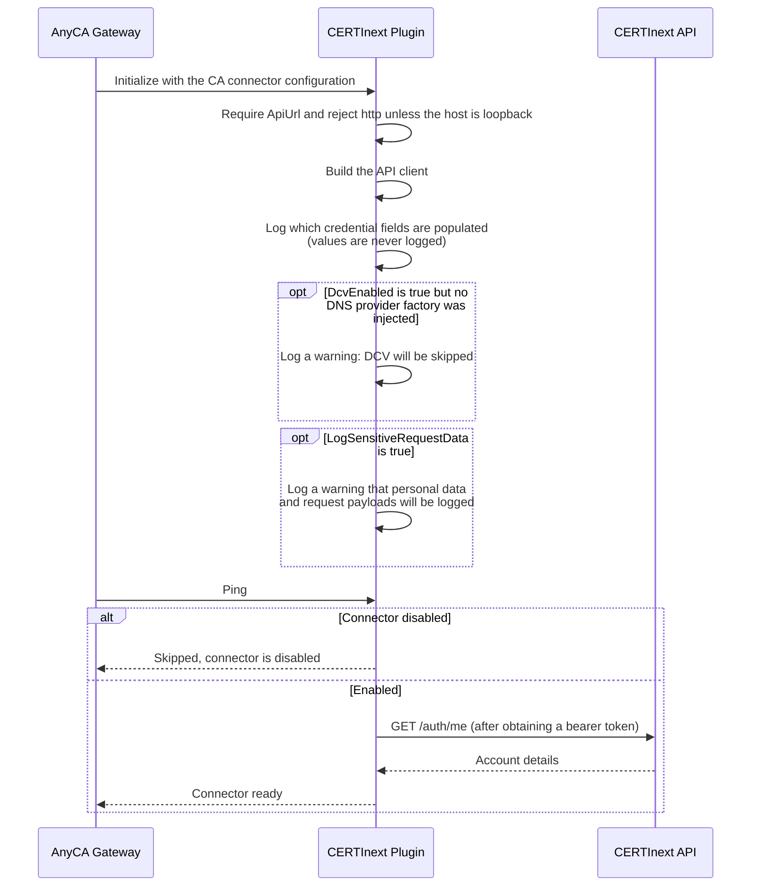
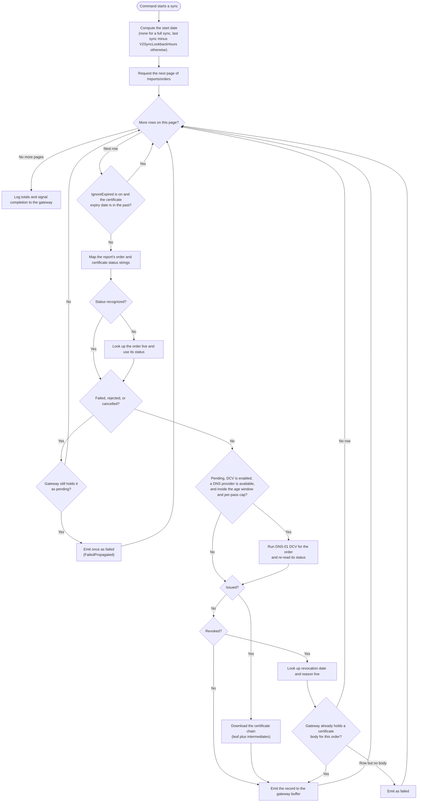
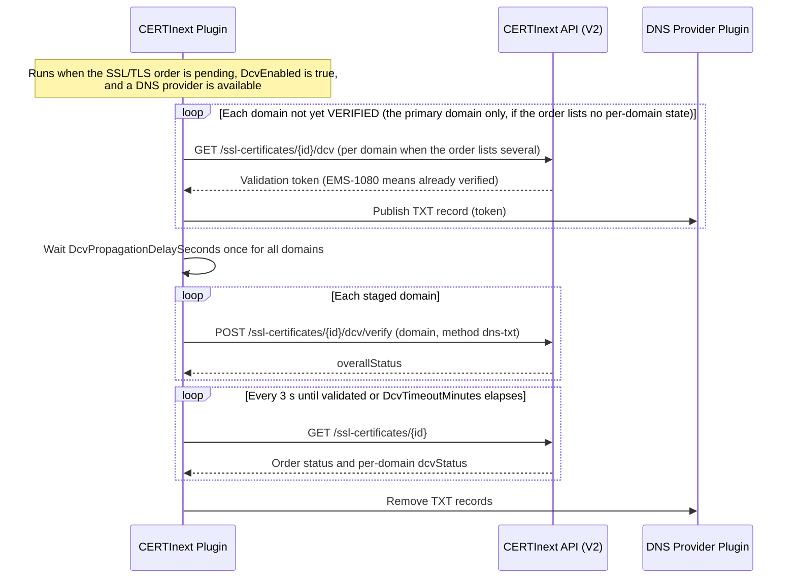
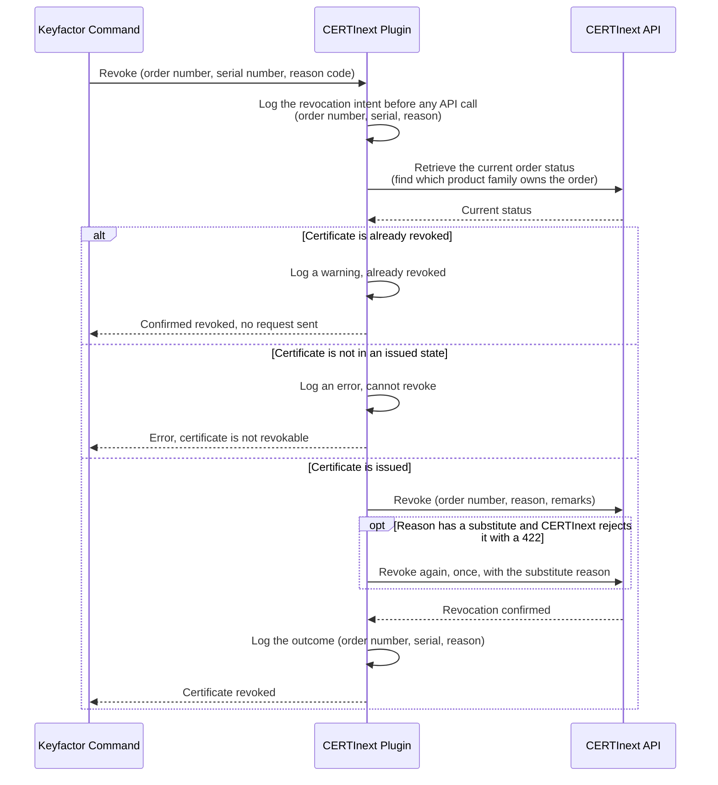
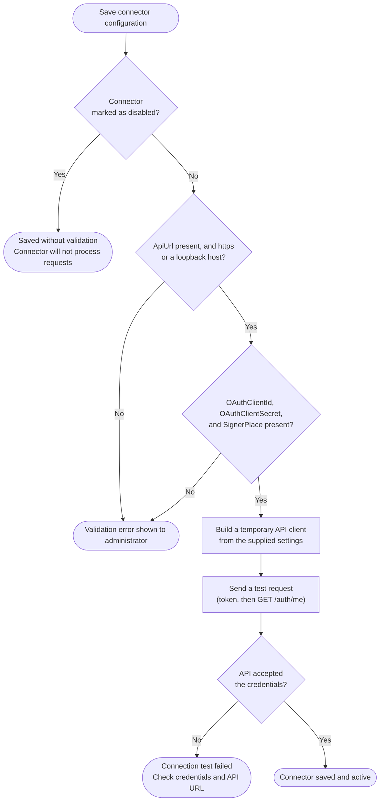

## Architecture

This document describes how the CERTInext AnyCA Gateway REST plugin integrates with Keyfactor Command and the CERTInext certificate authority. It covers the primary certificate lifecycle operations — synchronization, enrollment, domain control validation, and revocation — through the CERTInext V2 API. The deprecated V1 API's flows are described under [Legacy V1 API (Deprecated)](#legacy-v1-api-deprecated).

### Component Overview

```text
┌─────────────────────────────────────────────────────────┐
│                  Keyfactor Command                      │
│                                                         │
│   Certificate Enrollment  ·  Revocation  ·  Sync Jobs   │
└────────────────────────────┬────────────────────────────┘
                             │
                    AnyCA Gateway REST
                    (plugin host process)
                             │
┌────────────────────────────▼────────────────────────────┐
│            CERTInext AnyCA Gateway Plugin               │
│                                                         │
│   Translates Keyfactor operations into CERTInext API    │
│   calls, maps responses back to Command's data model,   │
│   publishes DNS-01 validation records through the       │
│   gateway's DNS provider plugin, and logs every         │
│   operation.                                            │
└────────────────────────────┬────────────────────────────┘
                             │  HTTPS · OAuth2 bearer token          
                             │
┌────────────────────────────▼────────────────────────────┐
│             CERTInext REST API (eMudhra)                │
│                                                         │
│ V2  POST /oauth/token · GET /auth/me                    │
│     GET  /catalog/products · GET /reports/orders        │
│     POST /{family}                 create order         │
│     PUT  /{family}/{id}/csr   (two-call; Private PKI)   │
│     GET  /{family}/{id}            track order          │
│     GET  /{family}/{id}/certificate                     │
│     GET  /ssl-certificates/{id}/dcv                     │
│     POST /ssl-certificates/{id}/dcv/verify              │
│     POST /{family}/{id}/revoke · POST .../cancel        │
└─────────────────────────────────────────────────────────┘
```

`{family}` is `ssl-certificates`, `private-pki-certificates`, or `signature-certificates` (see the [API Endpoint Reference](#api-endpoint-reference)).

### Request Authentication

Every call carries an `Authorization: Bearer` header. The token comes from `POST {ApiUrl}/oauth/token` (`client_credentials`, form-encoded) with `OAuthClientId` and `OAuthClientSecret`. The plugin caches it until 60 seconds before the expiry the token endpoint reports (minimum 30 seconds), and refreshes it thread-safely.

### Certificate Identifiers

CERTInext returns a single `orderId` when the order is created, and the plugin stores it unchanged as the `CARequestID`. Order IDs are numeric (reissues return derived IDs such as `1984857369R001`); see [Behavioral Differences After Migrating](#behavioral-differences-after-migrating).

### Gateway Startup

When the AnyCA Gateway process starts, it loads each configured CA connector. For CERTInext, this step reads the connector settings, checks that the API URL is acceptable, and builds the API client. Credentials are validated when an administrator saves the connector (see [Connector Validation](#connector-validation)) and exercised again by each gateway Ping.



### Synchronization

Keyfactor Command periodically synchronizes its certificate inventory with CERTInext. The plugin retrieves orders page by page and feeds them into Command's database. Synchronization can be a full refresh or incremental.

#### V2 synchronization

Synchronize pages through V2 `/reports/orders` (at most 100 rows per page, scoped to `GroupNumber` when set). An incremental sync asks for orders from `V2SyncLookbackHours` (default 72) before the last sync date, because the report's date filter may bracket either the order date or the issuance date and a slow order must not be missed.



### Single-Record Retrieval

When Command asks for one order (`GetSingleRecord`), for example to refresh a pending certificate, the plugin looks the order up and, if it is still pending, tries to advance it through DNS-01 DCV first.

| Step | Behavior |
|---|---|
| Look up the order | Find the product family that owns the order, then track it |
| Pending order | Run DCV when the order lists a domain, bounded by `DcvTimeoutMinutes`, then track again (a DCV failure is logged and ignored) |
| Issued order | Download the chain, leaf first (a failed download is logged and the record is returned without a body; a 422 `EMS-1165` right after `issued` means "not generated yet" and is logged at Information, not as a warning) |
| Revoked order with no certificate body | Returned as revoked only if the gateway already holds the certificate body; otherwise returned as failed |

The last row is the body-less revoked guard. CERTInext does not serve the body of a revoked order, and a body-less revoked record would break Command's revoked-certificate scans for the whole CA. `Synchronize` applies the same guard but skips the order when the gateway has no row for it, whereas `GetSingleRecord` must return something and so returns failed.

### Domain Control Validation

DNS-01 domain control validation (DCV) proves control of each domain on an order by publishing a TXT record that CERTInext then checks. The plugin publishes and removes the record through the DNS provider plugin the gateway resolves for the domain (`DcvEnabled`, on by default).

- **Where DCV runs.** Inline during `Enroll`, during `Synchronize` for pending orders, and during `GetSingleRecord` for a pending order.
- **Where it never runs.** For an order that is already issued, revoked, cancelled, or rejected, and for Private PKI and Document Signer orders, which have no DCV step.
- **Record name.** The TXT record is published at `DcvTxtRecordTemplate` (default `_emsign-validation.{0}`), with `{0}` replaced by the domain. Domains that SSL.com validates are the exception: the plugin publishes SSL.com's own record name and value (see [SSL.com-validated domains](#sslcom-validated-domains-v2)).
- **Wildcards.** The `*.` label is stripped, so the record is published at the base domain, and a wildcard and its apex on the same order share one record.
- **Which domains.** Every domain on the order that is not yet verified.
- **Skip and continue.** A domain that can't be staged (no DNS provider resolves it, the provider fails, or CERTInext returns no token) is logged and skipped so the other domains can still be validated. The order stays pending until the skipped domain is resolved.
- **Time bounds.** The whole flow for one order is bounded by `DcvTimeoutMinutes`. TXT records are always removed afterward, each removal bounded separately at 60 seconds.

#### V2 DCV



For an order that lists per-domain verification state (a multi-domain order, for example), every domain that is not yet `VERIFIED` is staged, with one propagation wait for the whole batch, and the poll waits until each verified domain shows `VERIFIED` (or `REJECTED`). For a single-domain order the poll waits for the status to leave `pending-dcv`, and if `verify` doesn't report `VERIFIED` the plugin removes the record and leaves the order pending. Either way, the next sync or `GetSingleRecord` call retries only the domains that are still unverified.

##### SSL.com-validated domains (V2)

Before it requests a challenge for a pending domain, the V2 flow looks the domain up (`GET /domains?search={domain}&exactMatch=true`). Each sync pass, and each `Enroll` or single-record DCV attempt, looks a domain up once and reuses the answer, including "no row", for every other order on that domain. A failed lookup isn't reused, so the next order on that domain tries again. A domain whose row says `validatedBy: SSLCOM` uses the domain-level DCV endpoints instead of the order-level ones:

1. `GET /domains/{domainId}/dcv` returns SSL.com's record. If SSL.com reports the domain `VALIDATED`, step 2 is skipped.
2. The plugin picks a `dns-txt` option, preferring the selected one, then one for exactly this name. It publishes that `recordName` and `recordValue` through the DNS provider plugin and ignores `DcvTxtRecordTemplate`. `dns-cname` and `http-url` options are not used, because the DNS provider interface (`IAnyCAPlugin` 3.3) can only publish TXT records.
3. After `DcvPropagationDelaySeconds`, `POST /domains/{domainId}/dcv/verify` is sent with that option's `optionId`. SSL.com waits about 15 seconds before answering.
4. The record is removed.

If no `dns-txt` option is offered, the plugin can't publish anything. If SSL.com can't be reached (502 on either call), or verify answers 422 with `caStatus` `PENDING`, `UNDER_REVIEW`, `FAILED` or `EXPIRED`, the plugin logs a warning with SSL.com's status and reason. In every one of these cases the order stays pending, the next sync or `GetSingleRecord` call retries, and the order is never cancelled. Record values are never logged.

A failed lookup, or a domain with no row, takes the order-level flow above, as before. On a multi-domain order, each domain takes the flow its own row selects. **This path is built from the V2 spec and unit-tested, but has not been verified live:** the sandbox account has no SSL.com-validated domains.

### Certificate Enrollment

When a requester submits a certificate request through Keyfactor Command, the plugin translates the request into a CERTInext order and returns the result. It places a new order for every enrollment type except an SSL/TLS reissue, which uses the reissue endpoint ([V2 reissue](#v2-reissue)).

#### V2 enrollment flow

Every enrollment follows the flow below, with the reissue call in place of the create call for an SSL/TLS reissue. The plugin checks the request locally first, so a template or request that can never succeed is rejected before any order is placed.

```mermaid
flowchart TD
    A([Enroll requested]) --> B["Log the enrollment intent"]
    B --> C{"Request passes local checks?<br/>family is ssl or private-pki, CSR present, SignerPlace set for SSL,<br/>Private PKI variant set,<br/>OrganizationNumber set for OV or EV,<br/>valid subscription and notification settings"}
    C -- No --> X1(["Enrollment rejected, no order placed"])
    C -- Yes --> D{Private PKI?}
    D -- Yes --> G0
    D -- No --> E2["Detect UCC and wildcard from the request:<br/>wildcard domain, UCC template product or extra DNS SANs"]
    E2 --> G0{"SSL/TLS with V2InlineCsr on?<br/>(Private PKI never)"}
    G0 -- "No: two-call (V2InlineCsr false, or Private PKI)" --> G["Create the order without a CSR<br/>(Idempotency-Key header, X-Product-Code only if the template sets ProductCode)"]
    G0 -- "Yes: single call, the default" --> GI["Create the order with the CSR inline, unchanged<br/>(Idempotency-Key header, X-Product-Code only if the template sets ProductCode)"]
    GI --> GI2{"Create call answered?"}
    GI2 -- "Rejected by the CA (HTTP 4xx)" --> X5a(["Enrollment fails, no order was created"])
    GI2 -- "5xx, timeout, or no response" --> X5b(["Enrollment fails with a do-not-resubmit message:<br/>the order may exist and may issue, the next sync imports it"])
    GI2 -- "Yes, order ID returned" --> M["Track the order"]
    G --> H["Submit the CSR unchanged<br/>PUT /{family}/{id}/csr"]
    H --> I{CSR accepted?}
    I -- "Rejected by the CA (HTTP 4xx)" --> J["Cancel the orphaned order once"]
    J --> X4(["Failed result carrying the order ID"])
    I -- "Transport error or timeout" --> K["Track the order"]
    K --> L{"Still pending-csr?"}
    L -- Yes --> J
    L -- "Tracking failed" --> P1(["Pending result with the order ID,<br/>next sync resolves it"])
    L -- "Moved past pending-csr" --> M
    I -- Yes --> M
    M --> M2{Tracking succeeded?}
    M2 -- No --> P1
    M2 -- Yes --> N{"SSL order pending, DCV enabled,<br/>and a DNS provider available?"}
    N -- Yes --> O["Run V2 DCV, then track the order again"]
    N -- No --> Q
    O --> Q{Issued?}
    Q -- Yes --> R["Download the certificate chain"]
    R --> S{Download succeeded?}
    S -- Yes --> T(["Issued result with the PEM chain"])
    S -- No --> U
    Q -- No --> U{"Order still pending, and DCV did not<br/>already wait inside this call?"}
    U -- No --> W
    U -- Yes --> V["Pickup poll<br/>PickupRetries x PickupDelay<br/>track, and download once issued"]
    V --> W{"Order revoked at the CA<br/>before a certificate was delivered?"}
    W -- Yes --> X5(["Failed result"])
    W -- No --> P2(["Issued if the poll found the certificate, failed if the<br/>order was rejected or cancelled, otherwise pending<br/>and picked up by the next sync"])
```



Notes on the V2 flow:

- **Product code.** The spec makes `X-Product-Code` an optional override: CERTInext picks the catalog product itself from the variant, whether the domain is a wildcard (starts with `*.`), and whether `additionalDomains` is non-empty. CERTInext advises sending only the variant, so the plugin sends the header only when the template sets `ProductCode` (or the deprecated `ProfileId`), and sends it as given. The connector's `DefaultProductCode` doesn't affect V2 orders. The create response's `resolvedProductCode` is logged at Information level.
  - **No product-code pre-check.** Enrollment never reads the catalog, with or without `ProductCode`; CERTInext rejects a code it can't use. The order is a wildcard when the domain starts with `*.`. It is multi-domain when the selected product is a UCC product, or when the gateway's SAN list has DNS names beyond the primary domain (its `www.` variant, and a wildcard's bare apex, don't count); those names go out as `additionalDomains`, which is what makes CERTInext choose a UCC product. Command's SAN list is authoritative: a name only in the CSR is ignored (the CSR is still sent unchanged), and the CSR's SANs are used only when the gateway passes no SAN list. This matches the other Keyfactor CA plugins that build a SAN list for their CA.
- **SSL.com organization validation (OV/EV).** Just before the create call, an OV or EV SSL/TLS order reads the organization's SSL.com validation status, refreshes it once if the order's level isn't validated, and, only when `SslComSubmitOrganization` is on and the organization is ready, submits it (accepting SSL.com's subscriber agreement on its behalf, audit-logged). This step is advisory: any failure or not-validated result logs a warning and the order is placed anyway. See [SSL.com organization validation](#sslcom-organization-validation).
- **Multi-domain products.** DNS SANs other than the primary domain are sent as `additionalDomains`, and non-DNS SANs are left off the order with a warning. Private PKI sends DNS and IP SANs as `additionalHosts`.
- **CSR delivery (`V2InlineCsr`).** By default (`V2InlineCsr = true`, SSL/TLS) the CSR is sent inline in the create body exactly as Command supplied it, and there is no Submit CSR step (a `PUT .../csr` after an inline CSR is rejected with HTTP 422). The create call then often holds about 20 seconds until the certificate is issued, and the order ID is known only once it returns. If that call fails with a 5xx or times out, the order may still exist and issue: the failure message says so, the plugin doesn't cancel the order, and the next sync imports it. Private PKI ignores the setting and always uses two calls, because CERTInext rejects an inline CSR on the Private PKI create (HTTP 422). With `V2InlineCsr = false` the plugin creates the order without a CSR and then submits it with `PUT .../csr`, cancelling the orphaned order once if that submit is rejected. That two-call flow fails for a domain the account has already validated: CERTInext reports the order `issued` at create, before any CSR, and then rejects the submit with HTTP 422 "Something went Wrong". A blank CSR is rejected before any CA call.
- **Idempotency.** Order-create, revoke, and cancel calls carry a fresh `Idempotency-Key` UUID. The V2 spec documents that header only for Verify DCV and Domains, as parsed but not yet enforced. On order create, a same-key retry was observed to create a second order behind an HTTP 500, so the plugin never retries an order-create call, and the AnyCA Gateway doesn't retry a timed-out `Enroll`. If an operator resubmits after an order-create error, check the CERTInext portal for an order that was created anyway.
- **Revoked before delivery.** An order CERTInext reports as revoked before any certificate was delivered is returned as failed, never as a revoked record with no certificate.
- **Full certificate chain.** The V2 `/certificate` endpoint returns the leaf in `certificatePem` and intermediates in `chainPem[]`. The plugin concatenates them, leaf first, into one PEM.

### Status Mapping

CERTInext statuses map to the Keyfactor statuses Command understands as follows. This applies to enrollment, synchronization, single-record retrieval, and revocation pre-checks. The status strings are listed under [V2 Order Lifecycle](#v2-order-lifecycle).

| CERTInext | Command status |
|---|---|
| Issued, or expired but not revoked | Issued (an expired certificate stays in inventory) |
| Any pending state (approval, validation, CSR, agreement, documents, `unknown`) | Pending external validation |
| Revoked | Revoked |
| Rejected, cancelled, or an unrecognized status | Failed |

### Revocation

When a certificate is revoked in Keyfactor Command, the plugin verifies the certificate's current state before calling the CERTInext revocation endpoint. This prevents unnecessary API calls for certificates that are already revoked or in a non-revokable state.



- **Idempotency.** If Command retries a revocation (for example after a timeout), the plugin sees the certificate is already revoked and returns success without a duplicate request to CERTInext.
- **Audit trail.** The revocation intent is written to the gateway log *before* the API call, so it is recorded even if the call fails.
- **Not revokable.** A 404 from the revoke endpoint means the order was not found or is not in a revokable state. The plugin has already located the order's product family, so it reports that plainly instead of probing the other families.
- **Note field.** CERTInext rejects a semicolon (`;`) in the revoke `note` (audit remarks) with a separate 422, "Invalid Revoke Remarks." Commas, periods, slashes, and parentheses are accepted. The plugin's generated notes avoid semicolons.

#### Revocation Reason Codes

The plugin translates the RFC 5280 code Command supplies into a kebab-case `reason` string.

| Command reason (CRL code) | Sent as | If CERTInext rejects it |
|---|---|---|
| Unspecified (0) | `unspecified` | Rejected; retried once as `cessation-of-operation` |
| Key compromise (1) | `key-compromise` | Accepted |
| CA compromise (2) | `ca-compromise` | Rejected; retried once as `key-compromise` |
| Affiliation changed (3) | `affiliation-changed` | Accepted |
| Superseded (4) | `superseded` | Accepted |
| Cessation of operation (5) | `cessation-of-operation` | Accepted |
| Certificate hold (6) | `certificate-hold` | Rejected; retried once as `cessation-of-operation` |
| Privilege withdrawn (9) | `privilege-withdrawn` | Rejected on SSL/TLS since 2026-11-13 (the 2.0.0 spec no longer lists it); retried once as `cessation-of-operation` |
| AA compromise (10) | `aa-compromise` | Rejected; retried once as `key-compromise` |
| Any other code (for example 8, `removeFromCRL`) | `unspecified` | Same as Unspecified |

- **What CERTInext accepts.** On SSL/TLS: key compromise (1), affiliation changed (3), superseded (4), and cessation of operation (5). Privilege withdrawn (9) was accepted until CERTInext began rejecting it (seen 2026-11-13); the plugin still sends it first, and only a rejection triggers the substitute.
- **Rejection wording.** CERTInext has answered a rejected reason with 422 "Invalid Revoke Reason ID" and, more recently, 422 "Revocation reason {reason} is not allowed." Both trigger the retry.
- **V2 spec versus live behavior.** The 2.0.0 spec's SSL/TLS revoke enum has 9 values: `unspecified`, `key-compromise`, `ca-compromise`, `affiliation-changed`, `superseded`, `cessation-of-operation`, `certificate-hold`, `remove-from-crl`, and `aa-compromise`. It doesn't list `privilege-withdrawn`. Live rejects `unspecified`, `ca-compromise`, `certificate-hold`, and `aa-compromise`, and, since 2026-11-13, `privilege-withdrawn`.
- **Retry rule.** The plugin retries a rejected reason once with the substitute in the table; any other revoke failure is surfaced as-is.
- **Why `cessation-of-operation`.** It substitutes for `unspecified` and `certificate-hold` because neither implies a key compromise, and `key-compromise` carries the V2 spec's Baseline Requirements §4.9.1.1 24-hour CRL-turnaround obligation, which would misrepresent the revoke. `unspecified` is Command's default reason, so it is the most common revoke case. `privilege-withdrawn` gets the same substitute for the same reason.

### Connector Validation

When an administrator saves or edits a CERTInext CA connector in the Keyfactor Command Management Portal, the gateway validates the configuration and performs a live connectivity check.



**Disabled connectors:** setting `Enabled` to `false` allows the connector record to be created and saved before credentials are available. The live connectivity test is skipped, so no credentials are required at save time.

The same https-or-loopback check runs again at gateway startup, so a connector saved with an `http` URL before the check existed fails to start until its URL is corrected.

#### Template validation

When an administrator saves a certificate template, the gateway asks the plugin to validate its product settings:

- an explicit `ProductCode` is optional and isn't checked against the catalog (CERTInext rejects a code it can't use when the order is placed);
- an SSL template's `ProductVariant` must agree with the selected product;
- a Private PKI template needs a Private PKI `ProductVariant`;
- `OrgRepresentative*` parameters must follow CERTInext's rules (OV only, `OrganizationNumber` set, name and email together, a valid email and phone).

Any failure is shown to the administrator with the field to fix.

### API Endpoint Reference

The table below maps each Keyfactor Command operation to the CERTInext API endpoint it calls.

| Operation | V2 endpoint |
|---|---|
| Obtain Bearer token | `POST /oauth/token` |
| Test connection | `GET /api/certinext/v2/auth/me` |
| Create order | `POST /api/certinext/v2/{family}` (carries the CSR inline for SSL/TLS by default, `V2InlineCsr`) |
| Submit CSR | `PUT /api/certinext/v2/{family}/{orderId}/csr` (two-call flow: always for Private PKI, and SSL/TLS with `V2InlineCsr = false`) |
| Check order status | `GET /api/certinext/v2/{family}/{orderId}` |
| Get DCV challenge (SSL/TLS only) | `GET /api/certinext/v2/ssl-certificates/{orderId}/dcv` (with `?domain=` per domain) |
| Verify DCV (SSL/TLS only) | `POST /api/certinext/v2/ssl-certificates/{orderId}/dcv/verify` |
| Download certificate | `GET /api/certinext/v2/{family}/{orderId}/certificate` |
| Reissue (SSL/TLS only) | `POST /api/certinext/v2/ssl-certificates/{orderId}/reissue` |
| Accept the Subscriber Agreement (SSL/TLS only) | `POST /api/certinext/v2/ssl-certificates/{orderId}/agreement` |
| Look up a domain; SSL.com domain DCV | `GET /api/certinext/v2/domains`, `GET /api/certinext/v2/domains/{domainId}/dcv`, `POST /api/certinext/v2/domains/{domainId}/dcv/verify` |
| SSL.com organization validation (OV/EV) | `GET` and `POST /api/certinext/v2/organizations/{orgNumber}/ca-validations/sslcom`, `POST .../sslcom/sync` |
| Revoke certificate | `POST /api/certinext/v2/{family}/{orderId}/revoke` |
| Cancel an orphaned order | `POST /api/certinext/v2/{family}/{orderId}/cancel` |
| List available products | `GET /api/certinext/v2/catalog/products` |
| Synchronize inventory | `GET /api/certinext/v2/reports/orders` (paginated) |

`{family}` is `ssl-certificates`, `private-pki-certificates`, or `signature-certificates`. The plugin finds the family that owns an existing order by tracking it in each family in that order.


