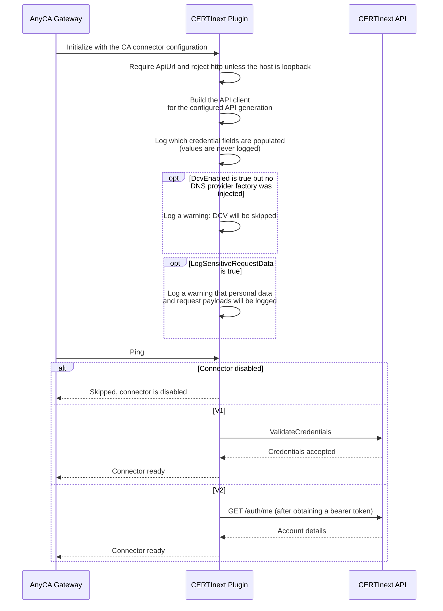
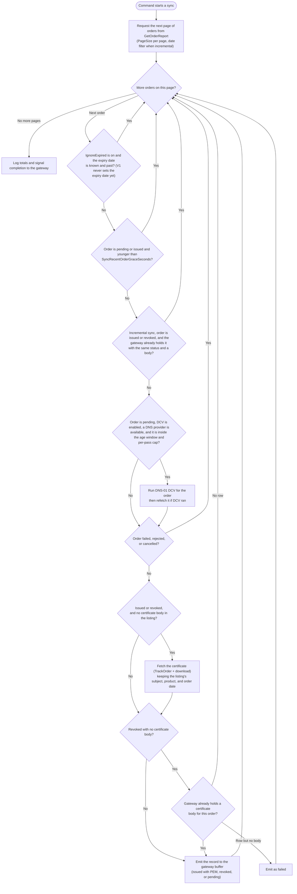
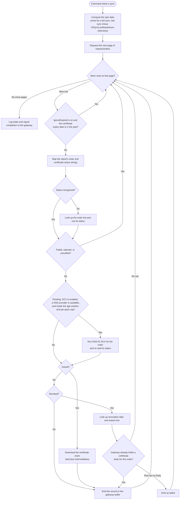
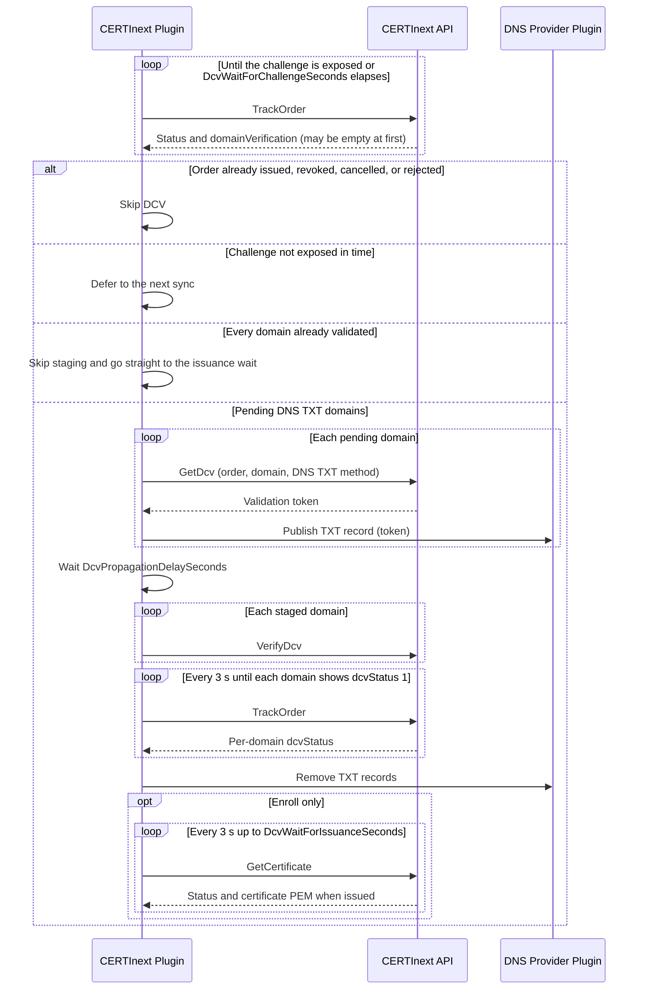
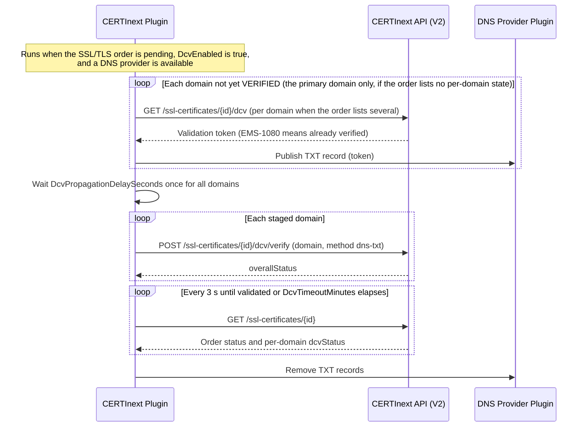
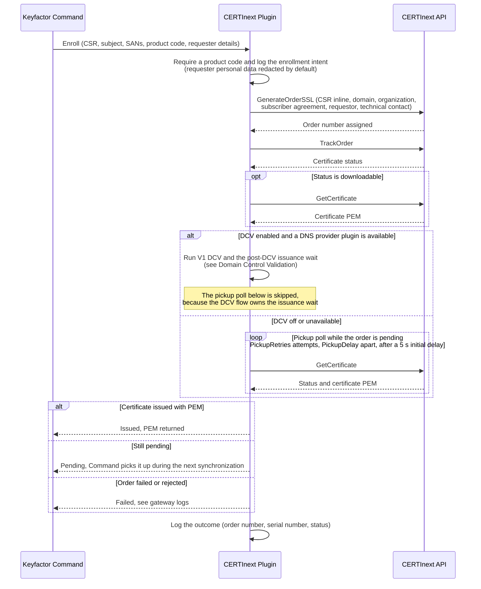
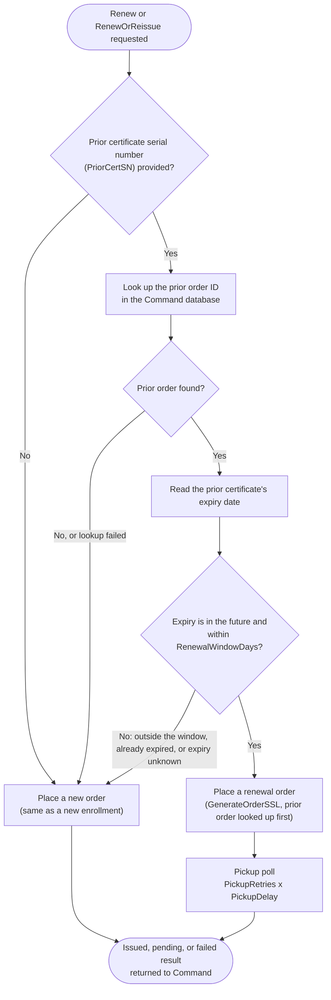
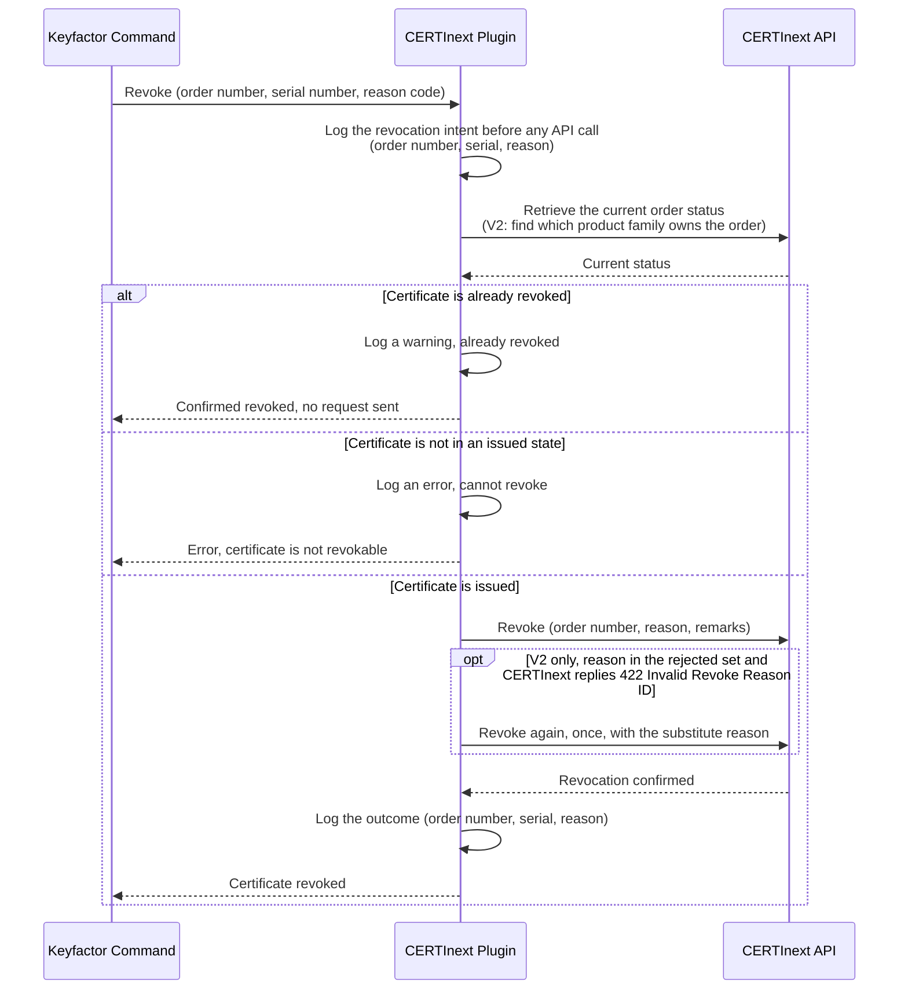
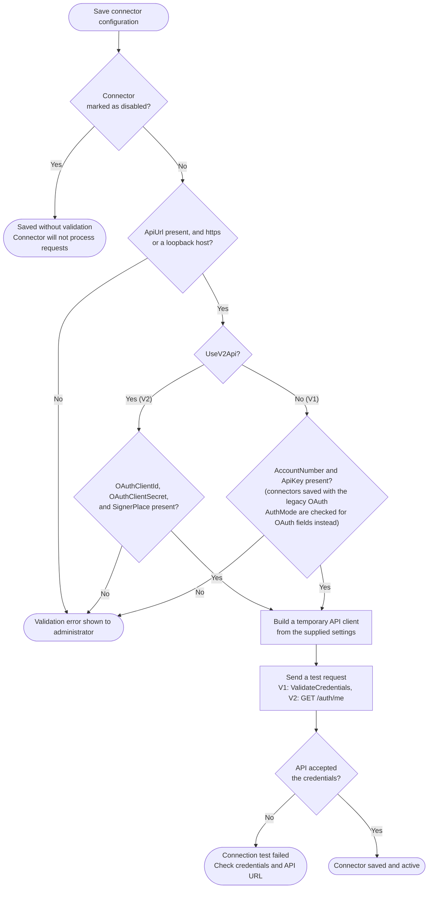

## Architecture

This document describes how the CERTInext AnyCA Gateway REST plugin integrates with Keyfactor Command and the CERTInext certificate authority. It covers the primary certificate lifecycle operations — synchronization, enrollment, domain control validation, and revocation — for both CERTInext API generations (V1 and V2), and how the plugin routes each one.

### Component Overview

```text
┌─────────────────────────────────────────────────────────┐
│                  Keyfactor Command                      │
│                                                         │
│   Certificate Enrollment  ·  Revocation  ·  Sync Jobs   │
└────────────────────────────┬────────────────────────────┘
                             │
                    AnyCA Gateway REST
                    (plugin host process)
                             │
┌────────────────────────────▼────────────────────────────┐
│            CERTInext AnyCA Gateway Plugin               │
│                                                         │
│   Translates Keyfactor operations into CERTInext API    │
│   calls, maps responses back to Command's data model,   │
│   publishes DNS-01 validation records through the       │
│   gateway's DNS provider plugin, and logs every         │
│   operation.                                            │
└────────────────────────────┬────────────────────────────┘
                             │  HTTPS · AccessKey (V1) or OAuth2 bearer
                             │
┌────────────────────────────▼────────────────────────────┐
│             CERTInext REST API (eMudhra)                │
│                                                         │
│ V1  ValidateCredentials · GenerateOrderSSL              │
│     TrackOrder · GetCertificate · GetOrderReport        │
│     RevokeOrder · GetProductDetails                     │
│     GetDcv · VerifyDcv                                  │
│                                                         │
│ V2  POST /oauth/token · GET /auth/me                    │
│     GET  /catalog/products · GET /reports/orders        │
│     POST /{family}                 create order         │
│     PUT  /{family}/{id}/csr   (two-call, the default)   │
│     GET  /{family}/{id}            track order          │
│     GET  /{family}/{id}/certificate                     │
│     GET  /ssl-certificates/{id}/dcv                     │
│     POST /ssl-certificates/{id}/dcv/verify              │
│     POST /{family}/{id}/revoke · POST .../cancel        │
└─────────────────────────────────────────────────────────┘
```

`{family}` is `ssl-certificates`, `private-pki-certificates`, or `signature-certificates` (see the [API Endpoint Reference](#api-endpoint-reference)).

### V1 and V2 at a Glance

`UseV2Api` selects one API generation for the whole connector; the two cannot be mixed.

| Aspect | V1 (default) | V2 (`UseV2Api` = `true`) |
|---|---|---|
| Authentication | Access key, sent as `meta.authKey` | OAuth2 `client_credentials` bearer token |
| `ApiUrl` | Includes the `/emSignHub-API/` path | Bare host, no path |
| Order ID (`CARequestID`) | Order number (a request number comes first) | Single `orderId`, stored unchanged |
| Sync source | `GetOrderReport`, filtered by order date (`yyyy-MM-dd`), no lookback | `/reports/orders`, from `V2SyncLookbackHours` (default 72) before the last sync |
| `IgnoreExpired` | Not applied yet | Applied |
| Renewal | Renewal window (`RenewalWindowDays`), otherwise a new order | Every enrollment type places a new order |
| DCV waits | `DcvWaitForChallengeSeconds`, `DcvWaitForIssuanceSeconds` | None; polls until the order leaves `pending-dcv`, bounded by `DcvTimeoutMinutes` |
| Revoke reasons | Numeric `revokeReasonId`; unaccepted codes sent as key compromise | Kebab-case strings; four rejected values retried once with a substitute |
| Product code | `ProductCode`, then `ProfileId`, then the built-in default for the selected product | `ProductCode`, then the live catalog, then `DefaultProductCode` among several matches |

### Request Authentication

| Mode | Credential | Sent as | `meta.authKey` |
|---|---|---|---|
| V1 | Access key (`ApiKey`) and `AccountNumber` | A `meta` block in every JSON request body (`ver`, `ts`, `txn`, `accountNumber`, `authKey`) | `SHA256(accessKey + ts + txn)` as lowercase hex |
| V2 (`UseV2Api` = `true`) | OAuth2 client ID and secret (`OAuthClientId`, `OAuthClientSecret`) | `Authorization: Bearer` header; the token comes from `POST {ApiUrl}/oauth/token` (`client_credentials`, form-encoded) | Not used |

- **V1 `authKey`.** A plain SHA-256 digest, not an HMAC. The access key is never transmitted; only the digest is sent. `ts` is a timestamp and `txn` is a random numeric transaction ID generated for each request, and both travel in `meta` so CERTInext can recompute the digest. The plugin does this automatically.
- **V2 tokens.** The plugin caches the bearer token until 60 seconds before the expiry the token endpoint reports (minimum 30 seconds), and refreshes it thread-safely.
- **V1 OAuth is unsupported.** The `AuthMode=OAuth` and `OAuthTokenUrl` settings are legacy: the live V1 API ignores a bearer token and rejects the call with 401 "clientAccessKey is not active". The code still accepts them for connectors that were already saved with that mode.

### Certificate Identifiers

V1 assigns two different reference numbers to each order. Understanding the difference matters when tracing certificates across systems:

| Identifier | When it is assigned | What it is used for |
|---|---|---|
| **Request Number** | Immediately when an order is created | Tracking a draft order before it is formally submitted; attaching a CSR to a pending order |
| **Order Number** | After the order is formally submitted and accepted | All post-issuance operations: checking status, downloading the certificate, revoking — **this is the identifier stored in Keyfactor Command** |

V2 returns a single `orderId` when the order is created, and the plugin stores it unchanged as the `CARequestID`. V2 order IDs are numeric, in the same format as V1 order numbers; see [Behavioral Differences After Migrating](#behavioral-differences-after-migrating).

### Gateway Startup

When the AnyCA Gateway process starts, it loads each configured CA connector. For CERTInext, this step reads the connector settings, checks that the API URLs are acceptable, and builds the API client. Credentials are validated separately, when an administrator saves the connector (see [Connector Validation](#connector-validation)).



### Synchronization

Keyfactor Command periodically synchronizes its certificate inventory with CERTInext. The plugin retrieves orders page by page and feeds them into Command's database. Synchronization can be a full refresh or incremental. V1 and V2 differ in the report they read and in how they classify each order.

#### V1 synchronization

A full sync reads every order in the account. An incremental sync requests only orders placed on or after the date of the previous sync. The filter is a date only (`yyyy-MM-dd`) on the order date, with no lookback, so an older order that is slow to issue is missed by incremental syncs; run a full sync to import it. V2 avoids this with `V2SyncLookbackHours`. The one exception is the recent-order hold-back below, which moves the incremental start back by the hold window.



- **Errors.** If processing an order throws, the plugin logs and counts the error and moves on to the next order. After at least 50 records, if more than 25 percent have errored, the sync aborts and is retried on the next cycle instead of completing with mostly failed records. V2 synchronization applies the same rule.
- **Recent-order hold-back.** A pending or issued order created less than `SyncRecentOrderGraceSeconds` (default 120, plus a 5-second clock margin) ago is not emitted, and issued ones are not downloaded, so a sync cannot insert the gateway row an in-flight enrollment is about to save and make that enrollment fail with a duplicate key. The next incremental pass imports the order. To keep a held order created just before UTC midnight in that next listing, the incremental start date is moved back by the grace window, the 5-second margin, and 5 minutes of slack. Revoked and failed orders, and orders with no usable order date, are never held. `0` disables the hold.
- **Unchanged orders.** The listing filter is a calendar day, so an incremental sync re-lists every order placed that day. On an incremental sync, an order listed as issued or revoked is skipped, with no `TrackOrder` or certificate download, when the gateway already holds it with the same status and a stored certificate body. New orders, status changes (pending to issued, issued to revoked), rows stored without a body, and a failed or unavailable lookup are processed as before. Pending orders and full syncs are unchanged. The sync summary reports `UnchangedInGateway`. V2 does not do this yet.
- **Revoked orders without a certificate body.** The V1 client never downloads a revoked order's certificate, so a revoked order is emitted as revoked only if the gateway already holds the certificate body. If the gateway has the order's row but no body it is emitted as failed, and if the gateway has no row for it (or the check cannot be made) the order is skipped. See [Single-Record Retrieval](#single-record-retrieval).
- **Expired certificates.** `IgnoreExpired` is applied on V2 only. On V1 the order report never populates a certificate expiry date, so the setting has no effect yet and expired certificates are imported.
- **DCV during sync.** Pending orders go through DNS-01 validation only while younger than `DcvSyncMaxOrderAgeHours` (older orders are reported as pending and left alone) and only up to `DcvSyncMaxPerPass` orders per pass, so a backlog of stalled orders can't slow every sync.
- **DCV timing.** The V1 sync path uses a short fixed propagation delay and a single-shot challenge check rather than the longer `Enroll` waits. See [Domain Control Validation](#domain-control-validation).

#### V2 synchronization

With `UseV2Api = true`, Synchronize pages through V2 `/reports/orders` (at most 100 rows per page, scoped to `GroupNumber` when set). An incremental sync asks for orders from `V2SyncLookbackHours` (default 72) before the last sync date, because the report's date filter may bracket either the order date or the issuance date and a slow order must not be missed.



### Single-Record Retrieval

When Command asks for one order (`GetSingleRecord`), for example to refresh a pending certificate, the plugin looks the order up and, if it is still pending, tries to advance it through DNS-01 DCV first.

| Step | V1 | V2 |
|---|---|---|
| Look up the order | `TrackOrder`, then `GetCertificate` when the order is downloadable | Find the product family that owns the order, then track it |
| Pending order | Run DCV, then refetch the certificate if DCV ran (a failed refetch is logged and the earlier result is returned) | Run DCV when the order lists a domain, bounded by `DcvTimeoutMinutes`, then track again (a DCV failure is logged and ignored) |
| Issued order | Certificate PEM from `GetCertificate` | Download the chain, leaf first (a failed download is logged and the record is returned without a body) |
| Revoked order with no certificate body | Status, date, and reason come from `TrackOrder`. Returned as revoked only if the gateway already holds the certificate body; otherwise returned as failed | Returned as revoked only if the gateway already holds the certificate body; otherwise returned as failed |

The last row is the body-less revoked guard, which applies to both V1 and V2. CERTInext does not serve the body of a revoked order, and a body-less revoked record would break Command's revoked-certificate scans for the whole CA. `Synchronize` applies the same guard but skips the order when the gateway has no row for it, whereas `GetSingleRecord` must return something and so returns failed.

### Domain Control Validation

DNS-01 domain control validation (DCV) proves control of each domain on an order by publishing a TXT record that CERTInext then checks. The plugin publishes and removes the record through the DNS provider plugin the gateway resolves for the domain (`DcvEnabled`, on by default).

- **Where DCV runs.** Inline during `Enroll`, during `Synchronize` for pending orders, and during `GetSingleRecord` for a pending order.
- **Where it never runs.** For an order that is already issued, revoked, cancelled, or rejected. V2 also skips Private PKI and Document Signer orders, which have no DCV step.
- **Record name.** The TXT record is published at `DcvTxtRecordTemplate` (default `_emsign-validation.{0}`), with `{0}` replaced by the domain.
- **Wildcards.** The `*.` label is stripped, so the record is published at the base domain, and a wildcard and its apex on the same order share one record.
- **Which domains.** V1 processes only domains CERTInext lists as pending that are unassigned or assigned to the DNS TXT method. V2 processes every domain that is not yet verified.
- **Skip and continue.** A domain that can't be staged (no DNS provider resolves it, the provider fails, or CERTInext returns no token) is logged and skipped so the other domains can still be validated. The order stays pending until the skipped domain is resolved.
- **Time bounds.** The whole flow for one order is bounded by `DcvTimeoutMinutes`. TXT records are always removed afterward, each removal bounded separately at 60 seconds.

#### V1 DCV



If `GetDcv` returns `EMS-956` (CERTInext lists the challenge before it accepts calls for the order), the whole pass is deferred to the next sync. On the sync and single-record paths the plugin refetches the certificate after DCV instead of running the issuance wait.

#### V2 DCV



For an order that lists per-domain verification state (a multi-domain order, for example), every domain that is not yet `VERIFIED` is staged, with one propagation wait for the whole batch, and the poll waits until each verified domain shows `VERIFIED` (or `REJECTED`). For a single-domain order the poll waits for the status to leave `pending-dcv`, and if `verify` doesn't report `VERIFIED` the plugin removes the record and leaves the order pending. Either way, the next sync or `GetSingleRecord` call retries only the domains that are still unverified.

### Certificate Enrollment

When a requester submits a certificate request through Keyfactor Command, the plugin translates the request into a CERTInext order and returns the result. V1 and V2 follow different flows. V1 handles renewals specially (see [V1 renewal and RenewOrReissue](#v1-renewal-and-reneworreissue)), while V2 places a new order for every enrollment type.

#### V1 enrollment (New or Reissue)



- **Issued but not yet downloadable.** An order CERTInext reports as issued before the certificate can be downloaded is returned as pending, not as an issued result with no certificate.
- **OV and EV.** These orders issue after organization verification (minutes to hours) and almost always exhaust the pickup window, so the next synchronization imports them.
- **Rate limiting.** A rate-limit rejection (`Inactive Account User.`) on order placement is retried with backoff before the failure is surfaced.
- **Synchronous pickup.** After placing an order, the plugin polls CERTInext up to `PickupRetries` times (default 5), `PickupDelay` seconds apart (default 10), after a fixed 5-second initial delay and within a hard ceiling of 75 seconds, which keeps the call inside Command's own enrollment timeout of about 100 seconds. This lets fast-issuing DV certificates come back in the same enrollment call; only a result with a certificate body counts as issued.

#### V1 renewal and RenewOrReissue

When Command initiates a renewal, the plugin checks whether the prior certificate is within the configured renewal window. Inside the window it places a renewal order; outside the window, or when the prior certificate can't be found, it places a new order.

> **Note:** CERTInext does not have a dedicated certificate renewal endpoint. Both paths submit a new `GenerateOrderSSL` order; the prior order is not revoked. The distinction determines how the request is built, not which endpoint is called. A renewal order does not run inline DCV; sync-driven DCV completes a pending DV renewal.

> **Note:** If the prior-order lookup itself throws (rather than cleanly returning "not found" — for example a transient database error), the plugin falls back to a new order rather than failing the enrollment.



#### V2 enrollment flow

With `UseV2Api = true`, every enrollment type (New, Reissue, Renew, RenewOrReissue) takes the same path and places a new order. The plugin checks the request locally first, so a template or request that can never succeed is rejected before any order is placed.

```mermaid
flowchart TD
    A([Enroll requested]) --> B["Log the enrollment intent"]
    B --> C{"Request passes local checks?<br/>family is ssl or private-pki, CSR present, SignerPlace set for SSL,<br/>Private PKI variant and ProductCode set,<br/>OrganizationNumber set for OV or EV,<br/>valid subscription and notification settings"}
    C -- No --> X1(["Enrollment rejected, no order placed"])
    C -- Yes --> D{Private PKI?}
    D -- Yes --> G0
    D -- No --> E["Fetch the product catalog<br/>and resolve the product code and product type"]
    E --> F{"Code resolved?<br/>Explicit ProductCode, or exactly one catalog match,<br/>or DefaultProductCode among several"}
    F -- No --> X2(["Failed result listing the candidates, no order placed"])
    F -- Yes --> F2{"Single-domain product with extra DNS SANs<br/>in the CSR or SAN list?"}
    F2 -- Yes --> X3(["Failed result, no order placed"])
    F2 -- No --> G0{"SSL/TLS with V2InlineCsr on?<br/>(Private PKI never)"}
    G0 -- "No: two-call, the default" --> G["Create the order without a CSR<br/>(X-Product-Code and Idempotency-Key headers)"]
    G0 -- "Yes: single call" --> GI["Create the order with the CSR inline, unchanged<br/>(X-Product-Code and Idempotency-Key headers)"]
    GI --> GI2{"Create call answered?"}
    GI2 -- "Rejected by the CA (HTTP 4xx)" --> X5a(["Enrollment fails, no order was created"])
    GI2 -- "5xx, timeout, or no response" --> X5b(["Enrollment fails with a do-not-resubmit message:<br/>the order may exist and may issue, the next sync imports it"])
    GI2 -- "Yes, order ID returned" --> M["Track the order"]
    G --> H["Submit the CSR unchanged<br/>PUT /{family}/{id}/csr"]
    H --> I{CSR accepted?}
    I -- "Rejected by the CA (HTTP 4xx)" --> J["Cancel the orphaned order once"]
    J --> X4(["Failed result carrying the order ID"])
    I -- "Transport error or timeout" --> K["Track the order"]
    K --> L{"Still pending-csr?"}
    L -- Yes --> J
    L -- "Tracking failed" --> P1(["Pending result with the order ID,<br/>next sync resolves it"])
    L -- "Moved past pending-csr" --> M
    I -- Yes --> M
    M --> M2{Tracking succeeded?}
    M2 -- No --> P1
    M2 -- Yes --> N{"SSL order pending, DCV enabled,<br/>and a DNS provider available?"}
    N -- Yes --> O["Run V2 DCV, then track the order again"]
    N -- No --> Q
    O --> Q{Issued?}
    Q -- Yes --> R["Download the certificate chain"]
    R --> S{Download succeeded?}
    S -- Yes --> T(["Issued result with the PEM chain"])
    S -- No --> U
    Q -- No --> U{"Order still pending, and DCV did not<br/>already wait inside this call?"}
    U -- No --> W
    U -- Yes --> V["Pickup poll<br/>PickupRetries x PickupDelay<br/>track, and download once issued"]
    V --> W{"Order revoked at the CA<br/>before a certificate was delivered?"}
    W -- Yes --> X5(["Failed result"])
    W -- No --> P2(["Issued if the poll found the certificate, failed if the<br/>order was rejected or cancelled, otherwise pending<br/>and picked up by the next sync"])
```



Notes on the V2 flow:

- **Product code.** For SSL/TLS, the plugin fetches the live catalog once per enrollment and resolves the code in this order:
  1. An explicit `ProductCode` is used as given. The catalog is then used only to recognize multi-domain and wildcard products; if it can't be fetched, the order proceeds as single-domain, so a request with extra SANs is rejected rather than silently accepted.
  2. Otherwise the catalog entry whose product type matches the selected product is used, and the enrollment fails if none match.
  3. If several entries match, `DefaultProductCode` must name one of them, or the enrollment fails and lists the candidates.

  Private PKI never fetches the catalog. Its `ProductCode` is required and was validated when the template was saved.
- **Multi-domain products.** DNS SANs other than the primary domain are sent as `additionalDomains`, and non-DNS SANs are left off the order with a warning. Private PKI sends DNS and IP SANs as `additionalHosts`.
- **CSR delivery (`V2InlineCsr`).** By default the plugin creates the order without a CSR and then submits it with `PUT .../csr`; if that submit is rejected, the plugin cancels the orphaned order once. With `V2InlineCsr = true` (SSL/TLS only), the CSR is sent inline in the create body exactly as Command supplied it, and there is no Submit CSR step (a `PUT .../csr` after an inline CSR is rejected with HTTP 422). The create call then often holds about 20 seconds until the certificate is issued, and the order ID is known only once it returns. If that call fails with a 5xx or times out, the order may still exist and issue: the failure message says so, the plugin doesn't cancel the order, and the next sync imports it. Private PKI ignores the setting and always uses two calls, because CERTInext rejects an inline CSR on the Private PKI create (HTTP 422). In both modes the create call is pinned with `X-Product-Code`, because an unpinned SSL create resolves to a CERTInext default product whose Submit CSR is rejected ("PFX based certificate orders are not allowed"). A blank CSR is rejected before any CA call.
- **Idempotency.** Order-create, revoke, and cancel calls carry a fresh `Idempotency-Key` UUID. The V2 spec documents that header only for Verify DCV and Domains, as parsed but not yet enforced. On order create, a same-key retry was observed to create a second order behind an HTTP 500, so the plugin never retries an order-create call, and the AnyCA Gateway doesn't retry a timed-out `Enroll`. If an operator resubmits after an order-create error, check the CERTInext portal for an order that was created anyway.
- **Revoked before delivery.** An order CERTInext reports as revoked before any certificate was delivered is returned as failed, never as a revoked record with no certificate.
- **Full certificate chain.** The V2 `/certificate` endpoint returns the leaf in `certificatePem` and intermediates in `chainPem[]`. The plugin concatenates them, leaf first, into one PEM.

### Status Mapping

CERTInext statuses map to the Keyfactor statuses Command understands as follows. This applies to enrollment, synchronization, single-record retrieval, and revocation pre-checks. The V2 status strings are listed under [V2 Order Lifecycle](#v2-order-lifecycle); V1 uses CERTInext's numeric certificate status codes.

| CERTInext | Command status |
|---|---|
| Issued, or expired but not revoked | Issued (an expired certificate stays in inventory) |
| Any pending state (approval, validation, CSR, agreement, documents, `unknown`) | Pending external validation |
| Revoked | Revoked |
| Rejected, cancelled, or an unrecognized status | Failed |

### Revocation

When a certificate is revoked in Keyfactor Command, the plugin verifies the certificate's current state before calling the CERTInext revocation endpoint. This prevents unnecessary API calls for certificates that are already revoked or in a non-revokable state.



- **Idempotency.** If Command retries a revocation (for example after a timeout), the plugin sees the certificate is already revoked and returns success without a duplicate request to CERTInext.
- **Audit trail.** The revocation intent is written to the gateway log *before* the API call, so it is recorded even if the call fails.
- **V2 not revokable.** A 404 from the V2 revoke endpoint means the order was not found or is not in a revokable state. The plugin has already located the order's product family, so it reports that plainly instead of probing the other families.
- **Note field.** CERTInext rejects a semicolon (`;`) in the revoke `note` (audit remarks) with a separate 422, "Invalid Revoke Remarks." Commas, periods, slashes, and parentheses are accepted. The plugin's generated notes avoid semicolons.

#### Revocation Reason Codes

V1 sends a numeric `revokeReasonId`; V2 sends a kebab-case `reason` string. The plugin translates the RFC 5280 code Command supplies.

| Command reason (CRL code) | V1 sends | V2 sends | If CERTInext rejects it |
|---|---|---|---|
| Unspecified (0) | Key compromise (1) | `unspecified` | Rejected on V2; retried once as `cessation-of-operation` |
| Key compromise (1) | 1 | `key-compromise` | Accepted |
| CA compromise (2) | Key compromise (1) | `ca-compromise` | Rejected on V2; retried once as `key-compromise` |
| Affiliation changed (3) | 3 | `affiliation-changed` | Accepted |
| Superseded (4) | 4 | `superseded` | Accepted |
| Cessation of operation (5) | 5 | `cessation-of-operation` | Accepted |
| Certificate hold (6) | Key compromise (1) | `certificate-hold` | Rejected on V2; retried once as `cessation-of-operation` |
| Privilege withdrawn (9) | 9 | `privilege-withdrawn` | Accepted |
| AA compromise (10) | Key compromise (1) | `aa-compromise` | Rejected on V2; retried once as `key-compromise` |
| Any other code (for example 8, `removeFromCRL`) | Key compromise (1) | `unspecified` | Same as Unspecified |

- **What CERTInext accepts.** Only key compromise (1), affiliation changed (3), superseded (4), cessation of operation (5), and privilege withdrawn (9), on both API generations. V1 never sends anything else, so it needs no retry.
- **V2 spec versus live behavior.** The V2 spec documents 8 reason values for the SSL/TLS revoke endpoint (`aa-compromise` is listed only for the Private PKI and Document Signer endpoints). Live, SSL/TLS orders reject four of the values, `unspecified`, `ca-compromise`, `certificate-hold`, and `aa-compromise`, with 422 "Invalid Revoke Reason ID".
- **Retry rule.** The plugin retries a rejected reason once with the substitute in the table; any other revoke failure is surfaced as-is.
- **Why `cessation-of-operation`.** It substitutes for `unspecified` and `certificate-hold` because neither implies a key compromise, and `key-compromise` carries the V2 spec's Baseline Requirements §4.9.1.1 24-hour CRL-turnaround obligation, which would misrepresent the revoke. `unspecified` is Command's default reason, so it is the most common revoke case.

### Connector Validation

When an administrator saves or edits a CERTInext CA connector in the Keyfactor Command Management Portal, the gateway validates the configuration and performs a live connectivity check.



**Disabled connectors:** setting `Enabled` to `false` allows the connector record to be created and saved before credentials are available. The live connectivity test is skipped, so no credentials are required at save time.

The same https-or-loopback check runs again at gateway startup, so a connector saved with an `http` URL before the check existed fails to start until its URL is corrected.

#### Template validation

When an administrator saves a certificate template, the gateway asks the plugin to validate its product settings. The product code must be set (explicitly, or derived from the selected product on V1). On V1 it must appear in the CERTInext product list for the account. On V2:

- an explicit `ProductCode` must exist in the live catalog and match the selected product's type;
- without one, exactly one catalog entry must match the selected product, or `DefaultProductCode` must name one of several;
- an SSL template's `ProductVariant` must agree with the selected product;
- a Private PKI template needs a Private PKI `ProductVariant` and an explicit `ProductCode` that is a Private PKI catalog product.

Any failure is shown to the administrator with the candidate codes or the field to fix.

### API Endpoint Reference

The table below maps each Keyfactor Command operation to the CERTInext API endpoint it calls.

**V1 endpoints (default)**

| Operation | CERTInext API endpoint |
|---|---|
| Test connection / verify credentials | `POST ValidateCredentials` |
| Issue new certificate | `POST GenerateOrderSSL` (CSR inline), then `POST TrackOrder` and `POST GetCertificate` |
| Renew certificate | `POST TrackOrder` on the prior order, then `POST GenerateOrderSSL` as above |
| Check certificate status | `POST TrackOrder` + `POST GetCertificate` |
| Revoke certificate | `POST RevokeOrder` |
| Synchronize inventory | `POST GetOrderReport` (paginated) |
| Domain control validation | `POST GetDcv`, `POST VerifyDcv` |
| List available product codes | `POST GetProductDetails` |
| Attach CSR to a draft order | `POST SubmitCSR` (developer tooling only; the plugin sends the CSR inline with `GenerateOrderSSL`) |

**V2 endpoints (UseV2Api = true)**

| Operation | V2 endpoint |
|---|---|
| Obtain Bearer token | `POST /oauth/token` |
| Test connection | `GET /api/certinext/v2/auth/me` |
| Create order | `POST /api/certinext/v2/{family}` (carries the CSR inline only with `V2InlineCsr`, SSL/TLS) |
| Submit CSR | `PUT /api/certinext/v2/{family}/{orderId}/csr` (two-call flow: the default, and always for Private PKI) |
| Check order status | `GET /api/certinext/v2/{family}/{orderId}` |
| Get DCV challenge (SSL/TLS only) | `GET /api/certinext/v2/ssl-certificates/{orderId}/dcv` (with `?domain=` per domain) |
| Verify DCV (SSL/TLS only) | `POST /api/certinext/v2/ssl-certificates/{orderId}/dcv/verify` |
| Download certificate | `GET /api/certinext/v2/{family}/{orderId}/certificate` |
| Revoke certificate | `POST /api/certinext/v2/{family}/{orderId}/revoke` |
| Cancel an orphaned order | `POST /api/certinext/v2/{family}/{orderId}/cancel` |
| List available products | `GET /api/certinext/v2/catalog/products` |
| Synchronize inventory | `GET /api/certinext/v2/reports/orders` (paginated) |

`{family}` is `ssl-certificates`, `private-pki-certificates`, or `signature-certificates`. The plugin finds the family that owns an existing order by tracking it in each family in that order.
