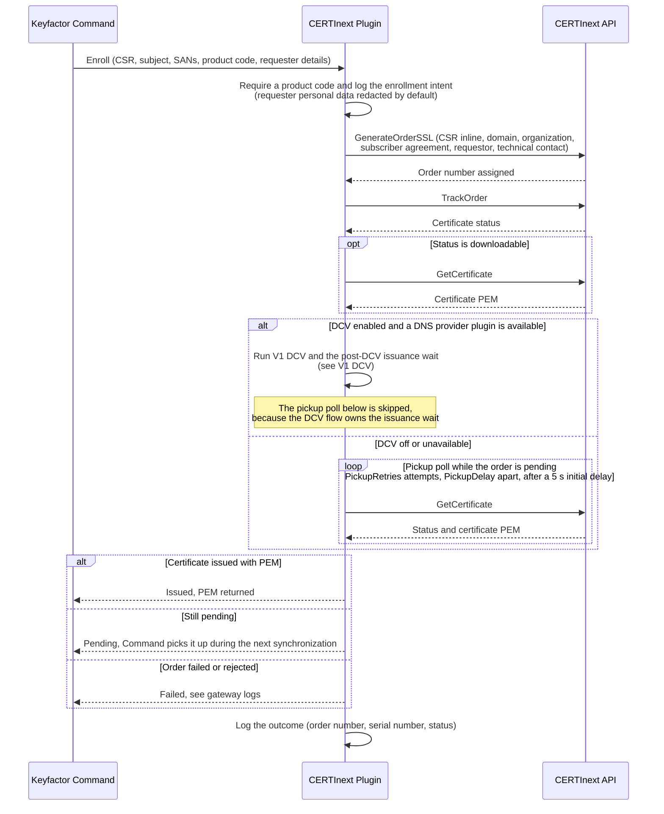
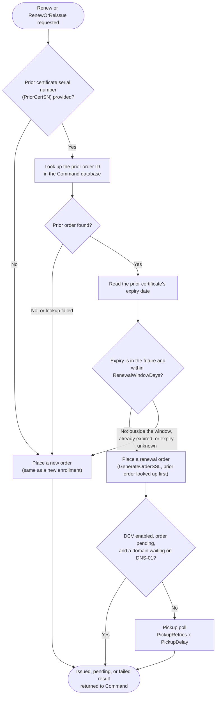
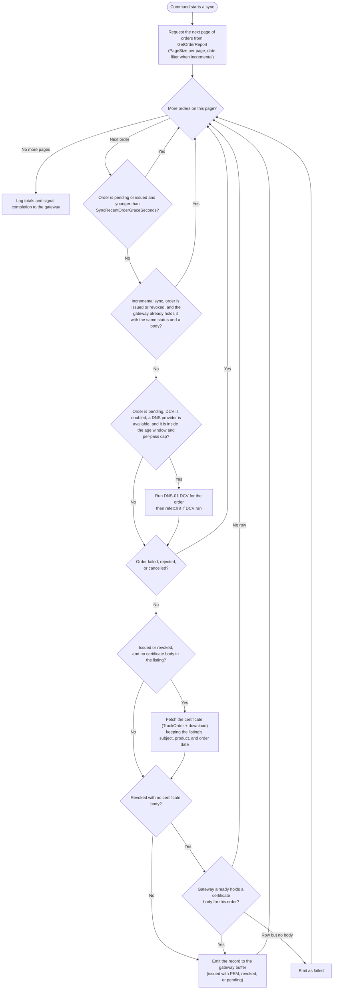
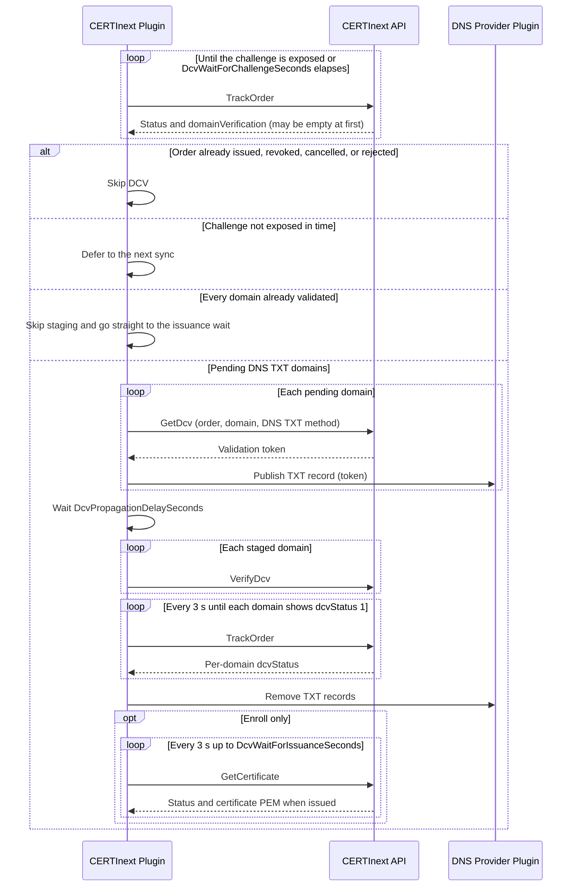

## Legacy V1 API (Deprecated)

> [!CAUTION]
> **The CERTInext V1 API is deprecated and no longer works.** CERTInext changed its API, and V1
> connectors can no longer be relied on to enroll, synchronize, or revoke. **Move every connector to
> the V2 API now** — see [Migrating from V1 to V2](#migrating-from-v1-to-v2).
>
> - Plugin 1.x supports only the V1 API, so it no longer works. Upgrade to 2.0.0 or later.
> - From 2.0.0, `UseV2Api` defaults to `true`. A connector is on V1 only if `UseV2Api` is explicitly
>   set to `false`.
> - This section is kept for reference while migrating. Don't create new V1 connectors.

### V1 and V2 Compared

| Aspect | V1 (`UseV2Api` = `false`, deprecated) | V2 (`UseV2Api` = `true`, default) |
|---|---|---|
| Authentication | Access key, sent as `meta.authKey` in every request body | OAuth2 `client_credentials` bearer token |
| `ApiUrl` | Host plus the `/emSignHub-API/` path | Bare host, no path |
| Credential fields | `AccountNumber`, `ApiKey` | `OAuthClientId`, `OAuthClientSecret` |
| Order ID (`CARequestID`) | Order number (a request number comes first) | Single `orderId`, stored unchanged |
| Products | SSL/TLS (DV, OV, EV) | SSL/TLS (DV, OV, EV) and Private PKI |
| Sync source | `GetOrderReport`, filtered by order date (`yyyy-MM-dd`), no lookback | `/reports/orders`, from `V2SyncLookbackHours` (default 72) before the last sync |
| `IgnoreExpired` | No effect | Applied |
| Renewal | Renewal window (`RenewalWindowDays`), otherwise a new order | SSL/TLS reissue endpoint outside the window, otherwise a new order |
| DCV waits | `DcvWaitForChallengeSeconds`, `DcvWaitForIssuanceSeconds` | None; polls until the order leaves `pending-dcv`, bounded by `DcvTimeoutMinutes` |
| Revoke reasons | Numeric `revokeReasonId`; unaccepted codes sent as key compromise | Kebab-case strings; rejected values retried once with a substitute |
| Product code | `ProductCode`, then `ProfileId`, then the built-in default for the selected product | None sent by default: CERTInext resolves the product. A template `ProductCode` is sent as the `X-Product-Code` override |

### V1 Connector Fields

These fields are read only when `UseV2Api` is `false`. V2 ignores them.

| Field | Required on V1 | Description |
|---|---|---|
| `ApiUrl` | Required | Host plus the `/emSignHub-API/` path. Sandbox: `https://sandbox-us-api.certinext.io/emSignHub-API/`. Production US: `https://us-api.certinext.io/emSignHub-API/`. Production India: `https://api.certinext.io/emSignHub-API/`. Must use `https`. |
| `AccountNumber` | Required | CERTInext account number (numeric string), sent in the `meta` block of every request. Found under your name or avatar → **Account Settings** or **My Profile**. Example: `1234567890`. |
| `ApiKey` | Required | Access Key from **Integrations → APIs**. Masked in the UI. |
| `AuthMode` | Optional | Legacy. Default: `AccessKey`. Leave as is; V1 does not honor OAuth. |
| `OAuthTokenUrl` | Optional | Legacy and unsupported: V1 does not honor OAuth tokens. |
| `AccountingModel` | Optional | Billing model: `2` = credit-based (most accounts), `1` = cash. Default: `2`. |
| `SignerIp` | Recommended | Public IP of the host accepting the subscriber agreement. Not checked at save; when blank, `127.0.0.1` is sent with a warning. Example: `203.0.113.10`. |
| `SubmitNonDnsSans` | Optional | `true` submits non-DNS SANs (IP, email, URI) to CERTInext, which cannot validate them, so the order will not issue until they are removed. `false` submits DNS names only. Default: `true`. |
| `DefaultProductCode` | Optional | Numeric product code used for renewals only, when the template supplies no `ProductCode`/`ProfileId`, because CERTInext's `TrackOrder` does not return the prior order's product code. No effect on new enrollments. If neither supplies a code, the renewal goes out with an empty product code. |
| `DcvWaitForChallengeSeconds` | Optional | How long `Enroll()` waits for CERTInext to expose the DCV challenge. `0` disables the wait. Default: `60`. Environment variable: `CERTINEXT_DCV_WAIT_FOR_CHALLENGE_SECONDS`. |
| `DcvWaitForIssuanceSeconds` | Optional | How long `Enroll()` waits for issuance after DCV verifies. `0` disables the wait. Default: `60`. Environment variable: `CERTINEXT_DCV_WAIT_FOR_ISSUANCE_SECONDS`. |

Save-time validation on V1 checks `ApiUrl` (present, `https` or loopback), `AccountNumber`, and `ApiKey`. Connectors saved with the legacy OAuth `AuthMode` are checked for the OAuth fields instead.

**Shared fields that behave differently on V1:**

- **`SignerName`, `SignerPlace`, `SignerIp`:** the agreement signer is the template parameters first, then the connector's `RequestorName`, `SignerPlace`, and `SignerIp`, then the placeholders `Keyfactor Gateway`, `Gateway`, and `127.0.0.1`. Each placeholder logs a warning. A blank `SignerIp` sends `127.0.0.1`, which misstates the audit record CERTInext keeps, so set it to the gateway host's outbound IP. A value that is not an IP address is sent unchanged, with a warning.
- **`TechnicalContact*`:** the name is sent as `pocFirstName` and `pocLastName`, split on the first whitespace (a single word goes in both). If no name or no email resolves, V1 omits the whole block and logs a warning, because CERTInext requires both inside it.
- **`RequestorDesignation`:** sent as `requestorInformation.requestorDesignation`.
- **`GroupNumber`:** sent in `productDetails.groupNumber` on `GetProductDetails` and in `orderDetails.groupNumber` on every SSL order (new and renewal).
- **`OrganizationNumber`:** when set, orders carry `organizationDetails.preVetting="1"` and this number, so CERTInext skips its manual vetting queue. Without it, orders can sit in `Pending System RA` for tens of hours.
- **`AutoSecureWww`:** sent as `orderDetails.autoSecureWWW` on every SSL order (new and renewal).
- **`EmailNotifications`:** `1` is sent as `1`; `0` and blank are sent as `0` (silent); any other value is sent unchanged, not validated.
- **`IgnoreExpired`:** no effect. The V1 order report never populates a certificate expiry date, so expired certificates are imported.
- **`PageSize`:** maximum `500`. A value below 1 is not corrected, so keep it at 1 or higher.
- **`DcvPropagationDelaySeconds`:** DCV driven during synchronization uses its own fixed 3-second delay instead; enrollment and `GetSingleRecord` use the configured delay.
- **`ValidityDays` (template):** requested validity in days. The order's term is the larger of `ValidityYears` and `ValidityDays` rounded up to whole years (365 days = 1 year). Each field counts only when it is set, and a field left at its default (1 year) never overrides the other, so a template saved with only `ValidityDays` keeps its term. Because the larger value wins, a stale larger `ValidityDays` cannot be shortened with `ValidityYears` alone; set `ValidityDays` back to `365`.
- **`DomainName` (template):** ignored. V1 always uses the CSR subject `CN`.
- **`OrgRepresentative*` (template):** ignored. Saving a V1 template that sets them logs a warning.

### V1 Authentication (AccessKey)

The V1 API signs every request. Each call includes a computed `authKey` field in the `meta` block of the request body (`ver`, `ts`, `txn`, `accountNumber`, `authKey`). There is no `Authorization` header. The access key itself is never transmitted — only the derived hash is sent.

```
authKey = SHA256(accessKey + ts + txn)
```

`ts` is the ISO 8601 timestamp of the request and `txn` is a random numeric transaction ID generated per request; both travel in the same `meta` block so CERTInext can recompute the digest. It is a plain SHA-256 digest (lowercase hex), not an HMAC. The plugin computes it automatically on every outbound call.

**V1 OAuth is not supported.** The live V1 API ignores a bearer token and answers HTTP 401 (`clientAccessKey is not active`) whether or not one is sent. The `AuthMode` and `OAuthTokenUrl` fields remain only so connectors saved with them keep loading. Leave `AuthMode` as `AccessKey`.

**Steps to generate an Access Key:**

1. Log in to the CERTInext portal for your environment (e.g. https://in.certinext.io).
2. Navigate to **Integrations → APIs**.
3. Click **+ Create API Credentials** at the top right of the page.
4. In the dialog, set **API Type** to `REST`, enter a **Description** such as `keyfactor-gateway`, select the **User**, and set **Auth Type** to `Access Key`.
5. Click **Generate**, and copy the displayed Access Key immediately. This is the only time the key is shown in plaintext.
6. Confirm that the new credential row appears in the APIs list with status **Active**.

Enter the copied value in the `ApiKey` field. An Access Key credential doesn't work against V2; V2 needs a new OAuth-mode credential (see [Step 1 of the migration guide](#step-1--create-a-v2-oauth2-credential)).

### V1 Certificate Identifiers

V1 assigns two different reference numbers to each order:

| Identifier | When it is assigned | What it is used for |
|---|---|---|
| **Request Number** | Immediately when an order is created | Tracking a draft order before it is formally submitted; attaching a CSR to a pending order |
| **Order Number** | After the order is formally submitted and accepted | All post-issuance operations: checking status, downloading the certificate, revoking — **this is the identifier stored in Keyfactor Command** |

V1 order numbers also resolve through V2 Track Order, so existing `CARequestID` values carry over when a connector moves to V2.

### V1 HTTP Retries

- **Order placement and CSR submission are never auto-retried** after a timeout or server error, because CERTInext may have already created the order. The next synchronization imports it.
- **Other V1 calls** (status checks, downloads, revoke, reports) are retried up to 3 attempts on a 5xx response or network failure. 4xx responses are not retried.
- **Rate limit:** when order placement returns CERTInext's rate-limit response (the generic `Inactive Account User.` error), the plugin retries it up to 5 attempts with exponential backoff and jitter. See [`"Inactive Account User."` from `GenerateOrderSSL`](#inactive-account-user-returned-from-generateorderssl-v1).

### V1 Product Codes

V1 selects every product by its numeric code, resolved in this order:

1. `ProductCode` template parameter (explicit override — use for sandbox or non-standard codes).
2. `ProfileId` template parameter (deprecated alias, accepted for backward compatibility).
3. Default production code looked up from the selected product name (e.g. **DV SSL** → `838`).

If none of these yield a code, enrollment fails with a validation error. Template validation requires the code to appear in the account's `GetProductDetails` list. If you have a `GroupNumber` configured, include it in the request `productDetails` block — some accounts require this to return a non-empty list (`make get-product-details-group`).

**Product codes are provisioned per account by eMudhra.** The table below holds **eMudhra's published reference values from the emSign era**. They haven't been verified against every environment, they may differ for accounts that issue through SSL.com, and your account's own product list is the only authority. "Invalid Product Code" (EMS-1162) means your account does not have that product provisioned.

| Product | Sandbox Code | Production Code | CERTInext-side requirements (beyond `domainName`, `csr`, `requestorInformation`, `subscriptionDetails`, `agreementDetails`) |
|---|---|---|---|
| DV (Domain Validated) | `842` | `838` | None. `domainName` is derived from the CSR CN if omitted on the template. |
| DV Wildcard | `843` | `839` | CSR CN must use wildcard format (e.g. `*.example.com`). `domainName` in the order must also use the wildcard format. |
| DV UCC (Multi-domain) | `844` | `840` | `certificateInformation.additionalDomains` — array of additional SAN values beyond the primary `domainName`. |
| DV Wildcard UCC (Multi-domain Wildcard) | `845` | `841` | Combines wildcard and multi-domain requirements. CSR CN and `domainName` must use wildcard format; `certificateInformation.additionalDomains` required. |
| OV (Organization Validated) | `846` | `842` | `organizationDetails.organizationNumber` (your CERTInext org ID); `certificateInformation.locality`, `postalCode`, and full organization address fields (`streetAddress`, `city`, `state`, `country`). |
| OV Wildcard | `847` | `843` | Same as OV. CSR CN and `domainName` must use wildcard format. |
| OV UCC (Multi-domain) | `848` | `844` | Same as OV plus `certificateInformation.additionalDomains`. |
| OV Wildcard UCC (Multi-domain Wildcard) | `849` | `845` | Combines OV, wildcard, and multi-domain requirements. Same as OV plus wildcard CN/domainName and `certificateInformation.additionalDomains`. |
| EV (Extended Validation) | `850` | `846` | All OV fields plus: `contractSignerInfo` object (`name`, `email`, `isdCode`, `mobileNumber`, `designation`, `employeeID`); `certificateApproverInfo` object (same fields); `certificateInformation.companyRegistrationNumber`; `streetAddress2` must be non-empty. |
| EV UCC (Multi-domain EV) | `851` | `847` | Same as EV plus `certificateInformation.additionalDomains`. |

- The plugin supplies `domainName` and `additionalDomains` (from the CSR and its SANs), but none of the organization, address, or EV fields in the table. For OV and EV it sends only `organizationDetails.preVetting` and `organizationNumber`, so these products need a pre-vetted organization: set `OrganizationNumber` on the connector.
- The codes are offset by 4 between the US sandbox and Production India — treat that as a coincidence, not a guarantee.
- Some accounts also have short-validity products (for example **SSL DV 1 month**, code `917` on the US sandbox) that don't always appear in the V1 `GetProductDetails` response.

### V1 Enrollment

When the gateway calls `Enroll`, the plugin selects a path from the enrollment type and the age of the prior certificate:

1. **New or Reissue** (`EnrollmentType.New` / `Reissue`) — a new `GenerateOrderSSL` request is submitted.
2. **Renew or RenewOrReissue** — Command supplies the prior certificate's serial number (`PriorCertSN`). The plugin resolves the prior order from the Command database, then:
    - no serial number, or no prior order found (including a failed lookup): a new order is submitted as for a new enrollment;
    - the prior certificate's expiry is in the future and within `RenewalWindowDays` (default 90 days): a renewal order is submitted — CERTInext has no dedicated renewal endpoint, so this is also a new `GenerateOrderSSL` order; the prior order is looked up first and its details fill in anything the request doesn't supply;
    - the prior certificate is outside the window, or already expired: a new order is submitted.

The prior order is never revoked automatically. Every V1 order carries `additionalInformation.remarks` (`"Issued via Keyfactor Command AnyCA REST Gateway."`), which `GenerateOrderSSL` requires; error `EMS-918: Additional Information cannot be empty` means it was not sent.



- **Issued but not yet downloadable.** An order CERTInext reports as issued before the certificate can be downloaded is returned as pending, not as an issued result with no certificate.
- **OV and EV.** These orders issue after organization verification (minutes to hours) and almost always exhaust the pickup window, so the next synchronization imports them.
- **Failures after the order is placed.** The order already exists at CERTInext, so a failed `TrackOrder` status check or a failed in-call DCV or issuance wait is logged as a warning and the enrollment returns pending with the order number. A later synchronization finishes the order.
- **DCV that skips a domain.** If DCV validates some domains but skips others (for example an IP or email SAN with no DNS provider), `Enroll` does not wait for issuance. It returns pending and the sync-driven DCV retry picks the order up.

#### V1 renewal and RenewOrReissue

Both paths submit a new `GenerateOrderSSL` order; the prior order is not revoked. The distinction determines how the request is built, not which endpoint is called. A renewal order does not run inline DCV; sync-driven DCV completes a pending DV renewal. With DCV enabled and a DNS provider available, a renewal that is still waiting on DNS-01 validation returns pending at once and skips the pickup poll. If the prior-order lookup itself throws (for example a transient database error), the plugin falls back to a new order rather than failing the enrollment.



### V1 Order Status Codes

| Keyfactor result | CERTInext `certificateStatusId` values | Behavior |
|---|---|---|
| Issued | `7`, `9`, `12`, `15`, `20`, `23` | Certificate returned immediately. Status `12` (expired) stays in inventory as issued rather than failing. |
| Pending | `1`, `2`, `4`, `6`, `16`, `17`, `24` | Enrollment returns pending. `Enroll()` first polls briefly (see `PickupRetries`/`PickupDelay`). |
| Revoked | `22` | Certificate marked revoked. |
| Failed | `3`, `5`, `8`, `13`, `14`, `18`, `19`, `21`, or any unrecognized ID | Enrollment returns a failed result. |

### V1 Synchronization

Synchronization uses `GetOrderReport` with paginated results (`PageSize`, default 100, max 500). A full sync reads every order in the account. An incremental sync requests only orders placed on or after the date of the previous sync. The filter is a date only (`yyyy-MM-dd`) on the order date, with no lookback, so an older order that is slow to issue is missed by incremental syncs; run a full sync to import it.



- **Cancelled and rejected orders** are skipped, except that an order the gateway still holds as pending is emitted once as failed (`FailedPropagated`).
- **Recent-order hold-back.** A pending or issued order created less than `SyncRecentOrderGraceSeconds` ago is not emitted; the next incremental pass imports it. To keep a held order created just before UTC midnight in that next listing, the incremental start date is moved back by the grace window, a 5-second margin, and 5 minutes of slack.
- **Unchanged orders.** The listing filter is a calendar day, so an incremental sync re-lists every order placed that day. An order listed as issued or revoked is skipped, with no `TrackOrder` or download, when the gateway already holds it with the same status and a stored certificate body (`UnchangedInGateway`).
- **Revoked orders without a certificate body.** The V1 client never downloads a revoked order's certificate, so a revoked order is emitted as revoked only if the gateway already holds the certificate body; otherwise it is emitted as failed (row without a body) or skipped (no row). `GetSingleRecord` applies the same guard but returns failed when there is no row.
- **Errors.** After at least 50 records, if more than 25 percent have errored, the sync aborts and is retried on the next cycle.
- **Single record.** `GetSingleRecord` uses `TrackOrder`, then `GetCertificate` when the order is downloadable; a pending order is run through DCV first and refetched.

### V1 DCV

The TXT record is published at `DcvTxtRecordTemplate` for each domain CERTInext lists as pending that is unassigned or assigned to the DNS TXT method.



If `GetDcv` returns `EMS-956` (CERTInext lists the challenge before it accepts calls for the order), the whole pass is deferred to the next sync. On the sync and single-record paths the plugin refetches the certificate after DCV instead of running the issuance wait. The sync path also uses a fixed 3-second propagation delay and a single-shot challenge check.

### V1 Revocation Reason Codes

V1 sends a numeric `revokeReasonId` and has no retry. CERTInext accepts key compromise (1), affiliation changed (3), superseded (4), cessation of operation (5), and privilege withdrawn (9); every other Command reason (unspecified, CA compromise, certificate hold, AA compromise, and any other code) is sent as key compromise (1).

### V1 API Endpoint Reference

| Operation | CERTInext API endpoint |
|---|---|
| Test connection / verify credentials | `POST ValidateCredentials` |
| Issue new certificate | `POST GenerateOrderSSL` (CSR inline), then `POST TrackOrder` and `POST GetCertificate` |
| Renew certificate | `POST TrackOrder` on the prior order, then `POST GenerateOrderSSL` as above |
| Check certificate status | `POST TrackOrder` + `POST GetCertificate` |
| Revoke certificate | `POST RevokeOrder` |
| Synchronize inventory | `POST GetOrderReport` (paginated) |
| Domain control validation | `POST GetDcv`, `POST VerifyDcv` |
| List available product codes | `POST GetProductDetails` |
| Attach CSR to a draft order | `POST SubmitCSR` (developer tooling only; the plugin sends the CSR inline with `GenerateOrderSSL`) |

### V1 Troubleshooting

#### `"Inactive Account User."` returned from `GenerateOrderSSL` (V1)

**Symptom.** V1 enrollments fail with `CERTInext order failed: Inactive Account User.. See gateway logs for details.`, while a `Ping` (`ValidateCredentials`) seconds earlier succeeds and the next enrollment after a brief pause also succeeds.

**Root cause.** The CERTInext sandbox applies a **burst rate limit** on order placement (roughly 16 or more enrollments within 10 seconds) and rejects it with `"Inactive Account User."`, the same string it uses for genuinely inactive accounts. The response has no `errorCode`, `Retry-After` header, or other field that tells the two apart.

**Confirm it.** Run a single `Ping`; if it succeeds, the account is active. The gateway warning log's API-failure line includes the full raw response body, so any distinguishing code CERTInext returns appears there.

**Mitigation.** The plugin retries this error with exponential backoff and jitter (up to 5 attempts) before surfacing it. It has no client-side throttle, so beyond that, throttle order placement to roughly one per 1–2 seconds, or split high-volume work into batches of about 10 orders separated by a short pause, or wait 30–60 seconds and retry.

#### `EMS-956 "Invalid Request for this API"` from `GetDcv` (V1)

CERTInext exposes the `domainVerification` slot in `TrackOrder` **before** the `GetDcv` endpoint accepts calls for that order. The plugin treats this as "DCV not ready yet", logs one line, and retries on a later sync; the wait can range from seconds to several hours. No action is needed.

### Rolling Back to V1

**Don't roll back:** the V1 API no longer works, so a rolled-back connector won't function. These steps matter only if CERTInext restores V1 for your account, and only if you kept the V1 values (copy the V1 `ApiUrl` before editing a connector, and don't overwrite `ApiKey` and `AccountNumber`).

1. Set `UseV2Api` to `false` on the connector.
2. Restore the V1-format `ApiUrl` (with the `/emSignHub-API/` path).
3. Confirm `ApiKey` and `AccountNumber` are intact.
4. Save the connector.

`Enroll`, `GetSingleRecord`, `Revoke`, and `Synchronize` choose V1 or V2 from the connector's current `UseV2Api` flag, not from the stored `CARequestID`. V1 Track Order and `GetOrderReport` may not see an order placed through V2, and rolling back a connector that has issued V2 certificates isn't validated. Certificates enrolled before the switch to V2 are V1 orders.
